# 🗺️ debim MEP Network & Branching Routing Roadmap
## "Topological Plumbing, Drainage, and Electrical Conduit Distribution Engine"
### สถาปัตยกรรมระบบท่อแตกกิ่งและรวมสายอัตโนมัติ (Tree Topology & Auto-Fittings Generation)

> **Module Target:** `debim-mep-routing` (Milestone v0.7.0 / Dedicated MEP Engine)  
> **Status:** `DRAFT / SPECIFIED`  
> **Standards:** OpenBIM IFC4 (`IfcPipeSegment`, `IfcPipeFitting`, `IfcJunctionBox`, `IfcDuctSegment`), TIS (มอก.), EIT (วสท.)  
> **Core Philosophy:** *High-Level Intent to Mathematical Graph: จากการคำนวณพิกัดทีละจุด สู่การเดินท่ออัจฉริยะแบบโครงข่ายต้นไม้ (Graph DAG) และคำนวณ Fitting อัตโนมัติ*

---

## 1. ปัญหาและแรงจูงใจ (Problem Statement & Motivation)

### ข้อจำกัดของโมเดลเดิม (Current Single-Path Limitation)
1. **ท่อทุกเส้นเป็นอิสระต่อกัน (Disjoint Polyline):** หากต้องการให้ท่อแตกกิ่ง (1-to-Many เช่น ท่อน้ำดี, ท่อร้อยสายไฟ) หรือท่อรวม (Many-to-1 เช่น ท่อน้ำทิ้งสุขภัณฑ์) ผู้ใช้/AI ต้องคำนวณพิกัด $(X, Y, Z)$ ของจุดตัดเองด้วยมือ
2. **ปัญหาท่อลอย/หลุดแนว (Disconnection Errors):** หาก AI คำนวณพิกัดผิดพลาดแม้แต่ 1 มม. โมเดล IFC จะถือว่าเป็นคนละชิ้น ไม่ต่อกันในเชิง Topological Connection
3. **ขาดระบบนับข้อต่อ (No Auto-Fittings):** การถอดแบบ BOQ ต้องพึ่งพาการนับด้วยมือ ขาดการสร้าง ข้อต่อสามทาง (Tee), ข้อต่อ Y (Sanitary Wye), ข้อลด (Reducer) และกล่องพักสาย (Junction Box) อัตโนมัติ
4. **ความลาดเอียงท่อน้ำทิ้ง (Gravity Drainage Slope):** ท่อน้ำทิ้งจากสุขภัณฑ์หลายตัวที่ไหลมารวมกัน ต้องคำนวณ Slope 1:100 ($1\%$) ลดหลั่นลงไปตามระยะทางจริง

---

## 2. รูปแบบตรรกะของระบบท่อ 3 รูปแบบหลัก (Core MEP Typologies)

```mermaid
flowchart TD
    subgraph Supply_1toN["1. ระบบจ่ายแบบแตกกิ่ง (Diverging: 1-to-N)"]
        M1["ท่อเมนน้ำดีหลัก (1 นิ้ว)"] --> T1["ข้อต่อสามทาง (Tee 1)"]
        T1 -->|ลดขนาด 1/2 นิ้ว| B1["ก๊อกอ่างล้างหน้า"]
        T1 --> T2["ข้อต่อสามทาง (Tee 2)"]
        T2 -->|ลดขนาด 1/2 นิ้ว| B2["โถสุขภัณฑ์ (WC)"]
        T2 -->|ลดขนาด 1/2 นิ้ว| B3["ฝักบัวอาบน้ำ"]
    end

    subgraph Drainage_Nto1["2. ระบบระบายน้ำแบบรวมสาย (Converging: N-to-1)"]
        D1["น้ำทิ้งอ่าง (Slope 1:100)"] --> W1["Sanitary Wye 45°"]
        D2["น้ำทิ้งพื้น Floor Drain"] --> W1
        W1 --> W2["Sanitary Wye 45°"]
        D3["น้ำเสียชักโครก (Slope 1:50)"] --> W2
        W2 --> MAIN_STACK["ท่อระบายน้ำหลักลงชั้นล่าง (Stack/Riser)"]
    end

    subgraph Electrical_Branching["3. ระบบท่อร้อยสายไฟ (Conduit & Junction Box)"]
        PANEL["ตู้ย่อย DB"] --> JB1["Junction Box 1"]
        JB1 --> LIGHT1["โคมไฟ 1"]
        JB1 --> JB2["Junction Box 2"]
        JB2 --> LIGHT2["โคมไฟ 2"]
        JB2 --> SW1["สวิตช์ไฟ"]
    end
```



---

## 3. โครงสร้างข้อมูลใหม่ (Declarative Manifest Specification)

อนุญาตให้ AI หรือผู้ใช้เขียนคำสั่งในระดับ **"เจตนาเชิงตรรกะ (High-Level Intent)"** โดยไม่ต้องใส่พิกัดทับซ้อน:

```yaml
mep_systems:
  # 1. ท่อน้ำดี (Cold Water Supply)
  - id: "SYS_CW_BATH_L2"
    system_type: "DOMESTIC_COLD_WATER"
    material: "PPR"
    main_pipe:
      tag: "PIPE_CW_MAIN"
      from: { grid: ["1", "B"], offset: [0.2, 0.0, 2.6] }
      to:   { grid: ["1", "D"], offset: [0.2, 0.0, 2.6] }
      diameter: 0.025 # 25mm (1")
    branches:
      - tag: "BRANCH_BASIN"
        branch_from: "PIPE_CW_MAIN"
        target_fixture: "SAN_BASIN_01"
        target_port: "CW_INLET"
        diameter: 0.015 # 15mm (1/2")
        auto_reducer: true
      - tag: "BRANCH_WC"
        branch_from: "PIPE_CW_MAIN"
        target_fixture: "SAN_WC_01"
        target_port: "CW_INLET"
        diameter: 0.015
        auto_reducer: true

  # 2. ท่อน้ำทิ้งและน้ำเสีย (Drainage & Soil)
  - id: "SYS_SOIL_WASTE_L2"
    system_type: "SANITARY_DRAINAGE"
    material: "PVC_CLASS_8.5"
    collector_pipe:
      tag: "PIPE_SOIL_MAIN"
      discharge_to: "RISER_STACK_01"
      slope: 0.01 # 1:100 (1%)
      diameter: 0.100 # 4"
    gather_fixtures:
      - fixture: "SAN_WC_01"
        branch_diameter: 0.100
        fitting_type: "SANITARY_WYE_45"
      - fixture: "SAN_BASIN_01"
        branch_diameter: 0.050
        slope: 0.01
        fitting_type: "SANITARY_TEE_REDUCER"

  # 3. ท่อร้อยสายไฟ (Electrical Conduit)
  - id: "SYS_CONDUIT_LIGHTING_L2"
    system_type: "ELECTRICAL_CONDUIT"
    material: "WHITE_UPVC"
    home_run:
      from_panel: "DB_L2"
      to_junction_box: "JB_ROOM_01"
      diameter: 0.020 # 20mm
    distribution:
      junction_box: "JB_ROOM_01"
      drops:
        - to_element: "SW_2GANG_01"
          diameter: 0.020
        - to_element: "LIGHT_DOWNLIGHT_01"
          diameter: 0.020
        - to_element: "LIGHT_DOWNLIGHT_02"
          diameter: 0.020
```

---

## 4. แผนการพัฒนา 5 ขั้นตอน (Implementation Roadmap Steps)

### Step 1: Schema & Data Model Expansion (`debim.schema.json` & `schema.py`)
- เพิ่มคลาส `MepNetworkSystem`, `PipeBranchDefinition`, `CollectorPipeDefinition`
- รองรับฟิลด์ `branch_from`, `target_fixture`, `target_port`, `auto_reducer`, `fitting_type`
- รองรับการเชื่อมต่อกับ fixture port definitions บน `IfcSanitaryTerminal`

### Step 2: Topological Graph Router & Coordinate Snapping (`resolver.py`)
- พัฒนา Topological Graph Resolver สำหรับคำนวณจุดตัด (Intersection Projection):
  $$\mathbf{P}_{\text{junction}} = \operatorname{proj}_{\mathbf{L}_{\text{main}}}(\mathbf{P}_{\text{fixture}})$$
- คำนวณเส้นทางท่อแขนงแบบฉาก (Orthogonal Routing) จากจุดตัดบนท่อหลักไปยัง Port ของสุขภัณฑ์หรืออุปกรณ์
- ทำ Coordinate Snapping ปลายท่อชนกันอย่างสมบูรณ์ 100%

### Step 3: Automated MEP Fittings Generator (`compiler.py`)
- ตรวจจับจุดร่วม (Junction Point Analyzer):
  - 2 ทิศทาง $\rightarrow$ **IfcPipeFitting (ELBOW 90° / 45°)**
  - 3 ทิศทาง $\rightarrow$ **IfcPipeFitting (TEE หรือ SANITARY WYE 45°)**
  - 4 ทิศทาง $\rightarrow$ **IfcPipeFitting (CROSS)**
  - ขนาดท่อเปลี่ยน $\rightarrow$ **IfcPipeFitting (CONCENTRIC REDUCER)**
  - ท่อสายไฟรวมตัว $\rightarrow$ **IfcJunctionBox (กล่องพักสาย 2x4 หรือ 4x4 นิ้ว)**
- ส่งออก IFC4 Native Entities ครบถ้วนตามมาตรฐาน buildingSMART

### Step 4: Gravity Drainage Solver & Slope Auto-Propagation (`solver.py`)
- คำนวณระดับความสูง ($Z$) ย้อนกลับจากท่อเมนระบายน้ำ:
  $$Z_{\text{branch\_start}} = Z_{\text{main\_junction}} + (\Delta d_{xy} \times \text{slope})$$
- รับรองว่าท่อระบายน้ำทุกแขนงมีความลาดเอียงถูกต้องตามมาตรฐาน วสท. ($\ge 1:100$) และระดับพื้นไม่ชนกับคานโครงสร้าง (Clash Detection กับ `IfcBeam`)

### Step 5: Advanced BOQ & Take-Off Integration (`qto.py` & `cost.py`)
- แยกรายการถอดแบบอัตโนมัติ:
  - ความยาวท่อแยกตามชนิดและขนาด (เมตร)
  - จำนวนข้อต่อและอุปกรณ์ Fitting ทุกชนิด (ตัว/ชิ้น) เช่น ข้องอ 90°, สามทาง, ข้อลด, วาย 45°, Junction Box
  - ค่าแรงติดตั้งระบบสุขาภิบาลและไฟฟ้าตามมาตรฐานกรมบัญชีกลาง ว480

---

## 5. ผลลัพธ์และเกณฑ์การตรวจรับ (Acceptance Criteria)
1. **AI Output Efficiency:** AI สามารถสั่งงานเดินท่อทั้งห้องน้ำได้ด้วย Manifest ไม่เกิน 25 บรรทัด
2. **Zero Floating Pipes:** ไม่พบท่อลอยหรือขาดการเชื่อมต่อใน IFC4 Validation
3. **Automated BOQ:** ตาราง BOQ มีรายการข้อต่อ (Fittings) ออกมาอัตโนมัติโดยที่ผู้ใช้ไม่ต้องเขียนรายการทีละตัว
4. **Full Test Suite Pass:** ชุดทดสอบ Unit & Integration Tests ครอบคลุมการแตกกิ่งและรวมสายผ่าน 100%
