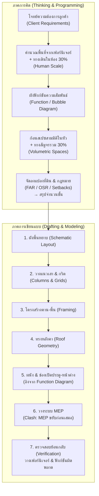

# 🏛️ คู่มือและลำดับขั้นกระบวนการคิดและเขียนแบบของสถาปนิก
## (Architectural Thinking Process & Drafting Workflow Specification)

> **เอกสารอ้างอิงหลักสำหรับ AI Agents (debim Engine):**  
> มนุษย์สถาปนิกไม่ได้เริ่มเขียนแบบจากเส้น 2D แต่เริ่มจาก **"กระบวนการคิดเชิงพื้นที่ (Spatial Thinking)"** ก่อนเข้าสู่ **"กระบวนการเขียนแบบ (Drafting Execution)"**  
> เอกสารฉบับนี้กำหนดวิธีคิด กฎทางคณิตศาสตร์สัดส่วนมนุษย์ (Human Scale + 30%) ลำดับชั้นความสำคัญ (Hierarchy) และขั้นตอนการสร้างโมเดล BIM ในระบบ `debim`

---

## สารบัญ (Table of Contents)
1. [แก่นความคิด: การแยกส่วนระหว่าง "การคิด" กับ "การเขียนแบบ"](#1-แก่นความคิด-การแยกส่วนระหว่าง-การคิด-กับ-การเขียนแบบ)
2. [ภาคที่ 1: ส่วนการคิดเชิงพื้นที่ (Architectural Spatial Programming)](#ภาคที่-1-ส่วนการคิดเชิงพื้นที่-architectural-spatial-programming)
   - 1.1 [การคำนวณขนาดห้องจาก Human Scale และกฎสัญจร 30%](#11-การคำนวณขนาดห้องจาก-human-scale-และกฎสัญจร-30)
   - 1.2 [ผังฟังก์ชันและการเชื่อมโยง (Function Diagram & Adjacency Matrix)](#12-ผังฟังก์ชันและการเชื่อมโยง-function-diagram--adjacency-matrix)
   - 1.3 [ก้อนสามมิติที่มองไม่เห็น (Invisible Volumetric Space — IfcSpace)](#13-ก้อนสามมิติที่มองไม่เห็น-invisible-volumetric-space--ifcspace)
   - 1.4 [การจัดวางบนที่ดินและกฎหมายอาคาร: ที่มาของจำนวนชั้น](#14-การจัดวางบนที่ดินและกฎหมายอาคาร-ที่มาของจำนวนชั้น)
   - 1.5 [ลำดับชั้นการประสานงานเมื่อเกิดการชน (Clash Hierarchy: MEP vs Structure)](#15-ลำดับชั้นการประสานงานเมื่อเกิดการชน-clash-hierarchy-mep-vs-structure)
3. [ภาคที่ 2: ส่วนการเขียนแบบและการสร้างโมเดล (Drafting & BIM Modeling Sequence)](#ภาคที่-2-ส่วนการเขียนแบบและการสร้างโมเดล-drafting--bim-modeling-sequence)
   - 2.1 [ลำดับขั้นตอนการขึ้นแบบ 6 สเต็ป](#21-ลำดับขั้นตอนการขึ้นแบบ-6-สเต็ป)
   - 2.2 [การกำหนดตำแหน่งช่องเปิด (ประตู-หน้าต่าง) จาก Function Diagram](#22-การกำหนดตำแหน่งช่องเปิด-ประตู-หน้าต่าง-จาก-function-diagram)
   - 2.3 [กลไกตรวจจับข้อผิดพลาด (Architectural Error Detection)](#23-กลไกตรวจจับข้อผิดพลาด-architectural-error-detection)
4. [ภาคที่ 3: การแปลงสู่โค้ด debim (debim Declarative Mapping)](#ภาคที่-3-การแปลงสู่โค้ด-debim-debim-declarative-mapping)

---

## 1. แก่นความคิด: การแยกส่วนระหว่าง "การคิด" กับ "การเขียนแบบ"

ในการทำงานของสถาปนิก มีการแบ่งแยกสมองและกระบวนการทำงานออกเป็น 2 ส่วนชัดเจน:



---

## ภาคที่ 1: ส่วนการคิดเชิงพื้นที่ (Architectural Spatial Programming)

### 1.1 การคำนวณขนาดห้องจาก Human Scale และกฎสัญจร 30%
เมื่อได้รับโจทย์จากลูกค้า สถาปนิกจะไม่เดาขนาดกว้างxยาวของห้องในทันที แต่จะคำนวณหา **"ขนาดพื้นที่สุทธิ (Net Area)"** โดยอิงจาก **ฐานข้อมูลสัดส่วนมนุษย์ (Human Scale)**:

$$\text{พื้นที่ห้องขั้นต่ำ (Room Net Area)} = \left(\sum \text{พื้นที่เฟอร์นิเจอร์และสุขภัณฑ์ใช้งาน}\right) \times 1.30$$

* **ฐานข้อมูล Human Scale (Furniture Footprint):**
  * **เตียงนอน:** King 6 ฟุต (1.80 × 2.00 ม. = 3.60 ตร.ม.), โต๊ะข้างเตียง (0.50 × 0.50 ม. × 2), ตู้เสื้อผ้า (ลึก 0.60 ม. × ยาว 2.00 ม. = 1.20 ตร.ม.), โต๊ะเครื่องแป้ง/ทำงาน (0.60 × 1.20 ม. = 0.72 ตร.ม.)
  * **ห้องน้ำ:** ส้วมชักโครกพร้อมระยะนั่ง (0.80 × 1.20 ม. = 0.96 ตร.ม.), อ่างล้างหน้าพร้อมระยะยืน (0.60 × 0.90 ม. = 0.54 ตร.ม.), พื้นที่ยืนอาบฝักบัว (0.90 × 0.90 ม. = 0.81 ตร.ม.)
* **กฎสัญจรในห้อง (Intra-room Circulation Factor +30%):**
  * การใช้งานจริงมนุษย์ต้องมีระยะเปิดบานตู้เสื้อผ้า, ระยะก้าวลงจากเตียง, ระยะยืนหน้าอ่างล้างหน้า จึงต้องคูณเพิ่ม **30%** เสมอ
* **ผลลัพธ์ที่ได้:** ตารางรายการพื้นที่ (Space Schedule) ในรูปผลรวมตารางเมตร ($m^2$)

---

### 1.2 ผังฟังก์ชันและการเชื่อมโยง (Function Diagram & Adjacency Matrix)
สถาปนิกนำรายการห้องมาจัดทำ **Bubble Diagram / Function Diagram** เพื่อกำหนดความสัมพันธ์เชิงพื้นที่:
* **ความสัมพันธ์แบบเชื่อมตรง (Direct Connection):** ห้องครัว $\leftrightarrow$ โถงรับประทานอาหาร $\leftrightarrow$ ห้องนั่งเล่น
* **ความสัมพันธ์แบบส่วนตัว (Private Zoning):** ห้องนอน $\leftrightarrow$ ห้องน้ำส่วนตัว (En-suite Bathroom)
* **พื้นที่ห้ามอยู่ติดกัน (Negative Adjacency / Separation):**
  * ห้องน้ำแขก **ห้าม** เปิดออกสู่ห้องรับประทานอาหารตรงๆ
  * ห้องนอนใหญ่ **ห้าม** ใช้ผนังร่วมกับห้องเครื่อง/ปั๊มน้ำ หรือห้องครัวที่มีเสียงและความร้อนรบกวน
  * ห้องพระ **ห้าม** อยู่ใต้แนวท่อส้วมห้องน้ำชั้นบน

---

### 1.3 ก้อนสามมิติที่มองไม่เห็น (Invisible Volumetric Space — `IfcSpace`)
เมื่อผังฟังก์ชัน 2D ลงตัว สถาปนิกจะแปลงฟังก์ชันให้กลายเป็น **"ก้อนปริมาตรสามมิติในหัว (Volumetric 3D Spaces)"**:
* **ทางสัญจรระหว่างห้อง (Inter-room Circulation / Hallways):** พื้นที่ทางเดินเชื่อม, บันได, โถงทางเดิน (Corridors) จะคิดเพิ่มอีก **+30%** จากผลรวมพื้นที่ห้องทั้งหมด
* **ทำไม debim ต้องมี `IfcSpace`:** 
  * สถาปนิกมองเห็น "ความว่าง (Space/Void)" เป็นพระเอก ส่วนผนังและเสาเป็นเพียงเปลือกที่กั้นความว่าง
  * ก้อน `IfcSpace` จะเก็บค่าฟังก์ชัน ปริมาตร ความสูงฝ้าเพดาน วัสดุผิวพื้น และความต้องการปรับอากาศ

---

### 1.4 การจัดวางบนที่ดินและกฎหมายอาคาร: ที่มาของจำนวนชั้น
สถาปนิกจะนำก้อนพื้นที่ทั้งหมดมาวางลงในโฉนดที่ดิน โดยถูกควบคุมด้วย **กฎหมายควบคุมอาคาร**:
1. **ระยะร่น (Building Setbacks):** เว้นขอบเขตที่ดิน 0.50 ม. (ผนังทึบ), 2.00 ม. (ช่องเปิดชั้น 1-2), 3.00 ม. (ชั้น 3 ขึ้นไป)
2. **พื้นที่ว่างไม่น้อยกว่า 30% (Open Space Ratio / OSR):** ตัวอาคารปกคลุมดินได้สูงสุด 70% ของเนื้อที่ดิน
3. **พื้นที่อาคารรวมต่อพื้นที่ดิน (Floor Area Ratio / FAR):** ควบคุมพื้นที่อาคารรวมทั้งหมด
4. **เกณฑ์การยกขึ้นชั้นต่อไป (Stacking Logic):**
   $$\text{หาก } \sum \text{พื้นที่ชั้นล่าง} > \text{พื้นที่ก่อสร้างที่ดินหลังหักระยะร่นและ OSR} \implies \textbf{ต้องยกฟังก์ชันขึ้นชั้น 2 และชั้นต่อไป}$$
   * **การแบ่งโซนแนวตั้ง (Vertical Zoning):**
     * **ชั้น 1 (Public & Semi-Private):** ที่จอดรถ, เฉลียง, รับแขก, ทานอาหาร, ครัว, ซักล้าง, ห้องน้ำแขก, ห้องนอนผู้สูงอายุ
     * **ชั้น 2 (Private):** ห้องนอนสมาชิก, ห้องน้ำส่วนตัว, โถงครอบครัว, ห้องพระ

---

### 1.5 ลำดับชั้นการประสานงานเมื่อเกิดการชน (Clash Hierarchy: MEP vs Structure)
ในการวางระบบอาคาร (MEP: Mechanical, Electrical, Plumbing, HVAC) สถาปนิกใช้กฎเหล็ก:

$$\Large \textbf{MEP Moves First} \longrightarrow \textbf{Structure Moves Second} \longrightarrow \textbf{Architectural Space is Preserved}$$

1. **อันดับ 1 (MEP ขยับก่อน):** ท่อประปา ท่อแอร์ รางสายไฟ เมื่อชนแนวคานหรือเสา ต้องหลบหรือเลี้ยวแนวเดินท่อก่อนเสมอ
2. **อันดับ 2 (โครงสร้างขยับรองลงมา):** หากงานระบบจำเป็นต้องข้ามแนวแรงโน้มถ่วง (เช่น ท่อส้วม 4 นิ้วลาดเอียง) ให้พิจารณาขยับแนวคาน หรือเจาะ Sleeve ท่อตามหลักวิศวกรรม
3. **เป้าหมายสูงสุด (รักษา Space):** ไม่ว่าจะเกิดการชนจุดใด **ห้ามลดระดับฝ้าเพดานหรือหดพื้นที่ห้อง** จนเสียระยะความสูงปลอดโปร่ง (Clear Height) ที่สถาปนิกกำหนดไว้

---

## ภาคที่ 2: ส่วนการเขียนแบบและการสร้างโมเดล (Drafting & BIM Modeling Sequence)

เมื่อผ่านกระบวนการคิด สถาปนิกจะเริ่มลงมือเขียนแบบ โดยมีลำดับ 6 ขั้นตอนที่เคร่งครัด:

```
[ขั้นตอนที่ 1] ร่างผังพื้นหยาบ จัดวางตำแหน่งห้อง (Schematic Space Layout)
      ↓
[ขั้นตอนที่ 2] กำหนดตำแหน่งเสา (Column Placement) ตามช่วงพาดมาตรฐาน 3.00 - 5.00 ม.
      ↓
[ขั้นตอนที่ 3] ตีเส้นกริต (Grid Lines) อิงตามศูนย์กลางเสาหลัก
      ↓
[ขั้นตอนที่ 4] ถักแนวโครงสร้าง คาน-พื้น-บันได ทำทีละชั้น (Structural Framing)
      ↓
[ขั้นตอนที่ 5] ครอบหลังคา (Roof Geometry: ทรงปั้นหยา, จั่ว, โมเดิร์น)
      ↓
[ขั้นตอนที่ 6] กลับมาวางผนังและเจาะช่องเปิดประตู-หน้าต่าง ตาม Function Diagram
      ↓
[ขั้นตอนที่ 7] วางระบบอาคาร MEP และตรวจสอบย้อนกลับ (Verification)
```

---

### 2.2 การกำหนดตำแหน่งช่องเปิด (ประตู-หน้าต่าง) จาก Function Diagram
สถาปนิก **ไม่เคยเดาตำแหน่งประตูหน้าต่าง**:
1. **ตำแหน่งประตู (`IfcDoor`):**
   * ตรวจดูจาก Function Diagram: ก้อน `Space A` ชนกับ `Space B` ที่ระนาบใด $\rightarrow$ วางประตูทะลุหากัน
   * หากก้อน Space สองก้อนไม่ติดกัน $\rightarrow$ วางประตูออกสู่ทางสัญจรส่วนกลาง (Corridor/Hallway)
   * กฎการติดตั้ง: วางห่างจากมุมเสาหรือขอบผนังอย่างน้อย **10 ซม. (0.10 ม.)** เสมอสำหรับวงกบและบานเปิด
2. **ตำแหน่งหน้าต่าง (`IfcWindow`):**
   * ตรวจดูตามกฎหมายการระบายอากาศและแสงธรรมชาติ: พื้นที่ช่องเปิดระบายอากาศต้องไม่น้อยกว่า **10%** ของพื้นที่ห้องนั้นๆ
   * วางในแนวผนังภายนอกที่รับลมประจำฤดู (ทิศใต้-ทิศตะวันตกเฉียงใต้) และหลบแดดบ่าย (ทิศตะวันตก)

---

### 2.3 กลไกตรวจจับข้อผิดพลาด (Architectural Error Detection)
สถาปนิกและ AI จะรู้ได้ทันทีว่า **"แบบเขียนผิด (Plan Fault)"** จาก 2 ตัวชี้วัดสำคัญ:
1. **ผิดจาก Function Diagram (Adjacency Violation):**
   * ห้องที่ต้องแยกกัน ดันมาใช้ผนังร่วมกัน (เช่น ห้องส้วมเปิดประตูโผล่ใส่โต๊ะกินข้าว)
   * ห้องนอนไม่มีหน้าต่างระบายอากาศออกสู่อากาศภายนอก (Landlocked Room)
2. **ผิดจากการวางเฟอร์นิเจอร์ (Furniture Fit Failure):**
   * เมื่อนำบล็อกเฟอร์นิเจอร์จริง (Human Scale) ลงไปวางในห้อง แล้ววางไม่ได้, วางไม่ครบตามฟังก์ชัน, หรือระยะทางเดินในห้องเหลือน้อยกว่า 60 ซม.
   * **แปลว่า:** ขนาดห้องที่เขียนไว้เล็กเกินไป ต้องขยายกริตหรือจัดผังใหม่ทันที!

---

## ภาคที่ 3: การแปลงสู่โค้ด debim (debim Declarative Mapping)

ในการนำกระบวนการนี้มาสร้างเป็นโปรเจกต์ `debim` ให้ปฏิบัติตามโครงสร้างโมดูลดังนี้:

### ลำดับการจัดไฟล์โมดูลใน `debim`:
```
modules/
├── 00_spaces.yaml        # ก้อนฟังก์ชันสามมิติ (Invisible Spaces & Room Program)
├── 01_grids.yaml         # แกนกริตอ้างอิงศูนย์กลางเสา (Grid Lines)
├── 02_columns.yaml       # เสาหลัก เสาสั้น เสาดั้ง (IfcColumn)
├── 03_beams.yaml         # คานคอดิน คานชั้น 2 อะเส (IfcBeam)
├── 04_slabs.yaml         # พื้นโครงสร้าง ค.ส.ล. ผืนใหญ่ (IfcSlab)
├── 05_roof.yaml          # หลังคาครอบอาคาร (IfcRoof)
├── 06_walls.yaml         # ผนังและช่องเปิดประตูหน้าต่าง (IfcWall, IfcDoor, IfcWindow)
└── 07_mep.yaml           # งานระบบท่อและสุขาภิบาล (IfcPipe, IfcDuct)
```

### ตัวอย่าง: การนิยาม `IfcSpace` เพื่อคิดพื้นที่ตามสถาปนิก
```yaml
# modules/00_spaces.yaml
# ก้อนสเปซสามมิติ: คิดขนาดจาก Human Scale เฟอร์นิเจอร์ + สัญจร 30%
- class: IfcSpace
  tag: SPACE-MASTER-BEDROOM
  name: "ห้องนอนใหญ่ (Master Bedroom)"
  storey: FL2
  boundary:
    - ["1", "A"]
    - ["3", "A"]
    - ["3", "B"]
    - ["1", "B"]
  net_area_target: 20.00          # ได้จากการคำนวณเตียง 6ฟุต + ตู้เสื้อผ้า + โต๊ะ + 30%
  finish:
    floor_material: WOOD_PARQUET
    floor_thickness: 0.02
    ceiling_height: 2.80

- class: IfcSpace
  tag: SPACE-ENSUITE-BATH
  name: "ห้องน้ำในห้องนอนใหญ่"
  storey: FL2
  boundary:
    - ["3", "A"]
    - ["4", "A"]
    - ["4", "B"]
    - ["3", "B"]
  finish:
    floor_material: CERAMIC_TILE_8X8
    drop_elevation: -0.10         # ลดระดับพื้นห้องน้ำ 10 ซม.
```

### 3.2 การสั่งงานและแก้ไขแบบผ่านระดับพื้นที่ (Semantic Space-Oriented Mutation)
> **ทำไมมนุษย์ไม่บอกเบอร์ผนังหรือพิกัดเสา?**  
> ในชีวิตจริง ถ้าโครงการมี 100 ห้อง หากสถาปนิกหรือลูกค้าสั่งว่า *"ห้องนั่งเล่น ฝั่งที่ติดสวน ขอเปลี่ยนผนังก่ออิฐเป็นกระจกล้วน"*  
> หากโปรแกรม BIM บังคับให้มนุษย์ต้องไปหาว่าผนังนั้นชื่อ `W_042` กริต `B2 ถึง B4` จะเกิด **Cognitive Overload** มหาศาลและผิดพลาดง่ายมาก

**หลักการทำงานของ debim Compiler ในการแก้ไขแบบเชิงความหมาย (Semantic Cascading):**
1. **Addressing by Space & Orientation:** ระบุเป้าหมายด้วย `Space Name` + `Boundary Orientation / Target Adjacency` เช่น:
   ```yaml
   # คำสั่งระดับสถาปนิก (Architect Intent)
   mutate:
     target_space: "LivingRoom"
     boundary: "SOUTH" # หรือ "FACING: Garden"
     set:
       wall_type: "GLASS_CURTAIN_WALL"
       opening: "SLIDING_DOOR_FULL_HEIGHT"
   ```
2. **Automated Boundary Resolution:**
   - คอมไพเลอร์ debim จะคำนวณหาเส้นรอบรูป (Polygon Edge) ของห้องนั้นทางทิศใต้
   - เช็คว่าเส้นนั้นเป็น **ผนังภายนอก (Exterior Boundary)** หรือ **ผนังร่วมกับห้องอื่น (Interior Partition)**
   - สั่งปรับประเภทผนังและเจาะช่องเปิดให้ตรงตามขนาดของขอบห้องนั้นอัตโนมัติ
   - คำนวณ BOQ กระจก, อลูมิเนียม, และลดปริมาณอิฐฉาบปูนออกทันที
3. **Guardrails & Warnings:** หากคำสั่งขัดแย้งกับหลักสถาปัตยกรรม (เช่น สั่งเปลี่ยนผนังห้องน้ำที่ติดกับห้องนอนเป็นกระจกใสล้วน หรือสั่งทุบผนังที่มีเสาโครงสร้างรับน้ำหนักหลังคาพาดอยู่) เอนจินจะแจ้งเตือนความปลอดภัยทันที

---

> **คำสั่งสอน AI Agent:** เมื่อผู้ใช้สั่งให้ "ออกแบบบ้าน" หรือ "ขึ้นแบบอาคาร" หรือ "สั่งแก้แบบ":
> 1. ให้ AI คิดและสื่อสารในระดับ **"Space & Functional Requirements"** เป็นหลัก สถาปนิกจะคุยด้วยชื่อห้อง ทิศ และสเกตช์หยาบๆ
> 2. อย่าบังคับให้ผู้ใช้ต้องระบุพิกัด X, Y หรือ ID ชิ้นงานระดับไมโคร (เช่น W12, C4)
> 3. นำคำสั่งระดับ Space นั้นมาแปลง (Compile/Derive) เป็นองค์ประกอบทางสถาปัตยกรรมและโครงสร้างตามลำดับในเอกสารฉบับนี้โดยอัตโนมัติ!
