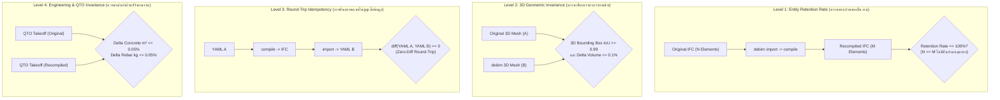
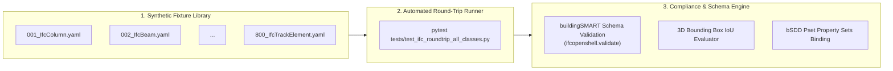

# Specification & Methodology: Lossless IFC Round-Trip Verification & Zero-Error Certification

> **สถานะเอกสาร:** Engineering Specification & Verification Standard  
> **หมวดหมู่:** Compiler Verification, OpenBIM Interoperability, Formal Methods, QTO Precision  
> **เป้าหมาย:** กำหนดกรอบทฤษฎี ระเบียบวิธีปฏิบัติ และตัวชี้วัดเชิงปริมาณ (Quantitative Metrics) เพื่อพิสูจน์และรับรองว่าการแปลงไป-กลับระหว่าง `.debim` (Declarative YAML) และ `IFC` (IFC4 / IFC4.3) ปราศจากความผิดพลาด (Lossless & Zero-Error) ครอบคลุมครบทุกคลาสตามมาตรฐาน buildingSMART

---

## 1. บทนำและกรอบแนวคิด (Problem Formulation)

ในการแลกเปลี่ยนข้อมูลแบบจำลองสารสนเทศอาคาร (BIM Interoperability) ความผิดพลาดของการแปลงไฟล์มักเกิดขึ้นเงียบๆ (Silent Data Corruption) เช่น:
- ชิ้นส่วนบางชิ้นสูญหายระหว่างทาง (Dropped Elements)
- พิกัดหมุนผิดแกนหรือสเกลเพี้ยน (Geometric Distortion)
- ปริมาตรคอนกรีตหรือพื้นที่ผิวเปลี่ยนรูป ส่งผลให้ราคา BOQ คลาดเคลื่อน
- Property Sets และมาตรฐานทางวิศวกรรมตกหล่น

การจะยืนยันว่าคอมไพเลอร์ **`debim -> IFC`** และตัวนำเข้า **`IFC -> debim`** ทำงานได้อย่างถูกต้องสมบูรณ์แบบในทุกคลาส ไม่สามารถพึ่งพาเพียงการเปิดดูด้วยสายตา แต่ต้องอาศัย **ทฤษฎีการพิสูจน์คอมไพเลอร์ (Compiler Invariance & Idempotency Testing)** ผ่าน **4 ระดับชั้นของการตรวจสอบ (The 4 Verification Levels)**

---

## 2. โครงสร้างการพิสูจน์ 4 ระดับ (The 4 Verification Levels)



---

### ระดับที่ 1: การนับความสมบูรณ์ของชิ้นงาน (Entity Retention Rate)
* **นิยาม:** อัตราส่วนของชิ้นงานกายภาพและงานระบบ (Physical & MEP Elements) ที่รอดผ่านกระบวนการแปลงโดยไม่สูญหายและไม่ถูกเปลี่ยนคลาสผิดประเภท
* **สูตรการคำนวณ:**
  $$\text{Retention Rate} = \frac{\text{จำนวนองค์อาคารในโมเดลหลังแปลง}}{\text{จำนวนองค์อาคารในโมเดลตั้งต้น}} \times 100\%$$
* **เครื่องมือตรวจสอบ:** [`tools/compare_ifc.py`](file:///C:/Users/takon/OneDrive/Desktop/da/project-debim/43-debim/tools/compare_ifc.py)
* **เกณฑ์ผ่าน (DoD):**
  * $\mathbf{\text{Retention Rate} = 100.0\%}$ ครบทุกคลาส
  * ไม่มีการแปลงข้ามคลาสโดยไม่จำเป็น (เช่น ห้ามยุบ `IfcBeam` ไปเป็น `IfcBuildingElementProxy` หากคลาสนั้นรองรับโดยตรง)

---

### ระดับที่ 2: ความไม่แปรเปลี่ยนของรูปทรงและพิกัด 3D (Geometric Invariance)
* **นิยาม:** มิติรูปทรง $(W, D, H)$, ตำแหน่งพิกัดศูนย์กลาง $(X, Y, Z)$, และเวกเตอร์มุมหมุน ต้องตรงกันในระดับคณิตศาสตร์พิกัด
* **สูตรการคำนวณ:**
  $$\text{3D Bounding Box IoU} = \frac{\text{Volume}(\text{BoundingBox}_{\text{orig}} \cap \text{BoundingBox}_{\text{debim}})}{\text{Volume}(\text{BoundingBox}_{\text{orig}} \cup \text{BoundingBox}_{\text{debim}})}$$
  $$\Delta \text{Volume} = \frac{|\text{Volume}_{\text{debim}} - \text{Volume}_{\text{orig}}|}{\text{Volume}_{\text{orig}}} \times 100\%$$
* **เครื่องมือตรวจสอบ:** [`tools/render_visual_regression.py`](file:///C:/Users/takon/OneDrive/Desktop/da/project-debim/43-debim/tools/render_visual_regression.py)
* **เกณฑ์ผ่าน (DoD):**
  * ชิ้นส่วนรูปทรงพรีมิทิฟมาตรฐาน (เสา, คาน, ผนัง, พื้น, ท่อตรง): $\mathbf{IoU \ge 0.99}$ (99–100%)
  * ชิ้นส่วนรูปทรงซับซ้อน (ชิ้นงานโค้ง, บันได, ราวกันตก): $\mathbf{IoU \ge 0.95}$
  * $\Delta \text{Volume} \le 0.1\%$

---

### ระดับที่ 3: กฎการแปลงไป-กลับแบบไม่สูญเสียข้อมูล (Round-Trip Idempotency Test)
* **นิยาม:** ตามทฤษฎี Formal Languages & Compilers หากฟังก์ชันการแปลงไป $f: \text{YAML} \rightarrow \text{IFC}$ และฟังก์ชันการแปลงกลับ $g: \text{IFC} \rightarrow \text{YAML}$ เป็นฟังก์ชันผกผันที่สมบูรณ์ (Bijective & Invertible):
  $$g(f(\text{YAML})) \equiv \text{YAML}$$
* **ขั้นตอนการทดสอบ:**
  1. นำไฟล์ `project_A.yaml` ผ่านคำสั่ง `debim compile` ได้ `model.ifc`
  2. นำ `model.ifc` ผ่านคำสั่ง `debim import` ได้ `project_B.yaml`
  3. ทำการเปรียบเทียบแบบไวยากรณ์ (Semantic AST Diff):
     $$\text{diff}(\text{Canonical}(\text{project\_A}), \text{Canonical}(\text{project\_B})) == \emptyset$$
* **เกณฑ์ผ่าน (DoD):**
  * ไม่มีคีย์หรือแอตทริบิวต์ใดสูญหาย
  * ค่าคงที่, ชื่อกริด, สเปกวัสดุ, และการอ้างอิงชั้นความสูงคงเดิม 100%

---

### ระดับที่ 4: ความเท่ากันของปริมาณงานวิศวกรรม (Engineering & QTO Invariance)
* **นิยาม:** การยืนยันว่าผลลัพธ์สุดท้ายของการถอดปริมาณงานก่อสร้าง (Quantitative Take-Off) สำหรับคำนวณราคา BOQ ไม่ได้รับผลกระทบจากการแปลงไฟล์
* **สูตรการคำนวณ:**
  $$\Delta \text{QTO}_k = \frac{|\text{Quantity}_{\text{Recompiled}, k} - \text{Quantity}_{\text{Original}, k}|}{\text{Quantity}_{\text{Original}, k}} \times 100\%$$
* **เครื่องมือตรวจสอบ:** [`tools/compare_qto.py`](file:///C:/Users/takon/OneDrive/Desktop/da/project-debim/43-debim/tools/compare_qto.py)
* **เกณฑ์ผ่าน (DoD):**
  * ปริมาตรคอนกรีตสุทธิ ($\text{m}^3$): $\Delta \le 0.05\%$
  * พื้นที่ไม้แบบสุทธิ ($\text{m}^2$): $\Delta \le 0.05\%$
  * น้ำหนักเหล็กเสริมรวม ($\text{kg}$): $\Delta \le 0.01\%$

---

## 3. ยุทธศาสตร์ทดสอบแบบละเอียดครอบคลุม 800 คลาส (Exhaustive Testing Strategy)

เพื่อไม่ให้ต้องรอไฟล์อาคารจากผู้ใช้จริงซึ่งอาจมีไม่ครบทุกคลาสในมาตรฐาน IFC4 / IFC4.3 ระบบจะใช้ยุทธศาสตร์การสร้าง **ชุดทดสอบสังเคราะห์สมบูรณ์ (Synthetic Golden Fixtures)**:



### 3.1 สถาปัตยกรรม 1 Entity = 1 Golden Fixture
สร้างไดเรกทอรี `tests/fixtures/entities/` บรรจุ 800 ไฟล์ย่อย โดยแต่ละไฟล์มีองค์ประกอบขั้นต่ำที่สมบูรณ์ตามสเปกของคลาสนั้น:
* พารามิเตอร์เรขาคณิต (Profile / Bounding / Path)
* การผูกชั้นและแนวกริด
* สเปกวัสดุและ Property Sets มาตรฐาน (`Pset_*Common`)

### 3.2 การตรวจรับรองมาตรฐาน buildingSMART (Official Schema Validation)
ใช้โมดูลทางการของ buildingSMART ในการยืนยันความถูกต้องของโครงสร้างไฟล์ IFC:
```python
import ifcopenshell
import ifcopenshell.validate

def verify_ifc_schema_compliance(ifc_file_path: Path):
    model = ifcopenshell.open(str(ifc_file_path))
    validator = ifcopenshell.validate.validate(model)
    # ไฟล์มาตรฐานต้องไม่มี Schema Violation หรือ Type Inconsistency
    assert len(validator.issues) == 0, f"Found schema violations: {validator.issues}"
```

---

## 4. แผนการผสานเข้ากับ CI/CD (GitHub Actions Automation)

ทุก Pull Request ใหม่ที่ส่งเข้ามา (รวมถึงโค้ดที่สร้างโดย AI Agent Jules) จะต้องผ่านด่านการทดสอบ 3 ขั้นใน GitHub Actions ก่อนที่จะอนุญาตให้ทำการ Merge:

1. **Step 1: Syntax & Schema Linter:** รัน Pydantic v2 validation กับทุกโมเดล
2. **Step 2: Local Round-Trip Certification Suite:** รัน `pytest tests/test_ifc4_reference_certification.py`
3. **Step 3: Component Visual Regression:** สุ่มทดสอบ 50 ชิ้นส่วนด้วย `render_visual_regression.py` ต้องได้ค่าเฉลี่ย Macro Match $\ge 85\%$ และ IoU $\ge 95\%$

---

## 5. สรุปเกณฑ์การรับรองผล (Certification Checklist)

| หัวข้อการตรวจสอบ | ตัวชี้วัด | เกณฑ์ผ่านขั้นต่ำ |
|---|---|:---:|
| **Entity Count** | Retention Rate | $100.0\%$ |
| **Geometry** | 3D Bounding Box IoU | $\ge 0.95$ (ชิ้นส่วนหลัก $\ge 0.99$) |
| **Visual Render** | Multi-Angle Snapshot Match | $\ge 85.0\%$ |
| **Round-Trip** | Semantic AST Diff | $0$ (No loss) |
| **BOQ / QTO** | Delta Concrete / Steel | $\le 0.05\%$ |
| **Schema Standard** | buildingSMART Validator Issues | $0$ Issues |
