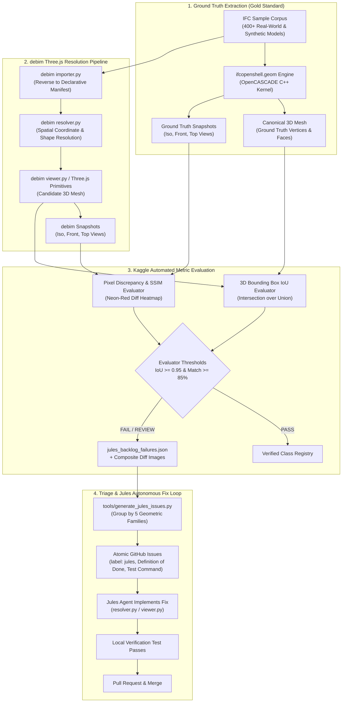
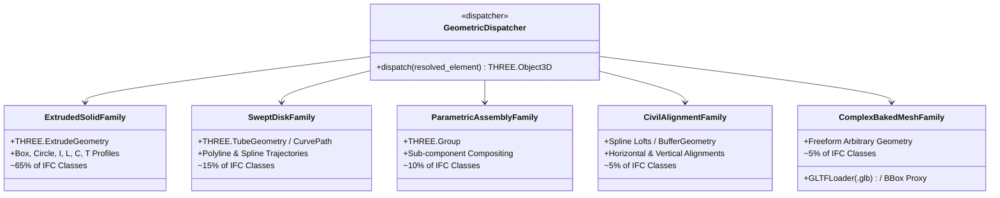
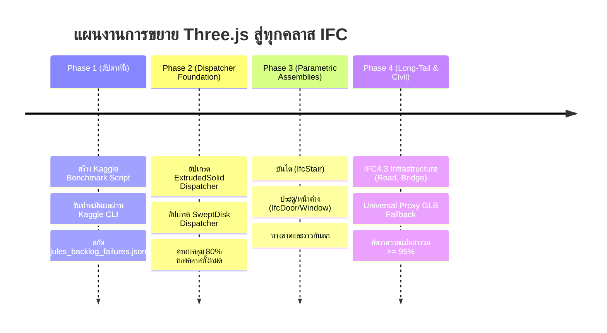

# Architectural Blueprint: Full IFC 3D/2D Visual Regression & Jules Agent Dispatch Pipeline

> **เอกสาร:** Technical Design & Execution Roadmap  
> **หมวดหมู่:** 3D Graphics, WebGL/Three.js, OpenBIM Interoperability, Visual Regression, AI Agent Automation (Jules)  
> **เป้าหมาย:** ออกแบบสถาปัตยกรรมและกระบวนการทดสอบอัตโนมัติ (Automated Visual Regression Benchmark) บน Kaggle เพื่อเปรียบเทียบการแสดงผล 3D (Three.js) และ 2D ของ debim กับโมเดลมาตรฐาน IFC ทุกคลาส (~800 Entities) และแปลงผลการทดสอบที่ตกเกณฑ์ให้เป็นชุดงานย่อย (Atomic Issues) ที่ส่งมอบให้ AI Coding Agent (**Jules**) จัดการแก้ไขได้อย่างแม่นยำ 100%

---

## 1. บทนำและปัญหาหลัก (The Core Dilemma)

### 1.1 ความท้าทายของการแสดงผล IFC ทุกคลาสบนเว็บ
มาตรฐาน buildingSMART IFC4 / IFC4.3 ประกอบด้วยเอนทิตีมากกว่า 800 ชนิด การพัฒนาตัวแสดงผลบน Three.js ใน `debim` ให้รองรับครบทุกคลาส พร้อมแสดงผล 2D Drawing และสเปกวัสดุตามสารบัญ เป็นงานที่มีขอบเขตกว้างใหญ่มาก:
- หากเขียนโปรแกรมรองรับทีละคลาสแบบไม่มีระบบ จะใช้เวลามหาศาลและเกิดความซ้ำซ้อน
- การทดสอบด้วยสายตามนุษย์ (Manual Visual Inspection) ทั้ง 800 คลาสทำได้ยากและไม่สามารถทำซ้ำได้ (Non-reproducible)

### 1.2 ข้อจำกัดของ AI Coding Agent (Jules) ในงาน 3D
เมื่อมอบหมายงานพัฒนาการแสดงผล 3D ให้ AI Agent เช่น Jules ปัญหาใหญ่ที่สุดคือ:
- **AI ไม่มีสายตามองจอ (Lack of Visual Perception):** AI ไม่สามารถประเมินได้ด้วยตนเองว่าโมเดล 3D ที่เรนเดอร์ออกมานั้น "หน้าตาถูกต้องหรือไม่"
- **ภาพหลอนความสำเร็จ (Hallucination of Success):** บ่อยครั้งที่ AI เขียนโค้ดรันผ่าน ไม่ขึ้น Error แต่ชิ้นงานใน Three.js กลับแบนราบ, พิกัดกลับทิศ, หรือขนาดหดเหลือศูนย์
- **ทางออก:** ต้องเปลี่ยน "ความรู้สึกทางสายตา" ให้กลายเป็น **"ตัวเลขคณิตศาสตร์ที่วัดผลได้แบบ Deterministic (Quantitative Metrics)"**

### 1.3 ทำไมต้องปฏิเสธ `ifcJSON` และเลือกใช้ `ifcopenshell.geom` เป็น Ground Truth?
มีความพยายามในวงการที่จะใช้ `ifcJSON` ในการเรนเดอร์บนเว็บ แต่สำหรับระบบการทดสอบ Benchmark แบบ Ground Truth:
1. **`ifcJSON` ไม่มี Geometric Kernel ในตัว:** `ifcJSON` เป็นเพียง Schema ข้อความ JSON การจะนำมาขึ้นภาพ 3D ต้องเขียนตัวแปลง CSG/SweptSolid บนเบราว์เซอร์ ซึ่งตัวแปลงนั้นเองมีบั๊กและไม่รองรับครบทุกคลาส ทำให้ไม่สามารถเป็นไม้บรรทัดวัดความถูกต้องได้
2. **`ifcopenshell.geom` (OpenCASCADE) คือ Gold Standard:** โปรเจกต์ `debim` มีเครื่องมือ `tools/render_visual_regression.py` ที่ใช้ OpenCASCADE ซึ่งเป็น C++ B-Rep/CSG geometry kernel มาตรฐานโลก สามารถแปลงไฟล์ IFC ตัวอย่างทุกคลาสออกมาเป็น 3D Mesh (Vertices/Faces) ที่ถูกต้อง 100% ทางคณิตศาสตร์

---

## 2. สถาปัตยกรรมระบบรวม (End-to-End Pipeline)



---

## 3. ยุทธศาสตร์ 5 ตระกูลรูปทรงเรขาคณิต (The 5 Geometric Families)

แม้มาตรฐาน IFC จะมีมากกว่า 800 Entities แต่ในมุมมองของ Three.js และ 3D Graphics การแสดงผลไม่ได้ต้องการ 800 อัลกอริทึมที่แตกต่างกัน หากแต่ยุบรวมลงเหลือ **5 Geometric Dispatchers** หลัก:



### รายละเอียดแต่ละตระกูล:
1. **Extruded Solid Family (~65% ของคลาสทั้งหมด):**
   - **คลาสที่เกี่ยวข้อง:** `IfcColumn`, `IfcBeam`, `IfcWall`, `IfcSlab`, `IfcFooting`, `IfcMember`, `IfcPlate`, `IfcPipeSegment`, `IfcDuctSegment` ฯลฯ
   - **Three.js Strategy:** ใช้ `THREE.BoxGeometry` และ `THREE.ExtrudeGeometry` ร่วมกับ `THREE.Shape` ที่รองรับ Standard Profiles (Box, Circle, I, H, L, C, T, Hollow/Tube)
   - **อิมแพกต์:** เมื่อ Dispatcher นี้สมบูรณ์ จะครอบคลุมคลาสใน IFC ไปแล้วกว่า 500 คลาสในคราวเดียว
2. **Swept Disk & Curve Trajectory Family (~15%):**
   - **คลาสที่เกี่ยวข้อง:** `IfcRailing`, `IfcFlowSegment` (ท่อเลี้ยว), สายไฟเคเบิล (`IfcCableSegment`), ท่อร้อยสายไฟ (`IfcConduitSegment`)
   - **Three.js Strategy:** ใช้ `THREE.TubeGeometry` หรือ `THREE.CurvePath` โดยสร้าง Extrusion ตามแนวเส้นแกน 3D
3. **Parametric Assembly Family (~10%):**
   - **คลาสที่เกี่ยวข้อง:** `IfcStair`, `IfcStairFlight`, `IfcDoor`, `IfcWindow`, `IfcRamp`
   - **Three.js Strategy:** ใช้ `THREE.Group` รวม Primitives ย่อย เช่น บันไดสร้างลูกตั้ง (Riser) + ลูกนอน (Tread), ประตูสร้างวงกบ (Frame) + บานเปิด (Panel)
4. **Civil Alignment & Terrain Family (~5% - มาตรฐาน IFC4.3):**
   - **คลาสที่เกี่ยวข้อง:** `IfcRoad`, `IfcBridge`, `IfcRailway`, `IfcEarthworksCut`, `IfcEarthworksFill`
   - **Three.js Strategy:** Cross-section lofting ตามแนว Alignment Spline
5. **Complex / Freeform Mesh Family (~5%):**
   - **คลาสที่เกี่ยวข้อง:** `IfcSanitaryTerminal` (โถสุขภัณฑ์), `IfcFurniture`, เครื่องสูบน้ำ, โคมไฟระย้า
   - **Three.js Strategy:** Dual Representation โหลดไฟล์ `.glb` ที่ Bake ล่วงหน้าด้วย `trimesh` หรือแสดง Oriented Bounding Box พร้อมป้ายชื่อ

---

## 4. เกณฑ์การวัดผลเชิงปริมาณสำหรับ AI Agent (Quantitative DoD)

เพื่อให้ AI Coding Agent (Jules) ทราบอย่างชัดเจนว่างานเสร็จสมบูรณ์หรือยัง ระบบจะใช้การประเมิน 4 มิติที่ไม่มีความกำกวม:

| มิติการตรวจสอบ | ตัวชี้วัดเชิงปริมาณ (Metric) | เกณฑ์ผ่าน (Pass Threshold) | เครื่องมือตรวจสอบ |
|---|---|:---:|---|
| **1. 3D Bounding Box Accuracy** | Intersection over Union (IoU) | $\ge \mathbf{0.95}$ (95%) | `render_visual_regression.py` |
| **2. Multi-Angle Visual Fidelity** | Mean Pixel Discrepancy (Iso, Top, Front) | $\ge \mathbf{85.0\%}$ Match | Matplotlib offscreen diff |
| **3. 2D Cut-Plane Projection** | Cut-polygon & Centerline match | Topology Valid | `debim.draw.projection` |
| **4. Schema & Properties Integrity** | Pydantic Schema Validation & bSDD bindings | $100\%$ Valid | `pytest tests/` |

---

## 5. การทำงานบน Kaggle Cloud Execution

### 5.1 จุดเด่นของการใช้ Kaggle
1. **ฟรีทรัพยากรประมวลผลสูง:** ซีพียู 4 คอร์ แรม 30 GB พร้อมอินเทอร์เน็ตความเร็วสูง
2. **คลัง Dataset ขนาดใหญ่:** เชื่อมต่อกับ IFC Benchmark Datasets (เช่น `claytonmiller/example-ifc-file`, `pridatakon/debim-5000-ifc-benchmark`)
3. **Headless Offscreen Rendering:** รัน `matplotlib`, `trimesh`, และ `ifcopenshell.geom` บนสภาพแวดล้อมเสมือนได้อย่างราบรื่น

### 5.2 Artifacts ที่ส่งออกจาก Kaggle
เมื่อรัน Kernel เสร็จสิ้น Kaggle จะส่งออกผลลัพธ์:
1. `jules_backlog_failures.json`: รายการคลาสทั้งหมดที่ไม่ผ่านเกณฑ์ พร้อมสถิติและพาธภาพ Diff
2. `class_accuracy_breakdown.csv`: สรุปค่าเฉลี่ย IoU และ Pixel Match รายคลาส
3. `diff_images/`: ภาพพาเนล 3 ช่อง (Original IFC vs debim Recompiled vs Diff Heatmap สีแดง)

---

## 6. โครงสร้าง Issue Blueprint สำหรับส่งงาน Jules

เมื่อนำ `jules_backlog_failures.json` ผ่านสคริปต์ `tools/generate_jules_issues.py` ระบบจะแปลงเป็น GitHub Issue ดังตัวอย่าง:

````markdown
### 🎯 Issue: [jules] Implement Three.js 3D & 2D Geometry for `{ENTITY_CLASS}`

- **Labels:** `jules`, `viewer-3d`, `ifc-geometry`, `family-{FAMILY_SLUG}`
- **Target Files:**
  - `src/debim/resolver.py` (คำนวณพิกัดและขนาด)
  - `src/debim/viewer.py` (Three.js representation)
  - `src/debim/draw/projection.py` (2D cut-plane)

#### 1. Kaggle Benchmark Failure Analysis:
- **Entity Class:** `{ENTITY_CLASS}`
- **Geometric Family:** `{FAMILY_NAME}`
- **Current IoU:** `{CURRENT_IOU}%` (FAIL - เกณฑ์คือ >= 95.0%)
- **Visual Match:** `{CURRENT_MATCH}%`
- **Failure Artifact:** `kaggle_results/diff/{DIFF_IMAGE_NAME}`

#### 2. Technical Requirements:
1. ปรับปรุงการสกัดข้อมูลใน `importer.py` และการคำนวณใน `resolver.py` ให้รองรับพารามิเตอร์เฉพาะของ `{ENTITY_CLASS}`
2. เพิ่ม Three.js rendering generator ใน `viewer.py` ภายใต้ `{FAMILY_NAME}` dispatcher
3. เพิ่มการฉายเส้นตัด Section 2D ใน `draw/projection.py`

#### 3. Definition of Done (DoD):
- [ ] รันคำสั่งตรวจสอบ: `python tools/render_visual_regression.py --class {ENTITY_CLASS}`
- [ ] ค่า 3D Bounding Box IoU ต้อง $\ge 0.95$
- [ ] ค่า Visual Match บนภาพ Snapshot ต้อง $\ge 85\%$
- [ ] ผ่าน Unit Tests ทั้งหมดโดยไม่มี Regression: `pytest tests/`
````

---

## 7. แผนปฏิบัติการและลำดับความสำคัญ (Execution Roadmap)


