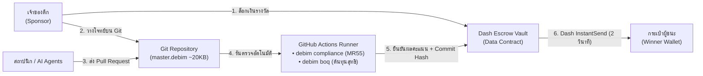

# 🎤 Pitch Deck: debim Bounty
## The Decentralized Architectural Optimization Platform on Dash Platform
### "Kaggle for Building-as-Code: ระดมสมองหั่นต้นทุนก่อสร้างอาคารและผังเมือง ชิงเงินรางวัลผ่าน Dash InstantSend"

> **งาน:** Dash Dev Day (29 พฤศจิกายน 2026 ณ อาคารจามจุรี 10 จุฬาลงกรณ์มหาวิทยาลัย)  
> **ผู้นำเสนอ:** ทีมพัฒนา debim  
> **รูปแบบ:** สไลด์นำเสนอ 3–5 นาที พร้อมบทพูดประกอบ (Speaker Notes)

---

## 📌 สไลด์ที่ 1: หน้าปก (Title & Hook)

### [Visual / Slide Content]
* **หัวข้อใหญ่:** **debim Bounty**
* **สโลแกน:** The Decentralized Optimization Platform for Building-as-Code
* **แนวคิด:** เปลี่ยนอาคารเป็นโค้ด $\rightarrow$ เปิดแข่งลดต้นทุนแบบ Kaggle บน Git $\rightarrow$ จ่ายเงินรางวัลทันทีด้วย **Dash InstantSend**
* **Badge:** `Built for Dash Platform` &bull; `100% Legal & Compliant` &bull; `AI-Agent Ready`

> 🎙️ **บทพูด (Speaker Notes):**  
> "สวัสดีครับ วันนี้เราขอพาทุกท่านมารู้จักกับ **debim Bounty** แพลตฟอร์มการแข่งขันลดต้นทุนอาคารและโครงสร้างเมืองแบบกระจายศูนย์บน Dash Platform ที่จะเปลี่ยนการออกแบบสถาปัตยกรรมให้กลายเป็นการระดมสมองระดับโลกของมนุษย์และ AI ครับ"

---

## 📌 สไลด์ที่ 2: ปัญหาและเม็ดเงินที่สูญเปล่า (Market Size & Bleeding Money)

### [Visual / Slide Content]
* **ตัวเลขตลาดก่อสร้างไทย:** **1.3 ล้านล้านบาท / ปี** (ทั่วโลก $12 Trillion)
* **ปัญหา Over-Engineering:** การออกแบบโครงสร้างที่เผื่อความหนาคอนกรีตและเหล็กเส้นเกินจริง 10% – 15%
* **มูลค่าเงินที่ถูกทิ้งน้ำเปล่าๆ:** **กว่า 130,000 ล้านบาทต่อปี ในไทยเพียงประเทศเดียว!**
* **โจทย์ของเจ้าของโครงการ:** อาคาร 50–100 ล้านบาท ยินดีจ่ายเงินรางวัลหลักแสนทันที หากมีใครช่วยลดค่าวัสดุก่อสร้างให้เขาได้ 3–5 ล้านบาท

> 🎙️ **บทพูด (Speaker Notes):**  
> "ในอุตสาหกรรมก่อสร้างไทยมูลค่า 1.3 ล้านล้านบาทต่อปี มีเงินที่สูญเปล่าไปกับการออกแบบโครงสร้างที่หนาเกินจำเป็น (Over-engineered) ถึง 10-15% หรือคิดเป็นเงินที่ทิ้งไปเปล่าๆ กว่า **1.3 แสนล้านบาททุกปี**! เจ้าของอาคารทุกคนรู้ว่าตึกตัวเองเปลืองคอนกรีตเกินจริง แต่ไม่มีเครื่องมือหรือแรงจูงใจใดๆ ให้ใครมาช่วยเขาคิดลดต้นทุนเลยครับ"

---

## 📌 สไลด์ที่ 3: สองคอขวดที่ไม่มีใครแก้ได้ (The Two Fatal Bottlenecks)

### [Visual / Slide Content]
1. **คอขวดทางเทคนิค (Technical Bottleneck):**
   * โปรแกรม CAD และ Revit เป็นไฟล์ไบนารีปิดขนาดใหญ่ (300MB – 1GB)
   * คอมพิวเตอร์ไม่สามารถรันสคริปต์ตรวจข้อสอบ หรือคำนวณราคาอัตโนมัติได้ ต้องใช้คนนั่งวัดด้วยตลับเมตรและสายตา
2. **คอขวดทางกฎหมายและการเงิน (Legal & Financial Bottleneck):**
   * หากจะจ้างผู้เชี่ยวชาญหรือวิศวกรข้ามชาติมาช่วย จะติด **ประกาศของ ธปท. และ ก.ล.ต. ที่ห้ามใช้คริปโตชำระค่าบริการ (Means of Payment: MOP Ban)**
   * การโอนเงินผ่านระบบธนาคารข้ามประเทศมีค่าธรรมเนียมสูง เอกสารซับซ้อน และใช้เวลานานนับเดือน

> 🎙️ **บทพูด (Speaker Notes):**  
> "ทำไมถึงไม่มีใครทำระบบระดมสมองแก้แบบตึกมาก่อน? ติด 2 เรื่องครับ:  
> หนึ่ง.. ไฟล์ CAD ทั่วไปมันเป็นไฟล์ปิดขนาดมหาศาล คอมพิวเตอร์ตรวจข้อสอบอัตโนมัติไม่ได้  
> สอง.. กฎหมายแบงก์ชาติห้ามใช้คริปโตจ่ายค่าจ้างบริการ ทำให้ไม่สามารถดึง Talent หรือ AI จากทั่วโลกมาช่วยงานได้เลยครับ"

---

## 📌 สไลด์ที่ 4: ทางแก้และหมัดเด็ดทางกฎหมาย (The Solution & Legal Moat)

### [Visual / Slide Content]
* **1. หมัดเด็ดทางกฎหมาย (100% Compliant):**
  * เรา **ไม่ใช่การรับจ้างออกแบบ** จึงไม่ผิดกฎหมาย MOP ของ ธปท./ก.ล.ต.
  * เราคือ **"การประกวดแข่งขันนวัตกรรมทางวิชาการชิงเงินรางวัล (Contest & Bounty Prize)"** เหมือน Kaggle, Topcoder และ Bug Bounty
* **2. กลไกการแข่งขัน (Kaggle for Architecture & Spatial Optimization):**
  * เจ้าของพื้นที่วางผัง `.debim` + วางเงินรางวัลใน Dash Smart Escrow (มีตั้งแต่ **Micro-Bounty 500 บาท** จนถึง **ตึกใหญ่ 200,000 บาท**)
  * สถาปนิก, นักศึกษา, วิศวกร และ **AI Coding Agents ทั่วโลก** แข่งกันแก้โค้ดเพื่อหาจุดที่คุ้มค่าที่สุด
  * **เงื่อนไขเหล็ก:** รัน Unit Test อัตโนมัติ ตรวจสอบระยะร่น กฎกระทรวง MR55 และขนาดพื้นที่ 100%

---

## 📌 สไลด์ที่ 4.1 (สไลด์ไฮไลต์): จาก "ตึก 50 ล้าน" สู่ "Micro-Bounties ในชีวิตประจำวัน" (Everyday Spatial Puzzles)

### [Visual / Slide Content]
> **ทำไมต้องรอแค่อภิมหาโครงการ? ใครๆ ก็ตั้งโจทย์แก้พื้นที่ในชีวิตประจำวันได้ รางวัลไม่ต้องสูง (500 – 5,000 บาท หรือ 1 – 10 DASH) ด้วย Dash InstantSend ค่าแก๊ส 0.01 บาท!**

| โจทย์ในชีวิตประจำวัน (Everyday Use Cases) | ตัววัดผลทางคณิตศาสตร์ (Objective Metric) | เงื่อนไขความปลอดภัย (Automated Constraints) |
| :--- | :--- | :--- |
| 🍲 **เจ้าของร้านชาบู: จัดโต๊ะรับลูกค้าสูงสุด** (Bounty: 2,000 บาท / 5 DASH) | **Maximize: จำนวนที่นั่งเก้าอี้ (`seat_count`)** ยิ่งได้ที่นั่งเยอะ ร้านยิ่งกำไร | ทางเดินพนักงานเสิร์ฟและรถเข็น $\ge 1.20$ ม., ระยะดึงเก้าอี้ $\ge 0.60$ ม., ไม่บังทางหนีไฟ |
| 🎪 **คอนเสิร์ตกลางแจ้ง 10,000 คน ไม่เหยียบกัน** (Bounty: 5,000 บาท / 12 DASH) | **Maximize: ความจุผู้ชม + ทางออกระบายคน** | ประตูทางออกหนีไฟต้องระบายคน 10,000 คนออกหมดภายใน $\le 4$ นาที |
| 🚗 **ดีไซน์ทางแยกในหมู่บ้าน/ลานจอดรถ** (Bounty: 1,500 บาท / 4 DASH) | **Maximize: Throughput การไหลของรถ** | รัศมีวงเลี้ยวรถดับเพลิง $\ge 6.00$ ม., ไม่รุกล้ำแนวที่ดินส่วนบุคคล |

* **Student & AI Friendly:** นักศึกษาเขียนอัลกอริทึม หรือสั่ง AI Agent รันแก้โจทย์ 5 นาที ส่ง PR แล้วรับ DASH ไปกินชาบูได้ทันที!

> 🎙️ **บทพูด (Speaker Notes):**  
> "ที่สำคัญที่สุดคือ เราไม่ได้จำกัดแค่ตึกใหญ่ 50 ล้านครับ... เพราะ Dash มีค่าธรรมเนียมแค่เศษสตางค์ เราจึงเปิดตลาด **'Micro-Bounties ในชีวิตประจำวัน'** ได้ทันที!  
> ตัวอย่างเช่น: เจ้าของร้านอาหารอยากจัดโต๊ะร้านชาบูให้รับคนได้มากที่สุด วางเงินรางวัลแค่ 2,000 บาท หรือ 5 Dash... นักศึกษาหรือใครก็ตามที่ปล่อยให้ AI ช่วยคิด Layout ที่ทางเดินไม่แคบเกิน 1.20 เมตร และได้เก้าอี้เพิ่มจาก 60 เป็น 84 ตัว — ส่งโค้ดปุ๊บ รับ 5 Dash เข้ากระเป๋าไปกินข้าวได้ทันทีใน 2 วินาที! นี่คือการสร้าง Transaction จริงในชีวิตประจำวันบน Dash ครับ!"

---

## 📌 สไลด์ที่ 5: สถาปัตยกรรม Git + GitHub Actions + Dash

### [Visual / Slide Content]

* **On-Chain Footprint เบามาก:** บันทึกเพียง **Git Commit Hash (32 Bytes)** ลง Dash Platform Data Contract ไม่ต้องเก็บไฟล์ 3D หนักๆ
* **Judging Engine ที่โปร่งใส:** GitHub Actions ทำหน้าที่เป็นกรรมการกลาง รันสคริปต์ตรวจความแข็งแรงและคำนวณราคา BOQ อัตโนมัติ

> 🎙️ **บทพูด (Speaker Notes):**  
> "โฟลว์การทำงานโปร่งใสและทรงพลังมากครับ:  
> แบบตึกทั้งหลังคือไฟล์ข้อความ `.debim` ขนาดแค่ 20 KB บน Git... ผู้เข้าแข่งขันส่ง Pull Request เข้ามา... GitHub Actions ทำหน้าที่เป็นกรรมการ รันตรวจกฎหมายและคิดราคา BOQ ใน 1 วินาที... เมื่อหมดเวลา แพลตฟอร์มจะสั่ง **Dash InstantSend โอนเงินรางวัลให้ Commit Hash ที่ประหยัดงบได้มากที่สุดทันทีใน 2 วินาที!**"

---

## 📌 สไลด์ที่ 6: ความโปร่งใสของสถานะโครงการ (What's Built vs What Needs to be Built)

### [Visual / Slide Content]

| 🚀 มีของแล้ว พร้อมใช้งาน (What's Already Built) | ⏳ ยังไม่ได้ทำ & ขอทุน Dash (What Needs to be Built) |
| :--- | :--- |
| ✅ **Core Engine v1.3.0:** คอมไพเลอร์ `.debim` สู่ OpenBIM IFC4 และ 3D WebGL สมบูรณ์ | ⏳ **Dash Data Contract Schema:** ออกแบบ Data Contract บน Dash Platform Drive สำหรับบันทึก Commit Hash |
| ✅ **Automated Regulatory Audit:** รันสคริปต์ตรวจกฎกระทรวง ฉบับที่ 55 (MR 55) อัตโนมัติ | ⏳ **GitHub Actions $\leftrightarrow$ Dash Oracle:** สคริปต์ดึง OIDC Attestation ยืนยันผลคะแนนส่งเข้า Dash |
| ✅ **Deterministic Thai BOQ Engine:** คำนวณปริมาณคอนกรีต ไม้แบบ เหล็กเส้น อิงราคา วสท./กรมบัญชีกลาง | ⏳ **Bounty Escrow on Dash Testnet:** Smart Contract ล็อกและโอน Dash อัตโนมัติเมื่อครบกำหนดเวลา |
| ✅ **debim.cloud & Interactive Playground:** หน้าเว็บทดสอบรันโค้ดและตัวจำลอง DAO Escrow สดบน Cloud Run | ⏳ **Live Hackathon Leaderboard UI:** หน้ากระดานจัดอันดับผู้เข้าแข่งขันแบบ Real-Time |
| ✅ **AI Agent Interface:** รองรับการสั่งการผ่าน FastMCP (`debim mcp`) ให้ AI เข้ามาแข่งได้ทันที | ⏳ **Pilot Case Study:** นำอาคารจริง 1 หลัง (งบ 20–50 ล้าน) มาเปิดแข่งขันนำร่อง |

> 🎙️ **บทพูด (Speaker Notes):**  
> "เราไม่ได้มาขายไอเดียบนกระดาษครับ!  
> **ฝั่งซ้ายคือสิ่งที่เราสร้างเสร็จแล้ว:** คอมไพเลอร์ debim v1.3.0, ระบบตรวจกฎหมายอาคาร MR55, ระบบถอดราคา BOQ และ Playground บนเว็บพร้อมใช้งานแล้ว  
> **ฝั่งขวาคือสิ่งที่เรามาขอทุนสนับสนุนจาก Dash:** คือการสร้างสะพานเชื่อม Dash Platform Data Contract, ตัว Oracle เชื่อม GitHub Actions และสัญญา Escrow บน Dash Testnet ครับ"

---

## 📌 สไลด์ที่ 7: ตัวเลขความคุ้มค่าและโมเดลธุรกิจ (Unit Economics & Business Model)

### [Visual / Slide Content]
* **Customer Value (เจ้าของตึก):**
  * วาง Bounty: **200,000 บาท** (ในรูปเหรียญ Dash)
  * ประหยัดงบค่าวัสดุก่อสร้างจริง: **3,000,000 บาท** (6% ของตึก 50 ล้าน)
  * **Net Savings / ROI: กำไรเน้นๆ 2.8 ล้านบาท (ROI 14x)**
* **Platform Monetization (รายได้ของเรา):**
  * คิด **Take Rate 5% – 10%** จากทุก Bounty Pool
  * ถ้ามีเพียง **100 โครงการ/ปี** จะสร้างเม็ดเงินหมุนเวียน 25–50 ล้านบาท สร้างรายได้ค่าธรรมเนียมให้แพลตฟอร์ม 2.5 ล้านบาท
* **Dash Ecosystem Impact:**
  * สร้าง Real-World B2B Transaction ปริมาณมหาศาลบน Dash Platform
  * ดึงดูดนักพัฒนา AI และวิศวกรโครงสร้างทั่วโลกให้มาถือและใช้เหรียญ Dash

> 🎙️ **บทพูด (Speaker Notes):**  
> "ในแง่ตัวเลขธุรกิจ: เจ้าของตึกจ่ายเงินรางวัล 2 แสน แต่ประหยัดงบก่อสร้างได้ถึง 3 ล้านบาท นี่คือข้อเสนอที่ไม่มีเจ้าของตึกคนไหนปฏิเสธได้!  
> ส่วนแพลตฟอร์มสร้างรายได้จาก Take Rate 5-10% ของเงินรางวัล และที่สำคัญ มันคือการดึงดูดเม็ดเงินจากโลกสถาปัตยกรรมจริงเข้ามาหมุนเวียนในระบบนิเวศของ Dash ครับ"

---

## 📌 สไลด์ที่ 8: งบประมาณขอสนับสนุนและแผนงาน (The Lean Ask & 3-Month Roadmap)

### [Visual / Slide Content]
> **เราไม่ขอค่าแรงพัฒนา เพราะเราสร้างคอร์เอ็นจินเสร็จแล้ว! เงินทุนทั้งหมดจะถูกใช้เพื่อ "ผู้ใช้งานและค่าเซิร์ฟเวอร์รันระบบ" 100%**

| หมวดงบประมาณที่ขอรับการสนับสนุน | รายละเอียดการใช้งาน | วงเงินที่ขอรับทุน |
| :--- | :--- | :---: |
| ⛽ **Sponsored Gas Pool (1 ปีเต็ม)** | อุดหนุนค่าแก๊สเพื่อให้ผู้ใช้, ร้านอาหาร, นักศึกษา และ AI ส่งแบบฟรี 100% ในปีแรก | **~30,000 บาท** (~20 DASH) |
| ☁️ **Cloud Serverless (2 ปี)** | ค่า Google Cloud Run รันระบบประมวลผล 24/7 (เดือนละ 5,000 บ. &bull; หยุดเบิกทันทีเมื่อระบบมีรายได้เลี้ยงตัวเอง) | **~120,000 บาท** (~80 DASH) |
| 🎯 **รวมงบประมาณขอทุนทั้งโครงการ** | **Micro-Grant ขอรับทุนสนับสนุนตั้งต้น** | **เพียง ~150,000 บาท (~100 DASH)** |

* **แผนงาน 3 เดือน (Milestone Execution):**
  * **เดือนที่ 1:** ออกแบบ Dash Data Contract Schema + Escrow Vault บน Dash Testnet
  * **เดือนที่ 2:** สร้าง GitHub Actions OIDC Verifier + คำสั่ง CLI `debim dao bounty`
  * **เดือนที่ 3:** เปิดตัว **"The 1st Everyday Spatial Hackathon on Dash"** (โจทย์จัดร้านอาหาร / คอนเสิร์ต / ตึกนำร่อง) พร้อมโปรโมชั่นฟรีค่าแก๊ส

> 🎙️ **บทพูด (Speaker Notes):**  
> "สุดท้ายนี้เรื่องการขอทุนสนับสนุน... เราไม่ได้มาขอเงินก้อนโตเพื่อจ่ายเงินเดือนตัวเองครับ เพราะเราลงแรงสร้างคอร์เอ็นจิน v1.3.0 เสร็จหมดแล้ว!  
> สิ่งที่เราขอจาก Dash Treasury เป็นเพียง **Micro-Grant ราว 100 Dash (ประมาณ 1.5 แสนบาท)** แบ่งเป็น:  
> 1. กองทุนอุดหนุนค่าแก๊ส ให้คนไทยและนักศึกษาเข้ามาส่งแบบฟรี 1 ปีเต็ม เพื่อสร้าง Transaction และดึงผู้ใช้ใหม่เข้าสู่ Dash  
> 2. ค่าคลาวด์เซิร์ฟเวอร์เดือนละ 5,000 บาทเป็นเวลา 2 ปี และถ้าแพลตฟอร์มเริ่มทำเงินจากค่าธรรมเนียมเลี้ยงตัวเองได้ เราจะหยุดเบิกทันทีครับ!  
> มาร่วมผลักดัน Real-World Utility ของ Dash Platform ไปด้วยกันครับ... ขอบคุณครับ!"
