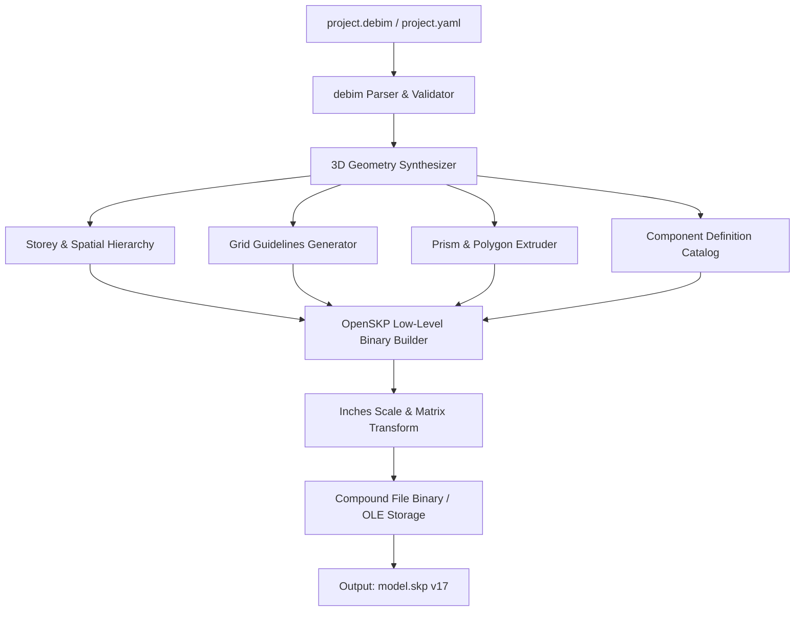

# ROADMAP_DEBIM_TO_SKP.md — Declarative BIM to SketchUp (.skp) Exporter Specification

> **"Code is the Source of Truth, SketchUp is the Interactive Design Canvas."**  
> เอกสารข้อกำหนดสถาปัตยกรรมและการพัฒนาโมดูลส่งออกโมเดลสามมิติจาก Declarative BIM (`.debim` / `project.yaml`) สู่ไฟล์เนทีฟของ SketchUp (`.skp` Legacy v17 & Compound Binary Format) แบบ Pure-Python ไร้การพึ่งพาไลบรารีภายนอก (Zero-External-Dependencies) พร้อมโครงสร้างเลเยอร์ (Tags), คอมโพเนนต์ (Components), กริดไลน์ (Guides), และการจัดกลุ่มตามชั้น (Storeys)

---

## 🏛️ 1. Core Philosophy & Architectural Intent (ปรัชญาและวัตถุประสงค์)

1. **Bridging Code with the Architect's Daily Workhorse:**
   - ในภูมิภาคเอเชียตะวันออกเฉียงใต้และประเทศไทย **SketchUp** คือซอฟต์แวร์สามมิติที่มีฐานผู้ใช้งานสถาปนิก, อินทีเรีย, มัณฑนากร, และผู้รับเหมากว้างขวางที่สุด
   - สถาปนิกใช้ SketchUp ทำงานออกแบบร่วมกับ Rendering Engine ยอดนิยม เช่น **Enscape, V-Ray, D5 Render, Lumion, และ Twinmotion**
   - การมีสะพานเชื่อมจาก `.debim` (Building-as-Code) สู่ `.skp` โดยตรง จะทำให้สถาปนิกสามารถ compile ตัวอาคารจากโค้ดขึ้นเป็น 3D Model ใน SketchUp ได้ในเสี้ยววินาที โดยไม่ต้องวาดมือซ้ำสอง (No Double-Drafting)

2. **Pure-Python & Zero-Runtime Dependency (รันได้ทุกที่):**
   - โมดูลแปลงต้องเขียนด้วย Pure Python 100% ไม่ต้องติดตั้ง SketchUp Pro, ไม่ต้องใช้ Trimble C API SDK (`slapi.dll`) ที่ผูกมัดกับ Windows C++ Runtime
   - สามารถรันได้บน Linux Server, Docker Container, Cloud Workers, Kaggle, และ Windows CLI ได้อย่างราบรื่น

3. **Intelligent Semantic Mapping (ไม่ใช่แค่ก้อนตาข่ายโพลีกอนโง่ๆ):**
   - ไม่แปลงออกมาเป็น Loose Mesh หรือก้อนสามเหลี่ยมแตกกระจายที่แก้ไขต่อไม่ได้
   - ชิ้นส่วนซ้ำ (Repeated Elements) เช่น เสา (`IfcColumn`), ฐานราก (`IfcFooting`), เสาเข็ม (`IfcPile`), ประตู-หน้าต่าง ต้องถูกแปลงเป็น **Component Definition & Instance** เพื่อให้โมเดลมีขนาดเบา และแก้ไขต้นแบบจุดเดียวเปลี่ยนทั้งอาคาร
   - ชิ้นส่วนเฉพาะ (Unique Elements) เช่น พื้น (`IfcSlab`), ผนัง (`IfcWall`) ต้องห่อหุ้มเป็น **Solid Group**
   - กำหนด **Tags (Layers)** ตามคลาสมาตรฐานสากล เช่น `A-WALL`, `S-COLS`, `S-SLAB`, `A-GLAZ`, `S-GRID`

4. **Bi-directional Visual & Metric Integrity (ตรงตามมาตราส่วน 100%):**
   - ระยะ ขนาด และพิกัด ทุกมิลลิเมตรใน `.debim` ต้องตรงกับ Dimension ใน SketchUp
   - การคำนวณปริมาณงาน (QTO / BOQ) ใน `debim` กับพื้นที่/ปริมาตร Entity Info ใน SketchUp ต้องสอดคล้องกันอย่างสมบูรณ์

---

## 📐 2. Coordinate System & Geometric Foundations (ระบบพิกัดและเรขาคณิต)

### 2.1 หน่วยวัดและการแปลงสเกล (Units Conversion)
SketchUp Binary Format จัดเก็บพิกัดเรขาคณิตภายในทั้งหมดด้วยหน่วย **นิ้ว (Inches)** เสมอ:

$$\text{Inches} = \text{Meters} \times 39.37007874015748$$

| แกน (Axis) | ทิศทางใน debim (IFC Standard) | สีและทิศทางใน SketchUp | อัตราส่วนแปลง |
| :--- | :--- | :--- | :--- |
| **X** | ตะวันออก (East / Grid Alpha) | เส้นแกนสีแดง (Red Axis) | $x_{\text{skp}} = x \times 39.3700787$ |
| **Y** | เหนือ (North / Grid Numeric) | เส้นแกนสีเขียว (Green Axis) | $y_{\text{skp}} = y \times 39.3700787$ |
| **Z** | ระดับความสูง (Elevation) | เส้นแกนสีน้ำเงิน (Blue Axis) | $z_{\text{skp}} = z \times 39.3700787$ |

### 2.2 ทิศทางของระนาบและเวกเตอร์ปกติ (Face Winding & Normal Direction)
- SketchUp มีแนวคิดเรื่อง **Front Face** (ผิวด้านหน้า - สีขาว/สีตามวัสดุ) และ **Back Face** (ผิวด้านหลัง - สีเทาอมฟ้า)
- กฎมือขวา (Right-Hand Rule): ขอบของ Loop ภายนอก (Outer Boundary) ต้องเรียงทวนเข็มนาฬิกา (Counter-Clockwise - CCW) เมื่อมองจากด้านนอก เพื่อให้ Normal เวกเตอร์พุ่งออกนอกชิ้นงานเสมอ ป้องกันปัญหา Back-Face หลุดเวลานำไปเรนเดอร์ใน Enscape / V-Ray

---

## 🗂️ 3. Semantic Entity Mapping Table (ตารางจับคู่ชิ้นงาน)

| debim IFC Entity | SketchUp Geometry Type | SketchUp Tag / Layer | Behavioral Rule |
| :--- | :--- | :--- | :--- |
| `spatial_structure.storeys` | Nested Top-Level Groups | `A-LEVEL` | จัดกลุ่มชิ้นงานตามชั้น (Level Grouping) เพื่อความสะดวกในการเปิด-ปิดดูทีละชั้นใน Outliner |
| `grids` | Guide Lines (Clines) / 3D Edges | `S-GRID` | เส้นกริดพร้อมข้อความ Grid Bubble (A, B, C / 1, 2, 3) |
| `IfcColumn` | **Component Instance** | `S-COLS` | สร้าง ComponentDefinition ตามขนาดหน้าตัด (เช่น `C1_400x400`, `WF_H300x150`) วาง Instance ตามจุดตัดกริด |
| `IfcSlab` | **Solid Group** | `S-SLAB` | Extrude โพลีกอนขอบเขตลงด้านล่างตามความหนา (`thickness`) |
| `IfcWall` | **Solid Group** | `A-WALL` | Extrude เส้นกึ่งกลางผนังออกซ้าย-ขวาตามความหนา และยืดสูงตาม `height` เจาะช่องเปิด (Openings) สำหรับประตู/หน้าต่าง |
| `IfcBeam` | **Component Instance** | `S-BEAM` | Extrude หน้าตัดคานตามความยาวของ Span ระหว่างเสา |
| `IfcFooting` | **Component Instance** | `S-FNDN` | ฐานรากแผ่ / ฐานรากเสาเข็ม ใต้ตำแหน่งเสา |
| `IfcDoor` | **Component Instance** | `A-DOOR` | บานกรอบ + บานประตู วางแนบในระนาบผนัง |
| `IfcWindow` | **Component Instance** | `A-WIND` | บานกรอบ + กระจกโปร่งแสง |
| `IfcRoof` | **Solid Group** | `A-ROOF` | สแลปหลังคา หรือโครงสร้างหลังคาลาดเอียง |
| `materials` | **SkpMaterial** | - | แมปชื่อวัสดุ, ค่าสี RGB และความโปร่งใส (Alpha) |

---

## 🎨 4. Material & Transparency System (ระบบวัสดุและความโปร่งแสง)

ใน `.debim` มีการระบุ Material Palette เช่น `CONCRETE_EXPOSED`, `GLASS_CLEAR`, `STEEL_WHITE`:

```yaml
materials:
  CONCRETE_STRUCT:
    diffuse: [0.75, 0.75, 0.73]
    opacity: 1.0
  GLASS_CLEAR:
    diffuse: [0.85, 0.92, 0.95]
    opacity: 0.30
  STEEL_WHITE:
    diffuse: [0.95, 0.95, 0.95]
    opacity: 1.0
```

### การแปลงเป็น SketchUp Material:
1. แปลงค่าสี RGB ($[0.0, 1.0] \rightarrow [0, 255]$)
2. ถ้า $\text{opacity} < 1.0$ ให้ตั้งค่า `Material.alpha` ใน SketchUp เพื่อให้แสดงผลเป็นกระจกโปร่งแสงทันทีใน Viewport
3. กำหนดชื่อ Material ให้ตรงกับ BOQ Item เพื่อให้ปลั๊กอิน Takeoff บน SketchUp (เช่น Quantifier Pro) อ่านต่อได้

---

## 🏗️ 5. Technical Pipeline & Binary Architecture (สถาปัตยกรรมทางเทคนิค)



### 5.1 โครงสร้างไบนารีของ SketchUp v17 (Compound File Binary Format)
SketchUp v17 (SketchUp 2017) เป็นเวอร์ชันคลาสสิกที่สามารถอ่านได้ด้วย SketchUp ทุกเวอร์ชันตั้งแต่ 2017, 2018, 2019, 2020, 2021, 2022, 2023, 2024 รวมถึง SketchUp Web:
- **Header:** Signature ไบนารีระบุเวอร์ชัน `SketchUp Model Version 17.x`
- **Entity Pool:**
  - `Layers` (Tags)
  - `Materials` (Colors, Opacity)
  - `ComponentDefinitions` (Geometry Templates)
  - `ComponentInstances` (Placement Transformations: 4x4 Affine Matrix)
  - `Groups` & `Entities` (Vertices, Edges, Loops, Faces)
  - `Camera / Views` (Isometric 3D Camera, Parallel Projection)

### 5.2 การจัดการ Component Definition และ Transformation Matrix
สำหรับเสาและคานที่มีขนาดซ้ำกัน:
1. สร้าง **Component Definition** ขึ้นมา 1 ชิ้นที่จุด Origin $(0, 0, 0)$
2. สร้าง **Component Instance** วางตามตำแหน่งจริงด้วย Affine Transformation Matrix 4x4:

$$\mathbf{M} = \begin{bmatrix} r_{11} & r_{12} & r_{13} & t_x \\ r_{21} & r_{22} & r_{23} & t_y \\ r_{31} & r_{32} & r_{33} & t_z \\ 0 & 0 & 0 & 1 \end{bmatrix}$$

โดยที่ $t_x, t_y, t_z$ คือพิกัดในหน่วยนิ้ว และ $r$ คือ Rotation/Orientation

---

## 💻 6. Proposed Python Package Architecture (โครงสร้างโค้ดภายใน `debim`)

เพิ่มโมดูล `debim.exporters.skp` ในระบบ:

```plaintext
src/debim/
├── exporters/
│   ├── __init__.py
│   ├── ifc.py                   # IFC Exporter เดิม
│   ├── dxf.py                   # 2D Blueprints Exporter
│   └── skp/                     # โมดูลใหม่: SketchUp Exporter
│       ├── __init__.py          # Export function entry point
│       ├── binary_writer.py     # Low-level OpenSKP binary writer
│       ├── entities.py          # SkpVertex, SkpEdge, SkpFace, SkpGroup, SkpComponent
│       ├── materials.py         # SkpMaterial palette
│       ├── transform.py         # 4x4 Matrix & Coordinate scaling (Meters to Inches)
│       └── synthesizer.py       # แปลงจาก debim Building AST สู่ SketchUp Scene Graph
```

### 6.1 ตัวอย่าง Signature ของ API
```python
# src/debim/exporters/skp/__init__.py
from pathlib import Path
from debim.models import BuildingModel

def export_skp(
    model: BuildingModel,
    output_path: Path | str,
    group_by_storey: bool = True,
    include_grids: bool = True,
    include_materials: bool = True,
) -> Path:
    """Compile and export a debim BuildingModel directly to a native .skp file."""
    ...
```

---

## ⌨️ 7. Command-Line Interface (CLI) Specification

คำสั่งใหม่ที่จะถูกผนวกเข้ากับ `debim` CLI:

```bash
# ส่งออกไฟล์โมเดลเป็น .skp มาตรฐาน
debim export skp -m project.debim -o model.skp

# ส่งออกพร้อมระบุเงื่อนไขพิเศษ
debim export skp -m project.debim -o output/farnsworth.skp \
    --group-by-storey \
    --include-grids \
    --default-layer-prefix "A-"

# ส่งออกพร้อมพรีวิวข้อมูล Scene Graph
debim export skp -m project.debim -o model.skp --verbose
```

---

## 🧪 8. Quality Assurance & Verification Benchmark (การทดสอบคุณภาพ)

1. **Dimensional Accuracy (ความแม่นยำระดับ 0.1 mm):**
   - วัดระยะเสาถึงเสาใน SketchUp ด้วย Tape Measure Tool เทียบกับค่าพิกัดใน `.debim`
   - ตรวจสอบความคลาดเคลื่อนทางคณิตศาสตร์ (Floating-point error $< 10^{-5}$ inches)
2. **Solid Group Integrity (กลุ่มทึบเรขาคณิต):**
   - Entity Info ใน SketchUp ต้องขึ้นสถานะเป็น **"Solid Group"** (ไม่มีรูรั่ว, ไม่มีเส้นเกิน) เพื่อให้สามารถคำนวณ Volume และส่งไปพิมพ์ 3D Print หรือรัน BoQ ได้
3. **Cross-Software Compatibility (เปิดได้ทุกโปรแกรม):**
   - ทดสอบเปิดไฟล์ `.skp` ที่ได้บน:
     - SketchUp Make 2017 (Free Desktop Version)
     - SketchUp Pro 2021 / 2024
     - SketchUp for Web (Free Browser Viewer)
     - D5 Render / Enscape (Load Direct Live-Sync)
     - Blender (ผ่าน SketchUp Importer Addon)

---

## 🗓️ 9. Phased Development Roadmap (แผนการพัฒนาเป็นระยะ)

- **Phase 1: Minimal Viable Geometry (Sprint 1)**
  - แกนหลัก Binary Writer และระบบแปลงหน่วย (Meters $\rightarrow$ Inches)
  - รองรับ Grid Lines, พื้น (`IfcSlab`), เสา (`IfcColumn`), คาน (`IfcBeam`), และ ผนังเรียบ (`IfcWall`)
  - รองรับ Tags/Layers และ Material สีพื้นฐาน
- **Phase 2: Fenestration & Openings (Sprint 2)**
  - การเจาะช่องเปิดผนัง (Subtractive Boolean สำหรับประตู-หน้าต่าง)
  - Component Definition สำหรับบานประตู (`IfcDoor`) และบานหน้าต่างกระจกใส (`IfcWindow`)
- **Phase 3: Spatial Structure & Outliner Hierarchy (Sprint 3)**
  - จัดระเบียบชั้นอาคาร (Storeys) ลงใน Outliner Tree
  - รองรับบันไดวน (`test_spiral_stair`) และบันไดตรง
- **Phase 4: CLI Integration & Automated Test Suite (Sprint 4)**
  - คำสั่ง `debim export skp`
  - Integration Tests เทียบกับโมเดล Farnsworth House และ Golden Test Models ใน `tests/`
