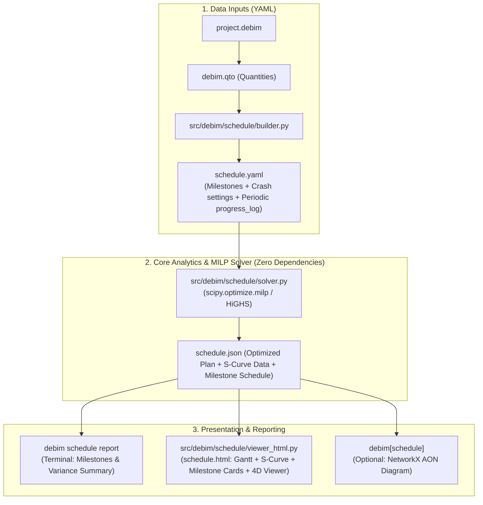

# ROADMAP_SCHEDULE_4D_CRASHING.md — 4D BIM Scheduling, Progress Tracking (S-Curve) & Milestone Engine

> **"From Static Geometry to Dynamic Construction Optimization: One-Shot Time-Cost Trade-Off, Periodic Progress Logging (Daily/Weekly S-Curve), Milestone Payment Allocation, and Standalone 4D HTML Visualizer."**  
> เอกสารแผนงานการพัฒนาระบบคำนวณแผนงานก่อสร้าง 4D, การแบ่งงวดงานก่อสร้าง (Payment Milestones) คำนวณจากแผนงานอัตโนมัติ, การบันทึกความคืบหน้าแบบรายวัน/รายสัปดาห์ เพื่อพลอต S-Curve, การเร่งงาน (Project Crashing) แบบคำนวณรอบเดียวจบด้วย MILP และการแสดงผล Interactive HTML Gantt & 4D Viewer

---

## 🧭 1. Executive Summary & Design Principles

ระบบนี้ต่อยอดจากแกนหลักของ `debim` เพื่อยกระดับจาก 3D/BIM สู่ **4D Construction Scheduling, Periodic Progress Tracking, S-Curve Analytics & Automated Milestone Allocation**:
1. **Decoupled Architecture (ไม่กระทบ `.debim`):**
   * โมเดลอาคาร (`project.debim`) ยังคงความบริสุทธิ์ของ Building-as-Code (Spatial & Physical Model)
   * แผนงาน, งวดงาน, การเร่งงาน, และประวัติความคืบหน้ารายวัน/รายสัปดาห์ บันทึกใน **`schedule.yaml`**
2. **Automated Milestone Planning (คำนวณงวดงานก่อสร้างจากแผนงาน):**
   * กำหนดงวดงาน (Milestones) ผูกกับกลุ่มกิจกรรม (Required Activities) ระบบจะคำนวณวันที่ส่งมอบงานแต่ละงวด (Planned Completion Date), วันที่คาดว่าจะเสร็จจริง (Actual Date), และยอดเงินเบิกจ่าย (%) ให้อัตโนมัติจากแผนงาน
3. **Periodic Progress Logging for Real S-Curve (บันทึก % รายวัน/รายสัปดาห์):**
   * รองรับการลงบันทึกความก้าวหน้าตามคาบเวลาจริง (`progress_log`: บันทึกเป็นรายวันหรือรายสัปดาห์)
   * คำนวณกราฟ **S-Curve (Planned Early Curve, Planned Late Curve, และ Actual S-Curve)** จากน้ำหนักมูลค่างาน (Cost Weight) ของแต่ละกิจกรรมโดยอัตโนมัติ
4. **Zero-Bloat Core Math (ใช้ Base SciPy ที่มีอยู่แล้ว):**
   * ใช้ `scipy.optimize.milp` (HiGHS Solver) คำนวณหาจุดคุ้มทุนที่สุดรอบเดียวจบ (One-Shot Solution) ขจัดจุดอ่อนของการวนลูป Greedy ทีละรอบ และแก้ปัญหาเส้นทางวิกฤตคู่ขนาน (Parallel Critical Paths) ได้สมบูรณ์แบบ
5. **Standalone Interactive HTML Viewer:**
   * ส่งออกเป็น `schedule.html` รวม 4 มิติในหน้าเดียว:
     1. **Interactive Gantt Chart:** แท่งบาร์คู่ Planned vs Actual พร้อมเส้นประแนวตั้ง Data Date
     2. **Dynamic S-Curve:** แสดงกราฟเส้น S-Curve พลอตจาก `progress_log` รายวัน/รายสัปดาห์ พร้อมหมุดปักงวดงาน (Milestone Pins)
     3. **Milestone Payment Table:** ตารางสรุปงวดเงินเบิกจ่าย สถานะงวดงานที่พร้อมส่งเบิก (Ready to Bill)
     4. **4D BIM View (Three.js):** ระบายสีชิ้นงาน 3D ตามสถานะความคืบหน้า พร้อม Time Slider เลื่อนดูสถานะอาคารตามแต่ละวัน

---

## 🏗️ 2. Architectural Structure & Component Breakdown



---

## 📝 3. รูปแบบการบันทึกงวดงานและ S-Curve ใน `schedule.yaml`

วิศวกรสามารถเปิดไฟล์มาตั้งค่างวดงาน และบันทึกเปอร์เซ็นต์ความคืบหน้ารายวันหรือรายสัปดาห์ได้อย่างเป็นธรรมชาติ:

```yaml
# schedule.yaml — แผนงาน, งวดงานก่อสร้าง และประวัติความคืบหน้าสำหรับ S-Curve
project_id: "PRJ-THAI-TROPICAL-01"
as_of_date: "2026-11-05"        # วันที่ตัดยอดรายงานความคืบหน้า (Data Date)
overhead_per_day: 4500          # ค่าโสหุ้ยต่อวัน (บาท)
max_budget_limit: 1500000

# ==============================================================================
# การแบ่งงวดงานก่อสร้าง (Payment Milestones)
# ==============================================================================
milestones:
  - id: "MS-01"
    name: "งวดที่ 1: งานเตรียมการและฐานราก ค.ส.ล. แล้วเสร็จ"
    payment_percent: 15.0       # 15% ของมูลค่าโครงการ
    required_activities: ["ACT_FOOTING"]

  - id: "MS-02"
    name: "งวดที่ 2: งานโครงสร้างเสา คาน และพื้นชั้น 1 แล้วเสร็จ"
    payment_percent: 25.0
    required_activities: ["ACT_COL_L1", "ACT_BEAM_L1"]

  - id: "MS-03"
    name: "งวดที่ 3: งานโครงสร้างชั้น 2 และคานหลังคาแล้วเสร็จ"
    payment_percent: 30.0
    required_activities: ["ACT_COL_L2", "ACT_ROOF_BEAM"]

  - id: "MS-04"
    name: "งวดที่ 4: งานมุงหลังคา ก่อผนัง และส่งมอบงานงวดสุดท้าย"
    payment_percent: 30.0
    required_activities: ["ACT_WALLS", "ACT_ROOFING"]

# ==============================================================================
# รายการกิจกรรม แผนงาน และประวัติความคืบหน้า (Daily/Weekly Progress Log)
# ==============================================================================
activities:
  - id: "ACT_FOOTING"
    name: "งานฐานรากและตอม่อ ค.ส.ล."
    element_ids: ["F1", "F2", "F3", "F4"]
    predecessors: []
    normal_duration: 10
    crash_duration: 7
    normal_cost: 65000
    crash_cost: 85000
    status: "COMPLETED"
    progress_percent: 100.0
    actual_start: "2026-10-01"
    actual_finish: "2026-10-09"
    # บันทึกความคืบหน้ารายสัปดาห์ (หรือรายวัน) เพื่อพลอต Actual S-Curve
    progress_log:
      - date: "2026-10-03"
        percent: 30.0
        notes: "ขุดดินและตัดหัวเข็มเสร็จ"
      - date: "2026-10-06"
        percent: 75.0
        notes: "ผูกเหล็กและเทคอนกรีตฐานราก"
      - date: "2026-10-09"
        percent: 100.0
        notes: "เทตอม่อและกลบดินเรียบร้อย"

  - id: "ACT_COL_L1"
    name: "งานเสา ค.ส.ล. ชั้น 1"
    element_ids: ["COL-1A", "COL-1B", "COL-2A", "COL-2B"]
    predecessors: ["ACT_FOOTING"]
    normal_duration: 6
    crash_duration: 4
    normal_cost: 45000
    crash_cost: 60000
    status: "IN_PROGRESS"
    progress_percent: 60.0
    actual_start: "2026-10-10"
    actual_finish: null
    progress_log:
      - date: "2026-10-15"
        percent: 25.0
      - date: "2026-10-22"
        percent: 60.0
        notes: "เข้าแบบและเทคอนกรีตเสาไปแล้ว 2 ต้น"

  - id: "ACT_BEAM_L1"
    name: "งานคานและพื้น ค.ส.ล. ชั้น 1"
    element_ids: ["BEAM-B1", "BEAM-B2", "SLAB-S1"]
    predecessors: ["ACT_COL_L1"]
    normal_duration: 8
    crash_duration: 5
    normal_cost: 70000
    crash_cost: 95000
    status: "NOT_STARTED"
    progress_percent: 0.0
    progress_log: []
```

---

## 📋 4. Step-by-Step Jules Development Plan (5-Stage Roadmap)

| Step | Workstream | Files to Create / Modify | Target Test |
| :---: | :--- | :--- | :--- |
| **1** | **Pydantic Schema: Milestones, Crashing & ProgressLog** | `src/debim/schedule/schema.py`<br/>`src/debim/schedule/__init__.py` | `tests/test_schedule_schema.py` |
| **2** | **Activity & Milestone Extractor (from Storeys/QTO)** | `src/debim/schedule/builder.py` | `tests/test_schedule_builder.py` |
| **3** | **MILP Solver + S-Curve Engine + Milestone Date Evaluator** | `src/debim/schedule/solver.py`<br/>`src/debim/schedule/scurve.py` | `tests/test_schedule_solver.py` |
| **4** | **CLI Integration & Rich Terminal Reporting (Milestones & S-Curve)** | `src/debim/schedule/reporter.py`<br/>`src/debim/cli.py` | `tests/test_cli_schedule.py` |
| **5** | **Standalone Interactive HTML Gantt, S-Curve & 4D Viewer** | `src/debim/schedule/viewer_html.py` | `tests/test_schedule_viewer.py` |

---

## 🤖 5. Detailed GitHub Issue Blueprints for Jules AI

---

### 🟢 Issue Step 1: `[jules] feat(schedule): Pydantic Schema for schedule.yaml (Milestones, ProgressLog, Crashing) & schedule.json`
- **Labels:** `jules`, `enhancement`, `schedule`
- **Files:** `src/debim/schedule/__init__.py`, `src/debim/schedule/schema.py`, `tests/test_schedule_schema.py`
- **Key Deliverables:**
  - สร้าง Pydantic v2 models:
    - `ProgressLogEntry`: `date: str`, `percent: float` (0.0 - 100.0), `notes: str | None = None`
    - `Milestone`: `id: str`, `name: str`, `payment_percent: float | None = None`, `payment_amount: float | None = None`, `required_activities: list[str] = []`
    - `CrashingActivity`:
      - แผนงาน: `id`, `name`, `element_ids`, `predecessors`, `normal_duration`, `crash_duration`, `normal_cost`, `crash_cost`, `cost_weight: float | None = None`
      - ติดตามงานจริง: `status: Literal["NOT_STARTED", "IN_PROGRESS", "COMPLETED"]`, `progress_percent: float = 0.0`, `actual_start: str | None`, `actual_finish: str | None`, `progress_log: list[ProgressLogEntry] = []`, `notes: str | None`
    - `CrashingManifest`:
      - `project_id: str`, `as_of_date: str | None`, `overhead_per_day: float = 0.0`, `max_budget: float | None`, `milestones: list[Milestone] = []`, `activities: list[CrashingActivity]`
    - `MilestoneResult`: `id: str`, `name: str`, `payment_percent: float`, `planned_completion_day: int`, `actual_completion_day: int | None`, `is_completed: bool`, `billing_status: Literal["PENDING", "READY_FOR_BILLING", "PAID"]`
    - `SCurveData`: `dates: list[str]`, `planned_early_percent: list[float]`, `planned_late_percent: list[float]`, `actual_percent: list[float]`
    - `ScheduleResult`: `project_id: str`, `status: str`, `total_duration: int`, `total_direct_cost: float`, `total_indirect_cost: float`, `total_cost: float`, `overall_progress_percent: float`, `critical_path: list[str]`, `activities: dict[str, ActivityScheduleResult]`, `milestones: list[MilestoneResult]`, `s_curve: SCurveData`
  - Helper functions: `load_schedule_yaml(path)` และ `dump_schedule_json(result, path)`
- **Acceptance Criteria:** `pytest tests/test_schedule_schema.py` ผ่าน 100%

---

### 🟢 Issue Step 2: `[jules] feat(schedule): Activity & Milestone Extractor from debim Storeys & QTO`
- **Labels:** `jules`, `enhancement`, `schedule`
- **Files:** `src/debim/schedule/builder.py`, `tests/test_schedule_builder.py`
- **Key Deliverables:**
  - สแกนโมเดล `project.debim` และแบ่งงวดงาน (Milestones) อัตโนมัติตามระดับชั้นอาคาร (Storeys) เช่น:
    - งวดที่ 1: งานฐานราก/ชั้นล่าง
    - งวดที่ 2..N: งานโครงสร้างแต่ละชั้น
    - งวดสุดท้าย: งานหลังคาและผนัง
  - กำหนดสัดส่วน `payment_percent` เริ่มต้นเฉลี่ยตามความเหมาะสม
  - สกัดกิจกรรมโครงสร้าง ผูก `required_activities` ในแต่ละงวด และสร้างเทมเพลต `schedule.yaml` ที่พร้อมใช้งาน
- **Acceptance Criteria:** `pytest tests/test_schedule_builder.py` ผ่าน 100%

---

### 🟢 Issue Step 3: `[jules] feat(schedule): One-Shot MILP Solver, S-Curve Engine & Milestone Evaluator`
- **Labels:** `jules`, `enhancement`, `schedule`
- **Files:** `src/debim/schedule/solver.py`, `src/debim/schedule/scurve.py`, `tests/test_schedule_solver.py`
- **Key Deliverables:**
  - **MILP Project Crashing:** คำนวณจุดคุ้มทุนรอบเดียวจบด้วย `scipy.optimize.milp`
  - **Milestone Date Evaluator:** คำนวณหาวันที่เสร็จสิ้นของงวดงานจาก $\max(\text{Finish Days of required activities})$ และตรวจสอบว่างวดงานใดเสร็จสมบูรณ์แล้วพร้อมตั้งเบิก (`READY_FOR_BILLING`)
  - **S-Curve Generator (`scurve.py`):**
    - กระจายน้ำหนักมูลค่างาน (Cost Weight) ตามวันทำงานเพื่อสร้างเส้น **Planned Early S-Curve** และ **Planned Late S-Curve**
    - รวบรวม `progress_log` รายวัน/รายสัปดาห์จากทุกกิจกรรมมาคำนวณเป็นเส้น **Actual S-Curve** สะสมตามช่วงเวลาจริง
- **Acceptance Criteria:** `pytest tests/test_schedule_solver.py` ผ่าน 100%

---

### 🟢 Issue Step 4: `[jules] feat(schedule): CLI Integration & Rich Terminal Reporting (Milestones & S-Curve)`
- **Labels:** `jules`, `enhancement`, `schedule`
- **Files:** `src/debim/schedule/reporter.py`, `src/debim/cli.py`, `tests/test_cli_schedule.py`
- **Key Deliverables:**
  - เพิ่มตารางแสดงผลบน Terminal ด้วย Rich:
    - **Milestone Table:** แสดงงวดที่, ชื่องวด, % เงินเบิกจ่าย, วันที่ตามแผน, สถานะงวดงาน (`[bold green]READY FOR BILLING[/bold green]` หรือ `[dim]PENDING[/dim]`)
    - **S-Curve & Progress Variance Summary:** สรุป % แผน vs % ทำได้จริง พร้อมระบุว่าเร็วกว่าหรือช้ากว่าแผนกี่เปอร์เซ็นต์
  - คำสั่ง CLI:
    - `debim schedule init <project.debim> [-o schedule.yaml]`
    - `debim schedule solve <schedule.yaml> [-o schedule.json]`
    - `debim schedule report <schedule.json>`
- **Acceptance Criteria:** `pytest tests/test_cli_schedule.py` ผ่าน 100%

---

### 🟢 Issue Step 5: `[jules] feat(schedule): Standalone Interactive HTML Gantt, S-Curve, Milestone Cards & 4D Viewer`
- **Labels:** `jules`, `enhancement`, `schedule`, `viewer`
- **Files:** `src/debim/schedule/viewer_html.py`, `tests/test_schedule_viewer.py`
- **Key Deliverables:**
  - ผลิตไฟล์ `schedule.html` แบบ Standalone เปิดดูได้ทุกที่:
    1. **Dynamic S-Curve Chart (SVG / Canvas):**
       - พลอต Planned Early S-Curve (เส้นประสีฟ้า), Planned Late S-Curve (เส้นประสีเทา), และ Actual S-Curve (เส้นทึบสีเขียวเข้ม)
       - หมุดปักงวดงาน (Milestone Pins) บนกราฟ S-Curve คลิกดูรายละเอียดงวดได้
    2. **Milestone Payment Cards & Billing Checklist:**
       - การ์ดสรุปงวดงานแต่ละงวด แสดงยอดเงินเบิกจ่าย และรายการกิจกรรมที่ต้องเสร็จในงวดนั้น
    3. **Interactive Gantt Chart (Planned vs Actual):**
       - บาร์คู่เปรียบเทียบแผนเดิมกับความคืบหน้าจริงจาก `progress_log`
    4. **4D BIM View (Three.js):**
       - สีชิ้นงาน 3D ตามสถานะงวดงานและความคืบหน้า พร้อม Time Slider
  - คำสั่ง CLI: `debim schedule view <schedule.json> [--model project.debim] [-o schedule.html] [--open]`
- **Acceptance Criteria:** `pytest tests/test_schedule_viewer.py` ผ่าน 100%

---

## 🔄 6. การทำงานร่วมกับ `jules_watchdog`

สั่งรัน Watchdog เพื่อเฝ้าติดตาม PR และเปิด Issue อัตโนมัติทั้ง 5 สเต็ป:

```powershell
python -u C:\Users\takon\.gemini\config\skills\jules_watchdog\scripts\watchdog_orchestrator.py `
  --repo "PRIDA-TAKON/debim" `
  --branch main `
  --interval 300 `
  --config tools\roadmap_schedule_jules.json `
  --test-cmd "pytest"
```
