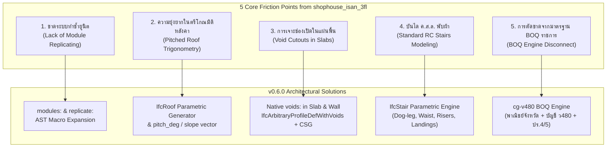
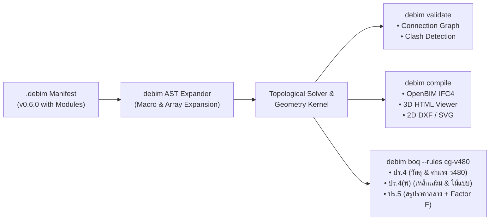
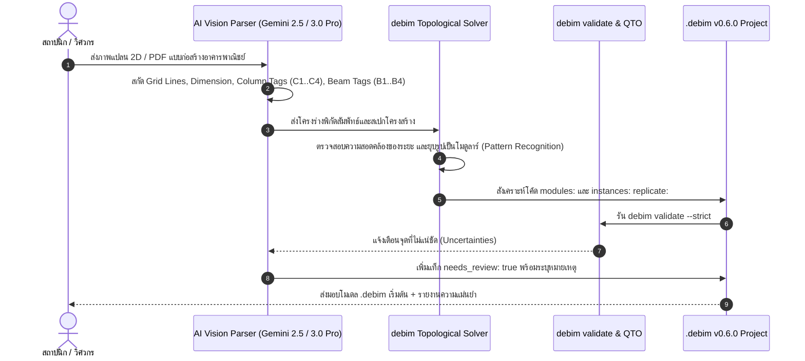

# 🚀 debim v0.6.0 Architecture Specification & Strategic Roadmap
## "The Shophouse & Infrastructure Release" — Declarative Modularity, Parametric Envelopes, and Thai Government Public Works BOQ (ว480)

> **Document Version:** 1.0.0  
> **Target debim Release:** v0.6.0  
> **Status:** Approved Engineering Blueprint  
> **Author:** debim Systems Architecture Team  
> **Context:** Post-Evaluation of Real-World Model `shophouse_isan_3fl.debim` (4-Bay 3-Storey Vernacular Shophouse, 371 BIM Elements)

---

## 📑 สารบัญ (Table of Contents)
1. [บทนำและผลการทดสอบเชิงประจักษ์ (Empirical Evaluation & Deliverables Overview)](#1-บทนำและผลการทดสอบเชิงประจักษ์)
2. [การวิเคราะห์ปัญหาและคอขวดเชิงระบบ (Root-Cause Analysis of 5 Major Friction Points)](#2-การวิเคราะห์ปัญหาและคอขวดเชิงระบบ)
3. [ข้อกำหนดไวยากรณ์ใหม่ v0.6.0 (DSL Schema Specifications)](#3-ข้อกำหนดไวยากรณ์ใหม่-v060-dsl-schema-specifications)
   - 3.1 [โมดูลาร์และการทำซ้ำยูนิต (Modular Definition & Replicate Array)](#31-โมดูลาร์และการทำซ้ำยูนิต-modules--replicate)
   - 3.2 [ระบบหลังคาพารามิเตอร์และตรีโกณมิติระนาบเอียง (Parametric Roof & Slope Vectors)](#32-ระบบหลังคาพารามิเตอร์และตรีโกณมิติระนาบเอียง-ifcroof--pitch_deg)
   - 3.3 [การเจาะช่องเปิดในพื้นและผนัง (Native Polygon Voids & Openings)](#33-การเจาะช่องเปิดในพื้นและผนัง-voids--openings)
   - 3.4 [บันได ค.ส.ล. แบบพับผ้าและชานพัก (Parametric Monolithic RC Stairs)](#34-บันได-คสล-แบบพับผ้าและชานพัก-ifcstair)
   - 3.5 [เอนจินถอดแบบและประมาณราคามาตรฐานราชการไทย (Thai CGD ว480 & Commercial Ministry BOQ)](#35-เอนจินถอดแบบและประมาณราคามาตรฐานราชการไทย-cg-v480-boq)
4. [สถาปัตยกรรมระบบและคำสั่ง CLI ใหม่ (CLI Ecosystem & Compiler Upgrades)](#4-สถาปัตยกรรมระบบและคำสั่ง-cli-ใหม่)
5. [ท่อประมวลผล AI Agent & Computer Vision (Vision-to-debim Parser Architecture)](#5-ท่อประมวลผล-ai-agent--computer-vision)
6. [แผนการดำเนินงานและการแบ่งภารกิจ (Execution Waves & Jules Work Breakdown)](#6-แผนการดำเนินงานและการแบ่งภารกิจ-waves-1---4)

---

## 1. บทนำและผลการทดสอบเชิงประจักษ์

ในการทดสอบนำร่องการสร้างแบบจำลองข้อมูลอาคาร (BIM) จากเอกสาร 2D CAD/PDF อาคารพาณิชย์ 3 ชั้น 4 คูหา สถาปัตยกรรมพื้นถิ่นอีสานประยุกต์ ด้วยเครื่องมือ **debim v0.5.0** ได้ผลลัพธ์โมเดล `shophouse_isan_3fl.debim` ซึ่งประกอบด้วย:
- **องค์ประกอบ BIM ทั้งสิ้น 371 Elements:** รองรับโครงสร้างครบวงจร ได้แก่ ฐานราก (25 จุด), เสา ค.ส.ล. C1–C4 (100 ต้น), คาน ค.ส.ล. (156 ช่วงคาน), แผ่นพื้นตามคูหา, ผนังแบ่งคูหา (Party Walls), บันได ค.ส.ล., โครงหลังคาเหล็กรูปพรรณ (Rafters, Purlins, Ridge Beams) และสถาปัตยกรรมพื้นถิ่นอีสาน (หน้าบันจั่วลวดลายฉลุ, บัวปูนปั้น, เชิงชาย GRC)
- **ระบบพิกัดและระดับชั้น:** 5 แนวแกนเสาหลัก (ช่วงละ 4.00 ม. กว้างรวม 16.00 ม.) ลึก 14.75 ม. + ลานซักล้าง 3.10 ม., ระดับความสูง 5 ชั้น (+0.25 ม. ถึงสันจั่ว +14.00 ม.)
- **โมเดลจำลอง 3 มิติบนเว็บ (`shophouse_isan_3fl_viewer.html`):** คอมไพล์สู่ Three.js สามารถตัดระนาบชั้น (Cut plane) และเลือกดูเลเยอร์โครงสร้าง/สถาปัตยกรรมแบบ Offline ได้ 100%

อย่างไรก็ดี การสร้างโมเดลขนาด 371 ชิ้นส่วนด้วยไวยากรณ์ Explicit Itemization ของ debim v0.5.0 ทำให้ไฟล์เอกสารมีความยาวสูง เกิดภาระงานคำนวณตำแหน่ง 3D ซ้ำซ้อน และแสดงให้เห็นถึงช่องว่างระหว่างการสร้าง Geometry กับข้อกำหนดการถอดแบบก่อสร้างจริงในประเทศไทย

**เป้าหมายของ debim v0.6.0:** เปลี่ยนผ่านจากระบบระบุชิ้นส่วนทีละชิ้น (Imperative-like Declarative) สู่ **ระบบการสร้างอาคารเชิงนามธรรมระดับสูง (High-Level Declarative Architecture)** ที่สามารถลดขนาดบรรทัดโค้ดลงได้มากกว่า 70% พร้อมทั้งเชื่อมโยงเข้ากับมาตรฐานราคาและกฎหมายการก่อสร้างไทยโดยอัตโนมัติ

---

## 2. การวิเคราะห์ปัญหาและคอขวดเชิงระบบ (Root-Cause Analysis of 5 Major Friction Points)



| ลำดับ | จุดติดขัดที่พบในการทดสอบ (v0.5.0) | สาเหตุรากเหง้าเชิงวิศวกรรม (Root Cause) | แนวทางแก้ไขใน v0.6.0 |
|---|---|---|---|
| **1** | **ขาดระบบทำซ้ำยูนิต (Module Replicating):** ต้องก็อปปี้โค้ดเสา คาน พื้น ผนัง ซ้ำกัน 4 คูหา ทำให้ไฟล์บวมกว่า 3,000 บรรทัด และเสี่ยงต่อข้อผิดพลาดพิกัดกริด | ระบบ AST ปัจจุบันประมวลผลแบบ Flat List ขาดไวยากรณ์ Sub-Assembly Template และ Macro Instantiation | เพิ่มบล็อก `modules:` และคำสั่ง `replicate:` พร้อมระบบแทนที่พิกัดกริดและการ Mirror |
| **2** | **ความยุ่งยากในระนาบเอียงหลังคา (Roof Trigonometry):** ต้องคำนวณมุม Euler `[rx, ry, rz]`, หาจุดกึ่งกลาง และความยาวคอร์ดจันทัน 32.5° ด้วยตนเอง | debim เน้น Relative Grid บนระนาบ Orthogonal ขาดสมการเวกเตอร์ 3D สำหรับชิ้นส่วนเอียง (Sloped Structural Framing) | เพิ่ม `IfcRoof` Generator ระดับสูง (`GABLE_HIP`, `HIP`, `GABLE`) และเพิ่มพารามิเตอร์ `pitch_deg` ในคาน/จันทัน |
| **3** | **การเจาะช่องเปิดในแผ่นพื้น (Void Cutouts):** โถงบันไดและโถงสูงสองชั้น (Double-Volume) ต้องซอยแผ่นพื้นออกเป็น 4 ชิ้นย่อยล้อมรอบ | ตัวคอมไพเลอร์และ Three.js Viewer รองรับเฉพาะ Outer Polygon Boundary ยังไม่เชื่อม `voids` ใน Extrusion Profile | ยกระดับ `SlabPlacement` ให้รองรับ `voids: [[pt...]]` แบบ 1st-Class และใช้ `IfcArbitraryProfileDefWithVoids` |
| **4** | **บันได ค.ส.ล. พับผ้า (RC Stairs):** มีเพียงบันไดเวียน (Spiral Stair) ส่วนบันไดชานพักรูปตัวยู (Dog-Leg) ต้องต่อรูปทรงกล่องเองทีละชิ้น | ขาดโมเดลเรขาคณิตสำหรับเอวบันได (Waist Slab), ชานพัก (Landing), ลูกตั้ง (Riser) และลูกนอน (Tread) แบบ Monolithic | เพิ่ม `stair_type: DOG_LEG` ใน `IfcStair` พร้อมคำนวณขั้นและปริมาตรคอนกรีต/ไม้แบบอัตโนมัติ |
| **5** | **BOQ Disconnect (มาตรฐานราชการไทย):** ฟิลด์ `unit_cost_ref` ขาดสูตรคำนวณเหล็กเสริมตามปริมาตรคอนกรีต และการคิดพื้นที่ไม้แบบหักผิวสัมผัส | ระบบ QTO ดึงเฉพาะ Gross Volume/Area ขาด Knowledge Base อัตราส่วนเหล็กต่อคอนกรีต (kg/m³) และตาราง ว480 | เพิ่มเอนจิน `cg-v480` ดึงฐานข้อมูลราคาพาณิชย์จังหวัด คำนวณเหล็ก/ไม้แบบ และสร้างรายงาน ปร.4/5 |

---

## 3. ข้อกำหนดไวยากรณ์ใหม่ v0.6.0 (DSL Schema Specifications)

### 3.1 โมดูลาร์และการทำซ้ำยูนิต (`modules:` & `replicate:`)

รองรับการประกาศ Blueprint ยูนิตต้นแบบ 1 คูหา แล้วนำมาวางซ้ำตามแนวกริด หรือระยะออฟเซต:

```yaml
version: "0.6.0"
project:
  name: "อาคารพาณิชย์ 3 ชั้น 4 คูหา สถาปัตยกรรมอีสานประยุกต์"

# 1. นิยามแม่แบบยูนิต (Module Template Definition)
modules:
  - id: "MOD_SHOPHOUSE_UNIT"
    name: "ยูนิตอาคารพาณิชย์มาตรฐาน กว้าง 4.00 ม."
    local_grids:
      axes_x: { "1": 0.0, "2": 4.0 }
      axes_y: { "A": 0.0, "B": 4.0, "C": 8.0, "D": 11.75, "E": 14.75 }
    elements:
      columns:
        - tag: "C1"
          grid: ["1", "A"]
          profile: { shape: "BOX", width: 0.20, depth: 0.20 }
          material: "concrete_c240"
        - tag: "C1"
          grid: ["2", "A"]
          profile: { shape: "BOX", width: 0.20, depth: 0.20 }
          material: "concrete_c240"
      beams:
        - tag: "B1"
          from: ["1", "A"]
          to: ["2", "A"]
          profile: { shape: "BOX", width: 0.20, depth: 0.40 }
          material: "concrete_c240"
      slabs:
        - tag: "S1"
          boundary: [["1", "A"], ["2", "A"], ["2", "C"], ["1", "C"]]
          thickness: 0.12
          material: "concrete_c240"

# 2. การสร้างอินสแตนซ์และการทำซ้ำ (Instantiation & Replication)
instances:
  - replicate:
      module: "MOD_SHOPHOUSE_UNIT"
      count: 4
      along: "grid_x"               # เลื่อนตามแนวแกนกริด X
      grid_x_mapping:               # จับคู่แกนกริดยูนิตเข้ากับกริดอาคารรวม
        - unit_1: { "1": "1", "2": "2" }
        - unit_2: { "1": "2", "2": "3" }
        - unit_3: { "1": "3", "2": "4" }
        - unit_4: { "1": "4", "2": "5" }
      prefix_pattern: "U{index}_"   # ผลลัพธ์: U1_C1, U2_C1, U3_C1, U4_C1
      party_wall_deduplication: true # รวมผนังร่วมระหว่างคูหาอัตโนมัติ
```

---

### 3.2 ระบบหลังคาพารามิเตอร์และตรีโกณมิติระนาบเอียง (`IfcRoof` & `pitch_deg`)

ลดภาระการคำนวณคณิตศาสตร์ 3D ของ AI Agent ด้วยตัวสร้างโครงหลังคาอัตโนมัติ:

```yaml
elements:
  roofs:
    - tag: "ROOF_MAIN"
      class: "IfcRoof"
      roof_type: "GABLE_HIP"         # ทรงไทยประยุกต์ / มะนิลา (ปั้นหยาตัดจั่ว)
      boundary: [["1", "A"], ["5", "A"], ["5", "E"], ["1", "E"]]
      base_storey: "ROOF_LEVEL"
      elevation: 11.25
      pitch_deg: 32.5               # ความชันหลังคา 32.5 องศา
      overhang: 1.00                # ชายคายื่น 1.00 ม. รอบด้าน
      gable_config:
        facade_gable: true          # หน้าบันจั่วด้านหน้าอาคาร (แนวกริด A)
        gable_offset_y: 2.00        # ระยะร่นจั่วจากสันปั้นหยา
        louver_pattern: "ISAN_WOOD_CARVED" # ลายฉลุไม้โปร่งระบายอากาศพื้นถิ่น
      framing:
        rafter_spacing: 1.00        # ระยะจันทัน @ 1.00 ม.
        purlin_spacing: 0.35        # ระยะแป @ 0.35 ม. รองรับกระเบื้องลอนคู่/ซีแพค
        material: "steel_ss400"
        ridge_profile: { shape: "BOX", width: 0.10, depth: 0.15 }
        rafter_profile: { shape: "BOX", width: 0.05, depth: 0.15 }
        purlin_profile: { shape: "BOX", width: 0.05, depth: 0.05 }
      covering:
        material: "concrete_tiles_cpac_prestige"
        fascia_board:
          material: "fiber_cement_grc"
          width: 0.20
          thickness: 0.02
```

สำหรับชิ้นส่วนเดี่ยวที่ต้องการกำหนดมุมเอียงโดยตรง สามารถระบุ `pitch_deg` หรือ `end_elevation` ได้ทันที:
```yaml
members:
  - tag: "RAFTER_CORNER"
    start: { grid: ["1", "A"], elevation: 11.25 }
    end: { grid: ["2", "B"], elevation: 14.00 }   # ตัวคอมไพเลอร์คำนวณ Vector 3D อัตโนมัติ
    profile: { shape: "BOX", width: 0.05, depth: 0.15 }
    material: "steel_ss400"
```

---

### 3.3 การเจาะช่องเปิดในพื้นและผนัง (`voids:` & `openings:`)

แก้ปัญหาโถงเปิดโล่งสองชั้น (Double-Volume Void) และช่องท่อดักท์ MEP / โถงบันได:

```yaml
slabs:
  - tag: "S_MEZZANINE_U1"
    class: "IfcSlab"
    storey: "MEZZANINE"
    boundary: [["1", "A"], ["2", "A"], ["2", "E"], ["1", "E"]]
    thickness: 0.12
    material: "concrete_c240"
    voids:
      - tag: "VOID_DOUBLE_VOLUME"
        description: "โถงสูงมองเห็นชั้นล่างช่วงกริด ข-ค"
        boundary: [["1", "B"], ["2", "B"], ["2", "C"], ["1", "C"]]
      - tag: "VOID_STAIR"
        description: "ช่องเจาะบันได ค.ส.ล."
        boundary_offset:
          reference_grid: ["1", "D"]
          dimensions: [1.20, 3.20]  # กว้าง 1.20 ม. ยาว 3.20 ม.
```

**ผลลัพธ์ในระบบ:**
- **Three.js Viewer:** เจาะช่องผ่าน `THREE.Shape.holes.push(holePath)` โดยไม่ต้องใช้ CSG หนักเครื่อง
- **IFC Compiler:** คอมไพล์เป็น `IfcArbitraryProfileDefWithVoids` สำหรับ Extrusion Profile สากล
- **QTO Engine:** หักลบพื้นที่และปริมาตรคอนกรีตออกอย่างแม่นยำ $V_{net} = (A_{outer} - \sum A_{void}) \times t$

---

### 3.4 บันได ค.ส.ล. แบบพับผ้าและชานพัก (`IfcStair`)

รองรับบันได ค.ส.ล. อาคารพาณิชย์มาตรฐาน (Dog-Leg / U-Turn with Landing):

```yaml
stairs:
  - tag: "STAIR_L1_TO_MEZZ"
    class: "IfcStair"
    stair_type: "DOG_LEG"           # DOG_LEG (U-Turn พับผ้า), STRAIGHT, L_SHAPE
    from_storey: "LEVEL_1"          # +0.25 ม.
    to_storey: "MEZZANINE"          # +2.75 ม. (ระยะยกสูงรวม 2.50 ม.)
    placement:
      start_grid: ["1", "D"]
      direction: "+Y"
      width: 1.10                   # ความกว้างช่วงบันได
    parameters:
      riser_height: 0.178           # ลูกตั้งไม่เกิน 18 ซม. (ตรงตามกฎกระทรวงฯ)
      tread_depth: 0.250            # ลูกนอน 25 ซม.
      waist_thickness: 0.12         # ความหนาเอวบันได 12 ซม.
      landing_depth: 1.10           # ชานพักลึก 1.10 ม.
      finish: "polished_terrazzo"   # ผิวขัดหินขัด / กรุกระเบื้อง
    structural_components:
      landing_beam_ref: "B_LANDING" # ฝากน้ำหนักเข้าคานชานพัก
    railing:
      material: "stainless_steel_sus304"
      height: 0.90
```

---

### 3.5 เอนจินถอดแบบและประมาณราคามาตรฐานราชการไทย (`cg-v480` BOQ)

เชื่อมโยงสูตรการคิดปริมาณงานจริงตามหลักเกณฑ์การคำนวณราคากลางงานก่อสร้างของราชการ (คณะกรรมการราคากลางและขึ้นทะเบียนผู้ประกอบการ / กรมบัญชีกลาง ว480):

```yaml
standards:
  qto_rules: "TH_CGD_V480"
  province: "nakhon_ratchasima"     # ใช้อิงดัชนีราคาวัสดุก่อสร้างพาณิชย์จังหวัด
  vat_percentage: 7.0
  factor_f:
    overhead_profit_tax: 1.2726     # Factor F ตามตาราง ว480 (เงินล่วงหน้า 0%, เงินประกัน 0%, ดอกเบี้ย 6%)

qto_density_rules:
  # อัตราส่วนเหล็กเสริมเฉลี่ยต่องานคอนกรีต 1 ลบ.ม. (วสท. / กรมโยธาธิการฯ)
  reinforcement_ratios:
    footing: { db12_16: 95.0, rb9: 15.0 }       # กก./ลบ.ม.
    columns: { db16_20: 135.0, rb6_rb9: 25.0 }  # กก./ลบ.ม.
    beams:   { db12_20: 110.0, rb6_rb9: 20.0 }  # กก./ลบ.ม.
    slabs:   { wiremesh_6mm: 3.5 }               # กก./ตร.ม.
    stairs:  { db12: 85.0, rb9: 25.0 }          # กก./ลบ.ม.
  
  # กฎการคำนวณไม้แบบและค้ำยัน (Formwork Contact Area)
  formwork_deductions:
    beam_column_junctions: true      # หักผิวสัมผัสรอยต่อคาน-เสา
    slab_beam_intersections: true    # ท้องคานและข้างคานคิดตามผิวสัมผัสจริง
```

---

## 4. สถาปัตยกรรมระบบและคำสั่ง CLI ใหม่



### คำสั่ง CLI ประจำเวอร์ชัน 0.6.0:

1. **`debim validate --strict`**
   - ตรวจสอบความถูกต้องของ Schema Pydantic v2
   - ตรวจสอบความต่อเนื่องของโครงสร้าง (Structural Continuity): แจ้งเตือนเสาลอย (Floating Columns), คานไร้ที่รองรับ, หรือฐานรากที่ไม่มีเสาถ่ายน้ำหนักลง
   - ตรวจจับจุดปะทะเบื้องต้น (AABB Clash Detection) ระหว่างแนวท่อ MEP กับคานโครงสร้าง

2. **`debim compile --target ifc4,gltf,html`**
   - คอมไพล์โมดูลและอินสแตนซ์ออกเป็นไฟล์มาตรฐาน IFC4 (ISO 16739-1:2018)
   - สร้างไฟล์ 3D Interactive HTML พร้อม UI สลับโหมดโครงสร้าง/สถาปัตย์ ตัดระนาบชั้น และแสดงตาราง Property

3. **`debim boq --rules cg-v480 --province <province_name> --out boq.xlsx`**
   - เชื่อมต่อ API/ฐานข้อมูลราคาพาณิชย์จังหวัดของกระทรวงพาณิชย์โดยอัตโนมัติ
   - คำนวณปริมาณงานคอนกรีต, พื้นที่ไม้แบบ (หักผิวสัมผัส), น้ำหนักเหล็กเสริม RB/DB, ปูนฉาบ, สี, และกระเบื้อง
   - สร้างสเปรดชีต Excel มาตรฐานราชการ: **ปร.4, ปร.4(พ), และ ปร.5** พร้อมคำนวณ Factor F และภาษีมูลค่าเพิ่ม 7% ทันที

---

## 5. ท่อประมวลผล AI Agent & Computer Vision (Vision-to-debim Parser Architecture)

เพื่อปลดล็อกการสร้างแบบโมเดลอัตโนมัติจาก Drawing 2D (CAD / Scanned PDF):



---

## 6. แผนการดำเนินงานและการแบ่งภารกิจ (Execution Waves 1 - 4)

### 🌊 Wave 1: Schema & Module Macro Expansion (Core DSL)
- [x] **Task 1.1:** นิยาม Pydantic Model สำหรับ `modules`, `instances`, และ `replicate` ใน `src/debim/schema.py`
- [x] **Task 1.2:** พัฒนา AST Preprocessor ใน `src/debim/loader.py` เพื่อคลายตัวแปร (Macro Expansion) ก่อนส่งต่อให้ Geometry Engine
- [x] **Task 1.3:** เขียน Unit Test ทดสอบการทำซ้ำ 4 คูหาจาก Blueprint เดียว เทียบกับไฟล์ Flat List เดิม

### 🌊 Wave 2: Geometry & Parametric Generators (Envelopes & Voids)
- [x] **Task 2.1:** พัฒนาตัวสร้างทรงหลังคา `IfcRoof` (GABLE, HIP, GABLE_HIP) พร้อมระบบคำนวณจันทันและแปอัตโนมัติใน `src/debim/compiler.py`
- [x] **Task 2.2:** ยกระดับ `SlabPlacement` ให้รองรับ `voids` ใน Three.js Viewer (Path Holes) และ IFC (`IfcArbitraryProfileDefWithVoids`)
- [x] **Task 2.3:** พัฒนาตัวขึ้นรูปบันได ค.ส.ล. แบบพับผ้า `IfcStair` (ลูกตั้ง, ลูกนอน, เอวบันได, ชานพัก)

### 🌊 Wave 3: Thai Public Works BOQ Engine (`cg-v480`)
- [x] **Task 3.1:** ผนวกตารางความหนาแน่นเหล็กเสริมตามปริมาตรคอนกรีตมาตรฐานราชการไทยใน `src/debim/qto.py`
- [x] **Task 3.2:** พัฒนาสูตรคำนวณพื้นที่ไม้แบบหักรอยต่อ (Contact Surface Deductions)
- [x] **Task 3.3:** พัฒนา Export Template สำหรับตาราง ปร.4, ปร.4(พ), และ ปร.5 ใน `src/debim/cost.py`

### 🌊 Wave 4: AI Agent Tools & Visual Validation
- [ ] **Task 4.1:** พัฒนา CLI `debim validate` เพื่อตรวจจับจุดต่อโครงสร้างและ Clash Detection
- [ ] **Task 4.2:** สร้างแบบทดสอบย้อนกลับ (Regression Verification) โดยนำโมเดล `shophouse_isan_3fl.debim` มาเขียนใหม่ด้วยไวยากรณ์ v0.6.0 และวัดผลการลดทอนจำนวนบรรทัดโค้ด (เป้าหมาย: ลดลง $\ge 65\%$)
- [ ] **Task 4.3:** จัดทำเอกสารคู่มือและ MCP Tool Definition สำหรับ Claude / Gemini Agents ในการเรียกใช้งาน `debim` v0.6.0

---
*เอกสารนี้จัดทำขึ้นเพื่อใช้เป็นพิมพ์เขียวหลักในการขับเคลื่อน debim v0.6.0 สู่งานวิจัยเชิงระบบและมาตรฐาน OpenBIM เชิงประกาศระดับสากล*
