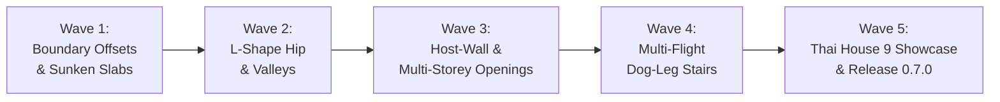

# 🗺️ debim v0.7.0 Master Roadmap & Technical Specification
## "The Contemporary Thai House Release" — Local Grid Offsets, Multi-Eaves Hip Roofs & Host-Wall Openings

> **Target Version:** `debim v0.7.0`  
> **Status:** `IN PROGRESS`  
> **Target Benchmark:** บ้านร่วมสมัย ๙ (Contemporary Thai House - 168 BIM Elements)  
> **Jules AI Budget:** 5 Focused Waves (Conserving daily task quota)

---

## 1. Architectural Highlights

### 1.1 Local Grid Expressions & Boundary Offsets (Pillar 1)
- Eliminates auxiliary dummy grids (`W-CANT`, `E-CANT`, `1-MID`, `STAIR-WALL`).
- Support string expressions with arithmetic: `["1 - 0.60", "B + 1.20"]` inside `boundary:` and `voids:`.
- Add `elevation_offset` (e.g. `-0.10` for sunken bathroom slabs).

### 1.2 L-Shape & Multi-Level Hip Roof Engine (Pillar 2)
- Solves 3D polygon bisectors for non-convex L-shaped and T-shaped roof boundaries.
- Automatically generates hips (สันตะเข้) and valleys (ตะเข้ราง) at 3D intersections.
- Supports split eaves heights (e.g. porch +6.65m, main roof +7.45m).

### 1.3 Multi-Storey Openings & Host-Wall Auto-Punching (Pillar 3)
- Tall stairwell windows (W5 1.40x2.90m) bridging across Storey 1 and Storey 2.
- Parent-child semantic relationship via `host_wall: TAG` with local offset coordinates.
- Automatic CSG Boolean cutouts in walls without manual coordination.

### 1.4 Multi-Flight Dog-Leg Stairs Scheduling (Pillar 4)
- Exact flight riser distribution: `flight_steps: [11, 6]` with `landing_elevation: 2.70`.
- Continuous monolithic RC waist and landing geometry for exact QTO.

### 1.5 Official Showcase & Verification (Pillar 5)
- Adds `examples/contemporary_thai_house/project.debim` (168 elements).
- End-to-end regression tests verifying QTO, Thai CGD ว480 BOQ, and 3D visualization.

---

## 2. Jules AI Workload Breakdown (5 Chained Waves)

### [x] Wave 1: Local Grid Expressions & Arithmetic Offsets in Boundary Coordinates (COMPLETED)
- **Target:** `src/debim/resolver.py`, `src/debim/schema.py`
- **Goal:** Allow arithmetic expressions `["1 - 0.60", "B + 0.40"]` in `IfcSlab.boundary` and `voids:`. Add `elevation_offset`.
- **Test:** `tests/test_boundary_offsets.py` (4/4 tests passed)
- **Status:** Merged via PR #443 (Resolves #442)

### [x] Wave 2: L-Shape Composite Hip Roof with Valley/Hip 3D Intersection Solver (COMPLETED)
- **Target:** `src/debim/roof.py`, `src/debim/compiler.py`
- **Goal:** Procedural 3D roof generation for L-shaped and multi-level eaves boundaries.
- **Test:** `tests/test_roof_l_shape.py` (3/3 tests passed)
- **Status:** Merged via PR #445 (Resolves #444)

### [x] Wave 3: Host-Wall Auto-Punching and Multi-Storey Window Placement (COMPLETED)
- **Target:** `src/debim/resolver.py`, `src/debim/compiler.py`
- **Goal:** Add `host_wall: TAG` and `span_storeys` for tall stairwell windows.
- **Test:** `tests/test_host_openings.py` (4/4 tests passed)
- **Status:** Merged via PR #447 (Resolves #446)

### [x] Wave 4: Multi-Flight Dog-Leg Stair Scheduling and Landing Elevation (COMPLETED)
- **Target:** `src/debim/schema.py`, `src/debim/resolver.py`, `src/debim/qto.py`
- **Goal:** Support `flight_steps: [11, 6]` and `landing_elevation: 2.70` for split U-shaped RC stairs.
- **Test:** `tests/test_stair_multiflight.py` (5/5 tests passed)
- **Status:** Merged via PR #449 (Resolves #448)

### [x] Wave 5: Documentation, Skills Update, AI Agent Context & v0.7.0 Release (COMPLETED)
- **Target:** `SKILL.md`, `llms.txt`, `README.md`, `pyproject.toml`, `version.py`
- **Goal:** Update all agent skills and LLM documentation with v0.7.0 declarative schemas, boundary arithmetic, host-wall openings, multi-level composite hip roofs, and multi-flight stairs.
- **Status:** Completed & Ready for Release Tag `v0.7.0`.
