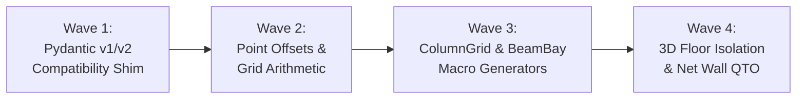

# 🗺️ debim v0.8.0 Master Roadmap & Technical Specification
## "The Engineering Productivity & High-Fidelity Visualization Release"

> **Target Version:** `debim v0.8.0`  
> **Status:** `IN PROGRESS`  
> **Target Benchmark:** บ้านครอบครัวไทยเป็นสุข ๘ (Baan Thai Family 8 - 214 BIM Elements)  
> **Execution Strategy:** 4 Chained Waves executed via Jules AI + Automated Watchdog Orchestrator

---

## 1. Architectural Highlights & Objectives

### 1.1 Pydantic v1 / v2 Dual Compatibility Layer (Pillar 1)
- Allow debim to run seamlessly inside restricted environments, older Google Colab instances, and Linux distributions with Pydantic 1.x without raising `ImportError: cannot import name 'RootModel'`.
- Implement `src/debim/compat.py` with unified fallback shims for `model_validator`, `field_validator`, and `RootModel`.

### 1.2 Local Point Offsets & Grid Arithmetic on Structural Elements (Pillar 2)
- Support `offset_x` and `offset_y` directly in `ColumnPlacement`, `FootingPlacement`, and `WallPlacement`.
- Support string arithmetic coordinates (e.g. `grid: ["3 + 1.00", "ข - 0.50"]`, `from_grid: ["1 - 0.20", "A"]`) across all single-point and linear elements without forcing users to register auxiliary dummy grids.

### 1.3 Structural Framing Array Macros (Pillar 3)
- Eliminate tedious manual definitions of 50+ columns and 70+ beams.
- Introduce `ColumnGrid` and `BeamBay` / `BeamGrid` macro expansions under `macro_elements:` in schema.
- Expand a 2D grid matrix into distinct `IfcColumn` and `IfcBeam` entities with customizable profiles, heights, and exclusion points (`except_points:`).

### 1.4 Smart Floor Isolation in 3D Viewer & Net Wall QTO Deductions (Pillar 4)
- **Smart 3D Storey Isolation:** Add interactive UI buttons in Three.js viewer (`[All Storeys]`, `[FL1 - Ground]`, `[FL2 - Second]`, `[Roof]`) to toggle visibility and inspect interior structural framing without slab obstruction.
- **Net Wall Area Deductions:** Subtract `host_wall` door and window openings from masonry wall surface areas in QTO and Thai CGD ว480 BOQ calculations.

---

## 2. Jules AI Workload Breakdown (4 Chained Waves)

### [ ] Wave 1: Pydantic v1 and v2 Dual-Compatibility Shim for Air-Gapped Sandboxes
- **Target:** `src/debim/compat.py`, `src/debim/schema.py`, `src/debim/modular.py`
- **Goal:** Create unified shim importing Pydantic v2 classes when available, falling back gracefully to v1 equivalents (`validator`, `root_validator`, `BaseModel`) so code runs on both Pydantic v1.10+ and v2+.
- **Test:** `tests/test_compat_pydantic.py`

### [ ] Wave 2: Local Point Offsets and Grid Arithmetic on Columns, Footings, and Walls
- **Target:** `src/debim/schema.py`, `src/debim/resolver.py`
- **Goal:** Support `offset_x`, `offset_y` in `ColumnPlacement`, `FootingPlacement`, and `WallPlacement`, and evaluate arithmetic string coordinates (`grid: ["3 + 1.00", "ข - 0.50"]`).
- **Test:** `tests/test_point_offsets.py`

### [ ] Wave 3: Structural Framing Array Macros (ColumnGrid & BeamBay Generator)
- **Target:** `src/debim/schema.py`, `src/debim/loader.py`, `src/debim/modular.py`
- **Goal:** Add `macro_elements:` supporting `ColumnGrid` and `BeamBay` to batch-generate columns and connecting beams across 2D grid intersections with exception filters.
- **Test:** `tests/test_framing_macros.py`

### [ ] Wave 4: 3D Smart Floor Isolation Toggle and Net Wall Opening Deduction in QTO
- **Target:** `src/debim/viewer.py`, `src/debim/qto.py`
- **Goal:** Add storey isolation UI controls in Three.js viewer HTML, and deduct `host_wall` window/door opening areas from gross wall surface areas in QTO.
- **Test:** `tests/test_viewer_and_net_qto.py`
