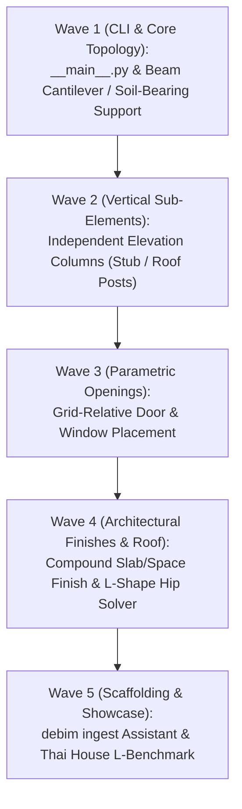

# 🗺️ debim v0.8.1 Master Roadmap & Technical Specification
## "The Real-World Thai Engineering Fidelity & Practical Construction Modeling Release"
### การยกระดับความสมจริงทางวิศวกรรมไทยและการปลดล็อกข้อจำกัดทางเรขาคณิตหน้างานจริง

> **Target Version:** `debim v0.8.1`  
> **Status:** `COMPLETED`  
> **Target Benchmark:** บ้านพักอาศัย ค.ส.ล. 2 ชั้นร่วมสมัย ผังตัว L (Contemporary L-Shaped Thai Residence — 220+ BIM Elements)  
> **Execution Strategy:** 5 Chained Waves through Jules AI / Automated Watchdog Orchestrator  
> **Primary Philosophy:** Deterministic, Non-hallucinatory, Thai Engineering Compliance (ว480 กรมบัญชีกลาง), Git-native Building-as-Code

---

## สารบัญ (Table of Contents)
1. [บทนำและวิสัยทัศน์ (Executive Summary)](#1-บทนำและวิสัยทัศน์-executive-summary)
2. [ภาคที่ 1: การวิเคราะห์ปัญหาและจุดติดขัดจากการใช้งานจริง (Friction & Pain Points Analysis)](#ภาคที่-1-การวิเคราะห์ปัญหาและจุดติดขัดจากการใช้งานจริง-friction--pain-points-analysis)
3. [ภาคที่ 2: สถาปัตยกรรมและข้อกำหนดทางเทคนิคฟีเจอร์ใหม่ (Technical Specification & Architecture)](#ภาคที่-2-สถาปัตยกรรมและข้อกำหนดทางเทคนิคฟีเจอร์ใหม่-technical-specification--architecture)
4. [ภาคที่ 3: แผนงานการพัฒนาและแบ่งงวดงาน (Multi-Wave Workload Breakdown)](#ภาคที่-3-แผนงานการพัฒนาและแบ่งงวดงาน-multi-wave-workload-breakdown)
5. [ภาคที่ 4: แผนการทดสอบและการตรวจสอบความถูกต้อง (Testing & Benchmark Plan)](#ภาคที่-4-แผนการทดสอบและการตรวจสอบความถูกต้อง-testing--benchmark-plan)
6. [ภาคที่ 5: บทสรุปความประทับใจและผลกระทบเชิงกลยุทธ์ (Strategic Impact & Conclusion)](#ภาคที่-5-บทสรุปความประทับใจและผลกระทบเชิงกลยุทธ์-strategic-impact--conclusion)

---

## 1. บทนำและวิสัยทัศน์ (Executive Summary)

`debim` ได้พิสูจน์จุดแข็งที่เหนือชั้นในฐานะ Declarative BIM Engine ที่แม่นยำระดับ Deterministic ไม่มีการสุ่มเดาตัวเลข (Zero Hallucination), คำนวณปริมาณงาน QTO และจัดทำ BOQ ตามเกณฑ์การคำนวณราคากลางงานก่อสร้างภาครัฐของไทย (ว480 กรมบัญชีกลาง) ได้อย่างเบ็ดเสร็จ พร้อมคอมไพล์เป็นโมเดล OpenBIM IFC4 และสร้าง 3D Interactive Web Viewer (Three.js) ได้ในตัว

อย่างไรก็ดี จากการทดสอบใช้งานจริงกับแบบวิศวกรรมและสถาปัตยกรรมบ้านพักอาศัยของไทย พบว่าระบบยังมี **Topological Constraints ที่เข้มงวดเกินไป** และยังขาด **ความยืดหยุ่นของโครงสร้างระดับ Parametric** ในบางมิติ ส่งผลให้ผู้ใช้ต้องสร้างองค์ประกอบจำลอง (Dummy Elements) หรือตัดทอนรายละเอียดของแบบลง

เวอร์ชัน **v0.8.1** จึงถูกออกแบบมาเป็น **"The Real-World Thai Engineering Fidelity Release"** เพื่อแก้ไขจุดติดขัด (Friction Points) ทั้ง 6 ประการหลัก และเสริม 1 ฟีเจอร์ตัวเร่งการทำงาน (Scaffolding Assistant) ให้ debim สะท้อนแบบก่อสร้างจริงได้ 100% โดยที่โครงสร้างโค้ดยังคงความสง่างาม สะอาด และ Deterministic เสมอ

---

## ภาคที่ 1: การวิเคราะห์ปัญหาและจุดติดขัดจากการใช้งานจริง (Friction & Pain Points Analysis)

### 1.1 ความเข้มงวดของ Topological Validation กับ "คานยื่น" และ "คานวางบนดิน"
* **บริบททางวิศวกรรม:** ในงานวิศวกรรมโครงสร้างไทย คานคอดิน (Ground Beam: GB) รอบนอก เช่น คานรับทางเดินรอบบ้าน, คานขอบพื้นซักล้าง, หรือคานคอดินที่ยื่นออกไปรับบันไดขึ้นเฉลียง จะมีปลายข้างหนึ่งวางบนดินบดอัดแน่น หรือฝากไว้กับฐานรากแผ่ขนาดเล็ก (SX / Footing) โดยไม่มีเสาหลัก (RC Column) รองรับที่ปลายสุด
* **พฤติกรรมเดิมของ debim:** เมื่อรันคำสั่ง `debim validate` ตัวตรวจสอบโครงข่ายใน `src/debim/compliance.py` จะตรวจสอบว่าปลายคานทั้งสองข้างต้องมีเสารองรับ หากพบปลายด้านใดด้านหนึ่งลอยอยู่จะพ่น Warning ทันที:
  ```text
  DANGLING_CANTILEVER: Beam 'GB-A4-B4' has dangling/unsupported endpoint at (9.00, 0.00, 0.00)
  ```
* **ผลกระทบ:** บีบให้ผู้ใช้ต้องตัดคานนั้นออกจากแบบ หรือต้องจำใจสร้างเสาหลอก (Dummy Column) เพื่อหลบ Validation Error ซึ่งขัดกับหลักการก่อสร้างจริงและทำให้แบบ QTO มีเสาเกินจริง

---

### 1.2 การจัดการเสาเสริมที่ไม่เต็มความสูงชั้น (Stub Columns / Landing Posts / Free-Height Columns)
* **บริบททางวิศวกรรม:** ในแบบสถาปัตย์และโครงสร้าง มีเสาเฉพาะกิจที่ความสูงไม่ได้อิงตามเส้นระดับชั้น (Storey Height) ได้แก่:
  1. **เสา CN (เสารับชานพักบันได):** เริ่มจากระดับพื้นดิน `+0.00` สูงขึ้นไปแค่ระดับชานพักบันได `+2.35` ม.
  2. **เสา CX (เสาดั้งหลังคา):** วางบนคานอะเสที่ระดับ `+7.45` ม. พุ่งขึ้นไปรับยอดอกไก่ที่ระดับ `+10.65` ม.
  3. **เสารั้ว หรือเสาเอ็น ค.ส.ล. ลอยตัว**
* **พฤติกรรมเดิมของ debim:** เอนทิตี `IfcColumn` ยึดโยงกับ `base_storey` และ `top_storey` เป็นแกนหลัก การสร้างเสาสั้นต้องอาศัยการขยับ `offset_base` / `offset_top` หรือจำเป็นต้องซอย Storey ย่อยใน `spatial_structure` ซึ่งทำให้โครงสร้างโมเดลบวมและจัดการยากเกินความจำเป็น

---

### 1.3 การวางตำแหน่งประตู-หน้าต่างผ่าน offset_distance ของผนัง (Relative-to-Grid Decoupling)
* **บริบททางวิศวกรรม:** ประตู (`IfcDoor`) และหน้าต่าง (`IfcWindow`) ในแบบสถาปัตยกรรมมักถูกกำหนดระยะอ้างอิงจากเส้นกริต (Grid Line) หรือศูนย์กลางเสา เช่น "หน้าต่าง W2 อยู่ห่างจาก Grid 3 ไป 1.20 ม."
* **พฤติกรรมเดิมของ debim:** ใน `modules/walls.yaml` ช่องเปิดถูกนิยามเป็น `children:` ของ `IfcWall` โดยกำหนดตำแหน่งผ่าน `offset_distance` วัดจากจุด Start Node ของผนังผืนนั้น
* **ผลกระทบ:** หากผนังยาวต่อเนื่องข้ามหลายกริต (เช่น ผนังจาก Grid 2 วิ่งไป Grid 4) ผู้ใช้ต้องคำนวณระยะสะสมด้วยตนเอง (Manual Offset Calculation) และหากมีการแก้ระยะกริตในภายหลัง ช่องเปิดจะไม่ขยับตามแนวศูนย์กลางกริตโดยอัตโนมัติ

---

### 1.4 ข้อจำกัดของหลังคาทรงปั้นหยาแบบผสม (L-Shaped Composite Hip Roof & Valley Gutters)
* **บริบททางสถาปัตยกรรม:** อาคารพักอาศัยทรงไทยประยุกต์และบ้านจัดสรรส่วนใหญ่มีผังพื้นเป็นรูปตัว L หรือตัว T โดยมีหลังคาปั้นหยาหลักคลุมตัวบ้าน และมีมุขหลังคาปั้นหยายื่นออกมาทางด้านหน้า เชื่อมโยงกันด้วยสันตะเข้ (Hip) และรางตะเข้ (Valley Gutter)
* **พฤติกรรมเดิมของ debim:** ฟังก์ชันคำนวณหลังคา (`src/debim/roof.py`) รองรับเฉพาะรูปทรงสี่เหลี่ยมผืนผ้าแบบ Convex Polygon นูน หากมีผังรูปตัว L ผู้ใช้ต้องแยกโมเดลเป็น 2 ชิ้น (`ROOF-MAIN` และ `ROOF-FRONT-PORCH`) เพื่อหลีกเลี่ยงไม่ให้ Hip solver สับสนกับความสูงของแนวสันอกไก่ (Ridge) ที่เหลื่อมระดับกัน

---

### 1.5 โครงสร้างพื้น ค.ส.ล. (Structural Slab) ปะปนกับผิววัสดุปูพื้น (Floor Finish)
* **บริบททางวิศวกรรมและการก่อสร้าง:** พื้นชั้น 2 ของบ้านพักอาศัย ค.ส.ล. ในทางโครงสร้างจะเทคอนกรีตเป็นผืนใหญ่ผืนเดียวต่อเนื่องข้ามคานหลายช่วง (Continuous Structural Slab) แต่ในทางสถาปัตยกรรม แต่ละห้องมีวัสดุปูพื้นไม่เหมือนกัน (เช่น ห้องนอนปูไม้ปาร์เก้, โถงปูกระเบื้อง 12", ห้องน้ำปูกระเบื้อง 8" พร้อมลดระดับ 10 ซม.)
* **พฤติกรรมเดิมของ debim:** ปัจจุบันต้องซอยแผ่นพื้น `IfcSlab` ออกเป็นชิ้นย่อย 10–20 ผืนตามแนวผนังห้อง เพื่อระบุ `elevation_offset` และ `material` แยกชิ้น
* **ผลกระทบ:** โมเดลโครงสร้างรกเกินจริง ไม่สะท้อนการทำงานของวิศวกรโครงสร้าง และทำให้การคำนวณแบบหล่อ/ปริมาตรคอนกรีตพื้นแตกกระจาย

---

### 1.6 แพ็กเกจขาด Entry Point `__main__.py`
* **บริบททางเทคนิค:** ในสภาพแวดล้อม CI/CD, Docker Container, หรือระบบปฏิบัติการที่มี Python Virtual Environment หลายชุด ผู้ใช้หรือระบบอัตโนมัติมักเรียกใช้ผ่านโมดูลมาตรฐาน:
  ```bash
  python -m debim --help
  ```
* **พฤติกรรมเดิมของ debim:** เกิดข้อผิดพลาด `No module named debim.__main__` เนื่องจากมีเฉพาะ Script Entry Point ใน `pyproject.toml` (`debim = "debim.cli:app"`) แต่ไม่มีไฟล์ `src/debim/__main__.py` ในแพ็กเกจ

---

## ภาคที่ 2: สถาปัตยกรรมและข้อกำหนดทางเทคนิคฟีเจอร์ใหม่ (Technical Specification & Architecture)

| # | ฟีเจอร์ที่พัฒนาใน v0.8.1 | รายละเอียดเชิงเทคนิค (Technical Details) | ประโยชน์และผลลัพธ์ (Benefits) |
|---|---|---|---|
| **1** | **Smart Cantilever & Soil-Bearing Beam Topology** | เพิ่มพารามิเตอร์ `support_type: SOIL_BEARING` หรือ `allow_cantilever: true` และ `cantilever_end: START \| END` ใน `IfcBeam` | ผ่านการตรวจสอบ Topology โดยไม่เกิด Error หลอกตา สะท้อนคานคอดินและคานยื่นจริง |
| **2** | **Independent Height & Elevation for Columns** | อนุญาตให้ `IfcColumn` ใช้ `base_elevation`, `top_elevation` หรือ `height` โดยไม่ต้องผูกมัดกับ `Storey` | รองรับเสาชานพัก (CN), เสาดั้งหลังคา (CX), เสารั้ว ได้อย่างอิสระและเป็นธรรมชาติ |
| **3** | **Grid-Relative Parametric Opening Placement** | รองรับการระบุตำแหน่งประตู/หน้าต่างแบบอิงกริตโดยตรง: `placement: { at_grid: "2 + 1.20", sill_height: 0.85 }` | ผนังเจาะช่องเปิดอัตโนมัติตามแนวพิกัด เมื่อระยะกริตเปลี่ยน ช่องเปิดจะเลื่อนตามทันที |
| **4** | **Decoupled Compound Slab & Room Space Finishes** | ให้ `IfcSlab` ทำหน้าที่เป็น Structural Slab ผืนใหญ่ ส่วนวัสดุปูพื้นและการลดระดับย้ายไปผูกกับ `IfcSpace` | โมเดลโครงสร้างคลีน ไม่ต้องตัดซอยแผ่นพื้น คำนวณ QTO ผิวพื้นและคอนกรีตได้ถูกต้อง |
| **5** | **Native L/T-Shaped Composite Hip & Valley Solver** | พัฒนา Geometry Solver ใน `src/debim/roof.py` ให้รับ Concave Polygon และคำนวณ Hips, Valleys, Ridges อัตโนมัติ | โมเดลหลังคาทรงไทยประยุกต์และบ้านที่มีมุขยื่นสร้างจบได้ในบล็อก `IfcRoof` เพียงชิ้นเดียว |
| **6** | **Package Entry Point `__main__.py`** | เพิ่มไฟล์ `src/debim/__main__.py` เรียกตรงไปยัง Typer CLI Runner | รองรับการรัน `python -m debim ...` ในทุก OS, Docker และ CI/CD Pipelines |
| **7** | **Scaffolding Ingestion Assistant (`debim ingest`)** | เพิ่ม CLI Tool สกัดข้อมูล Grid labels, ระยะมิติ, และ Text blocks จากแบบ PDF/DXF ออกมาเป็น `project.debim` โครงร่าง | ลดระยะเวลาการเขียนโค้ดตั้งต้น (Boilerplate) ลงได้มากกว่า 80% |

---

### รายละเอียดการออกแบบ Schema & ตัวอย่างการใช้งาน (Schema Specifications)

#### 1. Smart Cantilever & Soil-Bearing Beams
```yaml
# modules/ground_beams.yaml
- class: IfcBeam
  tag: GB-A4-B4
  material: CONCRETE_240KSC
  profile:
    shape: RECTANGLE
    width: 0.20
    depth: 0.40
  placement:
    from_grid: ["A", "4"]
    to_grid: ["B + 1.50", "4"]
    storey: FL1
    support_type: SOIL_BEARING      # บอก Topological Validator ว่าปลายคานวางบนดิน/ฐานรากแผ่
    allow_cantilever: true           # อนุญาตให้ปลายคานยื่นได้โดยไม่มีเสารองรับ
    cantilever_end: END              # ระบุข้างที่ยื่นออกไป
```

#### 2. Free-Height & Independent Elevation Columns
```yaml
# modules/columns.yaml
# เสารับชานพักบันได (Stub Column)
- class: IfcColumn
  tag: CN-STAIR-1
  material: CONCRETE_240KSC
  profile:
    shape: RECTANGLE
    width: 0.20
    depth: 0.20
  placement:
    grid: ["2 + 1.50", "B"]
    base_elevation: 0.00             # ระบุระดับฐานโดยตรง
    top_elevation: 2.35              # สิ้นสุดที่ชานพักบันได
    # หรือใช้ height: 2.35

# เสาดั้งรับโครงหลังคา (Roof Ridge Post)
- class: IfcColumn
  tag: CX-ROOF-1
  material: CONCRETE_240KSC
  profile:
    shape: RECTANGLE
    width: 0.15
    depth: 0.15
  placement:
    grid: ["3", "B"]
    base_elevation: 7.45             # วางบนหลังคานอะเสชั้น 2
    top_elevation: 10.65             # ชนยอดอกไก่
```

#### 3. Grid-Relative Placement for Doors and Windows
```yaml
# modules/walls.yaml
- class: IfcWall
  tag: WALL-FL1-EXT-01
  material: MASONRY_HOLLOW_BLOCK
  profile:
    thickness: 0.10
  placement:
    from_grid: ["1", "A"]
    to_grid: ["4", "A"]
    storey: FL1
  children:
    # วางหน้าต่างโดยอ้างอิงระยะจากเส้นกริตโดยตรง
    - class: IfcWindow
      tag: W-02
      dimensions:
        width: 1.40
        height: 1.20
      placement:
        at_grid: "2 + 1.20"          # อิงจาก Grid 2 ถัดไป 1.20 ม.
        sill_height: 0.85
```

#### 4. Decoupled Compound Slab & Room Space Finishes
```yaml
# modules/slabs.yaml (โครงสร้างแผ่นพื้นผืนใหญ่ผืนเดียว)
- class: IfcSlab
  tag: S2-RC-MAIN
  material: CONCRETE_240KSC
  thickness: 0.10
  slab_type: SOLID
  placement:
    storey: FL2
    boundary:
      - ["1", "A"]
      - ["4", "A"]
      - ["4", "C"]
      - ["1", "C"]

# modules/spaces.yaml (ผิววัสดุปูพื้นและการลดระดับตามการใช้งานจริง)
- class: IfcSpace
  tag: SPACE-BEDROOM-1
  storey: FL2
  boundary:
    - ["1", "A"]
    - ["2", "A"]
    - ["2", "B"]
    - ["1", "B"]
  finish:
    floor_material: WOOD_PARQUET
    floor_thickness: 0.02
    ceiling_material: GYPSUM_BOARD

- class: IfcSpace
  tag: SPACE-BATHROOM-2
  storey: FL2
  boundary:
    - ["2", "A"]
    - ["3", "A"]
    - ["3", "B"]
    - ["2", "B"]
  finish:
    floor_material: CERAMIC_TILE_8X8
    floor_thickness: 0.03
    drop_elevation: -0.10             # ระบุการลดระดับพื้นห้องน้ำ 10 ซม.
```

#### 5. Native L/T-Shaped Composite Hip Roof Solver
```yaml
# modules/roof.yaml
- class: IfcRoof
  tag: ROOF-COMPOSITE-L
  material: ROOF_CPAC_MONIER
  pitch_degrees: 30.0
  eaves_overhang: 1.00
  storey: ROOF
  boundary:
    # ขอบรูปตัว L แบบ Concave Polygon
    - ["1", "A"]
    - ["4", "A"]
    - ["4", "B"]
    - ["3", "B"]
    - ["3", "C"]
    - ["1", "C"]
  options:
    auto_valleys: true               # สร้างรางตะเข้ (Valley) ตรงรอยหักมุมในอัตโนมัติ
    auto_hips: true                  # สร้างสันตะเข้ (Hip) อัตโนมัติ
```

---

## ภาคที่ 3: แผนงานการพัฒนาและแบ่งงวดงาน (Multi-Wave Workload Breakdown)

การพัฒนาเวอร์ชัน v0.8.1 จะดำเนินตามรูปแบบการทดสอบที่รัดกุม 5 Chained Waves โดยใช้ Jules AI และระบบ Watchdog Orchestrator เพื่อรักษาเสถียรภาพและป้องกัน Regression



---

### [x] Wave 1: Entry Point `__main__.py` & Smart Cantilever/Soil-Bearing Beam Validation (COMPLETED)
* **Target Files:**
  - `src/debim/__main__.py` (สร้างใหม่)
  - `src/debim/schema.py` (เพิ่ม `support_type`, `allow_cantilever`, `cantilever_end` ใน `BeamPlacement`)
  - `src/debim/compliance.py` (ปรับปรุง `verify_structural_topology`)
* **Goals:**
  - รองรับการรันคำสั่ง `python -m debim [COMMAND]`
  - ยกเว้นการเตือน `DANGLING_CANTILEVER` เมื่อคานมี `support_type: SOIL_BEARING` หรือ `allow_cantilever: true`
* **Test Suite:** `tests/test_cantilever_beams.py`, `tests/test_main_entry.py` (8/8 tests passed)
* **Status:** Merged via PR #459 (Resolves #458)

---

### [x] Wave 2: Free-Height & Independent Elevation Columns (COMPLETED)
* **Target Files:**
  - `src/debim/schema.py` (`ColumnPlacement` รองรับ `base_elevation`, `top_elevation`, `height`)
  - `src/debim/resolver.py` (คำนวณ Z-coordinates จาก absolute elevation โดยไม่ต้องพึ่ง Storey line)
  - `src/debim/compiler.py` (สร้าง extrusion geometry ตามความสูงอิสระ)
* **Goals:**
  - กำหนดเสาชานพัก (CN) สูง 2.35 ม. และเสาดั้งหลังคา (CX) เริ่มที่ +7.45 ม. ถึง +10.65 ม. ได้โดยตรง
* **Test Suite:** `tests/test_independent_columns.py` (4/4 tests passed)
* **Status:** Merged via PR #461 (Resolves #460)

---

### [x] Wave 3: Grid-Relative Placement for Doors and Windows (COMPLETED)
* **Target Files:**
  - `src/debim/schema.py` (`IfcDoor` และ `IfcWindow` รองรับ `placement.at_grid`)
  - `src/debim/resolver.py` (แปลง `at_grid` เป็น offset distance ตามแนวแกนของ Host Wall)
  - `src/debim/compiler.py` (CSG Boolean cutout ตรงตำแหน่งพิกัดจริง)
* **Goals:**
  - ผู้ใช้ระบุตำแหน่งช่องเปิดอิงกริตได้ เช่น `at_grid: "2 + 1.20"`
  - เมื่อระยะกริตเปลี่ยน ช่องเปิดขยับตามแบบ Parametric
* **Test Suite:** `tests/test_grid_relative_openings.py` (8/8 tests passed)
* **Status:** Merged via PR #463 (Resolves #462)

---

### [x] Wave 4: Compound Slab / Space Finish Separation & L-Shape Hip Solver (COMPLETED)
* **Target Files:**
  - `src/debim/schema.py` (เพิ่ม `finish` schema ใน `IfcSpace`)
  - `src/debim/roof.py` (พัฒนา Straight Skeleton / Bisector Algorithm สำหรับ Concave Polygons)
  - `src/debim/qto.py` (แยกหมวด QTO คอนกรีตพื้นโครงสร้าง และผิววัสดุปูพื้นสถาปัตย์)
* **Goals:**
  - รวมแผ่นพื้น ค.ส.ล. ชั้น 2 เป็นผืนใหญ่ โดยวัสดุปูพื้นและระดับลดห้องน้ำคำนวณจาก `IfcSpace`
  - สร้างหลังคาปั้นหยาผังตัว L ที่มีสันตะเข้และรางตะเข้สมบูรณ์ในก้อนเดียว
* **Test Suite:** `tests/test_compound_slab_finishes.py`, `tests/test_composite_hip_roof.py` (6/6 tests passed)
* **Status:** Merged via PR #465 (Resolves #464)

---

### [x] Wave 5: Scaffolding Ingestion Assistant (`debim ingest`) & Thai House Benchmark (COMPLETED)
* **Target Files:**
  - `src/debim/ingest.py` (โมดูลสกัดข้อมูลจาก DXF / CAD)
  - `src/debim/cli.py` (เพิ่มคำสั่ง `debim ingest <file>`)
  - `examples/thai_l_house/` (ชุดตัวอย่างและโมเดล Benchmark บ้านผังตัว L ครบวงจร 220+ Elements)
* **Goals:**
  - สร้างคำสั่ง `debim ingest plan.dxf --out modules/` เพื่อสร้าง Grid และผังเสาเบื้องต้น
  - รวมโมเดลทดสอบ Benchmark 220+ BIM Elements เพื่อเป็นตัวอย่างอ้างอิงอย่างเป็นทางการ
* **Test Suite:** `tests/test_ingest.py`, `tests/test_thai_l_house_benchmark.py` (7/7 tests passed)
* **Status:** Merged via PR #467 (Resolves #466)

---

## ภาคที่ 4: แผนการทดสอบและการตรวจสอบความถูกต้อง (Testing & Benchmark Plan)

### 4.1 Unit & Integration Testing
* ทดสอบการทำงานของ `python -m debim` ในสภาพแวดล้อมที่ไม่มีสิทธิ์ Root หรือไม่ได้เซ็ต PATH
* ทดสอบ Topological Verification กับคานที่มีประเภทการรองรับหลากหลาย (Pinned-Pinned, Cantilever, Continuous, Soil-Bearing)
* ทดสอบคำนวณพิกัดกริตสะสมแบบสมการพีชคณิต (e.g., `"2 + 1.20 - 0.15"`)

### 4.2 Benchmark Model: บ้านพักอาศัย ค.ส.ล. 2 ชั้น ผังตัว L
* **จำนวนชิ้นงาน BIM:** 220+ Elements
* **จุดทดสอบเฉพาะทาง:**
  1. คานคอดินยื่นรับบันไดขึ้นเฉลียงและทางเดินรอบบ้าน (GB)
  2. เสารับชานพักบันได (CN) สูง 2.35 ม.
  3. เสาดั้งหลังคาวางบนคานอะเส (CX) รับอกไก่
  4. ผนังยาว 8.00 ม. เจาะหน้าต่างโดยอ้างอิงระยะ Grid 2 และ Grid 3
  5. พื้น ค.ส.ล. ชั้น 2 เทเป็นผืนเดียว พร้อมผิวพื้นห้องนอน (ไม้) และห้องน้ำ (กระเบื้องลด 10 ซม.)
  6. หลังคาปั้นหยามุขยื่นรูปตัว L มีรางตะเข้ (Valley) ไหลลงมาบรรจบกัน

### 4.3 Validation Matrix & Standards
* **IFC4 Compliance:** ตรวจสอบผ่าน IfcOpenShell และ BlenderBIM Validator (Zero schema errors)
* **Thai CGD ว480 BOQ:** ตรวจสอบสูตรคำนวณปริมาณงานคอนกรีต, ไม้แบบ, เหล็กเสริม, และงานผิวพื้นตรงตามมาตรฐานกรมบัญชีกลาง

---

## ภาคที่ 5: บทสรุปความประทับใจและผลกระทบเชิงกลยุทธ์ (Strategic Impact & Conclusion)

การเปิดตัว **debim v0.8.1** จะช่วยทลายกำแพงระหว่าง "ปรัชญา Building-as-Code แบบนามธรรม" กับ "ความเป็นจริงหน้างานก่อสร้างของวิศวกรไทย":

1. **Elimination of Artificial Workarounds:** ผู้ใช้งานไม่ต้องสร้างเสาหลอก, ไม่ต้องซอยแผ่นพื้นโครงสร้างออกเป็นชิ้นย่อย, และไม่ต้องคำนวณระยะกริตด้วยตนเอง
2. **True Parametric Agility:** เมื่อปรับระยะกริตตัวเรือน ประตู หน้าต่าง และส่วนประกอบสถาปัตยกรรมจะขยับตามอย่างเที่ยงตรง
3. **Seamless Automation Pipeline:** การเพิ่ม `__main__.py` และเครื่องมือ `debim ingest` ช่วยให้ระบบเชื่อมต่อเข้ากับ CI/CD, Containerized Cloud Run, และ Agentic Workflows ได้อย่างสมบูรณ์แบบ

> *"ความแม่นยำระดับ Deterministic บวกกับความยืดหยุ่นทางเรขาคณิตที่เข้าใจวิศวกร คือหัวใจสำคัญที่จะทำให้ debim ก้าวขึ้นเป็นมาตรฐานใหม่ของวงการวิศวกรรมและสถาปัตยกรรมยุคดิจิทัล"*
