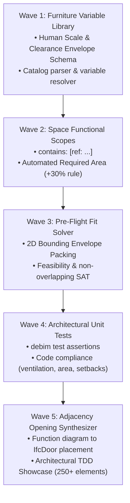

# 🗺️ debim v0.9.0 Master Roadmap & Technical Specification
## "The Architectural Spatial Programming & Test-Driven Design Release"
### สถาปัตยกรรมเชิงโปรแกรม: Space คือฟังก์ชัน, เฟอร์นิเจอร์คือตัวแปร, และการตรวจแบบคือ Unit Test

> **Target Version:** `debim v0.9.0`  
> **Status:** `PLANNED`  
> **Target Benchmark:** บ้านพักอาศัยครบวงจรแบบ Test-Driven Architectural Design (TDAD Residential Benchmark — 250+ BIM Elements)  
> **Execution Strategy:** 5 Chained Waves executed via Jules AI + Automated Watchdog Orchestrator  
> **Core Philosophy:** *Architecture as Functional Scopes, Furnishings as Variables, and Building Design as Automated Unit Tests*

---

## สารบัญ (Table of Contents)
1. [บทนำและปรัชญาการออกแบบ (Executive Summary & Philosophy)](#1-บทนำและปรัชญาการออกแบบ-executive-summary--philosophy)
2. [ภาคที่ 1: เสาหลักทางสถาปัตยกรรมเชิงฟังก์ชัน (Functional Architecture Pillars)](#ภาคที่-1-เสาหลักทางสถาปัตยกรรมเชิงฟังก์ชัน-functional-architecture-pillars)
   - 1.1 [คลังตัวแปรสัดส่วนมนุษย์และกล่องระยะใช้งาน (Human Scale & Clearance Envelope Library)](#11-คลังตัวแปรสัดส่วนมนุษย์และกล่องระยะใช้งาน-human-scale--clearance-envelope-library)
   - 1.2 [ก้อนสเปซในฐานะ Scope ฟังก์ชัน (`IfcSpace` Variable Consumption)](#12-ก้อนสเปซในฐานะ-scope-ฟังก์ชัน-ifcspace-variable-consumption)
   - 1.3 [คณิตศาสตร์ตรวจสอบความพอดีก่อนเขียนแบบ (Pre-flight 2D Geometric Fit Solver)](#13-คณิตศาสตร์ตรวจสอบความพอดีก่อนเขียนแบบ-pre-flight-2d-geometric-fit-solver)
   - 1.4 [การตรวจแบบสถาปัตยกรรมด้วย Unit Test อัตโนมัติ (`debim test` Architectural TDD)](#14-การตรวจแบบสถาปัตยกรรมด้วย-unit-test-อัตโนมัติ-debim-test-architectural-tdd)
   - 1.5 [ตัวแปลงผังความสัมพันธ์สู่ช่องเปิดประตู-หน้าต่าง (Adjacency-to-Opening Synthesizer)](#15-ตัวแปลงผังความสัมพันธ์สู่ช่องเปิดประตู-หน้าต่าง-adjacency-to-opening-synthesizer)
3. [ภาคที่ 2: ข้อกำหนด Schema และตัวอย่างโค้ด (Schema Specifications & Code Examples)](#ภาคที่-2-ข้อกำหนด-schema-และตัวอย่างโค้ด-schema-specifications--code-examples)
4. [ภาคที่ 3: แผนงานการพัฒนา 5 Chained Waves สำหรับ Jules AI](#ภาคที่-3-แผนงานการพัฒนา-5-chained-waves-สำหรับ-jules-ai)
5. [ภาคที่ 4: แผนการทดสอบและการรับรองคุณภาพ (Quality Assurance Plan)](#ภาคที่-4-แผนการทดสอบและการรับรองคุณภาพ-quality-assurance-plan)
6. [ภาคที่ 5: บทสรุปผลกระทบเชิงกลยุทธ์ (Strategic Impact & Conclusion)](#ภาคที่-5-บทสรุปผลกระทบเชิงกลยุทธ์-strategic-impact--conclusion)

---

## 1. บทนำและปรัชญาการออกแบบ (Executive Summary & Philosophy)

ในการพัฒนาโปรแกรมมิ่ง เราไม่เคยเริ่มเขียนโค้ดจากการจัดสรรฮาร์ดแวร์หรือหน่วยความจำ แต่เราเริ่มจาก **การนิยามฟังก์ชัน (Functions), ขอบเขตการทำงาน (Scopes), และตัวแปร (Variables)** ที่มีสถานะและการทำงานชัดเจน

สถาปัตยกรรมของอาคารก็เช่นเดียวกัน:
* **อาคารไม่ได้เริ่มต้นจากอิฐ หิน ปูน ทราย เสา หรือคาน** สิ่งเหล่านั้นเป็นเพียงฮาร์ดแวร์หรือเปลือกทางกายภาพ (Physical Runtime Infrastructure) ที่สร้างขึ้นเพื่อห่อหุ้มและปกป้อง "ความว่าง (The Void)" ให้อยู่รอดในโลกความจริง
* **สถาปัตยกรรมที่แท้จริง คือ "กล่องสเปซที่มองไม่เห็น (`IfcSpace`)"** ภายในนั้นบรรจุฟังก์ชันการใช้งานของมนุษย์ (เตียงนอน, ตู้เสื้อผ้า, เคาน์เตอร์ครัว, สุขภัณฑ์, โซฟา, ทางสัญจร)

เวอร์ชัน **debim v0.9.0** จึงถูกสร้างขึ้นเพื่อปฏิวัติการออกแบบอาคารด้วยแนวคิด **"Test-Driven Architectural Design (TDAD)"**:
1. อนุญาตให้ประกาศคลังตัวแปรเฟอร์นิเจอร์สัดส่วนมนุษย์ (Human Scale) พร้อมระยะใช้งาน (`clearance envelope`)
2. ส่งผ่านตัวแปรเข้าไปในก้อน `IfcSpace` เพื่อคำนวณพื้นที่ขั้นต่ำและตรวจสอบการบรรจุแบบเรขาคณิต (Mathematical Pre-flight Fit)
3. เปลี่ยนการตรวจแบบสถาปัตย์ที่เดิมใช้สายตามนุษย์นั่งเพ่งทีละแผ่น ให้กลายเป็นการรัน **Automated Unit Tests** ผ่าน `debim test`

---

## ภาคที่ 1: เสาหลักทางสถาปัตยกรรมเชิงฟังก์ชัน (Functional Architecture Pillars)

### 1.1 คลังตัวแปรสัดส่วนมนุษย์และกล่องระยะใช้งาน (Human Scale & Clearance Envelope Library)
* เฟอร์นิเจอร์และสุขภัณฑ์ทุกชิ้นถูกมองเป็นตัวแปรที่มีมิติ Bounding Box $(W \times D \times H)$ และขอบเขตระยะการใช้งานของมนุษย์ (Clearance Margin):
  * **ตัวอย่าง:** เตียง King 6 ฟุต ($1.80 \times 2.00$ ม.) มีระยะสัญจรรอบเตียงข้างละ $0.60$ ม. $\rightarrow$ ซองพื้นที่ใช้งานสุทธิคือ $3.00 \times 2.60$ ม.
  * **ตัวอย่าง:** ตู้เสื้อผ้า ($0.60 \times 2.00$ ม.) มีระยะยืนเปิดบานตู้ด้านหน้า $0.80$ ม. $\rightarrow$ ซองพื้นที่ใช้งานสุทธิคือ $1.40 \times 2.00$ ม.
* ตัวแปรเหล่านี้ถูกประกาศครั้งเดียวในระดับโปรเจกต์ (`variables:` หรือ `catalog:`) ตามหลัก **DRY (Don't Repeat Yourself)**

---

### 1.2 ก้อนสเปซในฐานะ Scope ฟังก์ชัน (`IfcSpace` Variable Consumption)
* `IfcSpace` ทำหน้าที่เป็นเหมือนฟังก์ชันในโปรแกรมมิ่งที่เรียกใช้งานตัวแปรผ่าน `contains: [ref: ...]`:
* ระบบจะคำนวณ **พื้นที่ห้องขั้นต่ำที่ต้องการ (Required Net Area)** อัตโนมัติ:
  $$\text{Required Area} = \left(\sum \text{Footprint of Contained Items}\right) \times 1.30 \text{ (Intra-room Circulation)}$$
* ก้อน Space ยังเก็บข้อกำหนดการออกแบบ (Design Assertions) เช่น ความสูงเคลียร์ฝ้าเพดาน, อัตราส่วนช่องเปิดระบายอากาศ, และการลดระดับพื้นเปียก

---

### 1.3 คณิตศาสตร์ตรวจสอบความพอดีก่อนเขียนแบบ (Pre-flight 2D Geometric Fit Solver)
* ก่อนที่สถาปนิกหรือ AI จะเริ่มวางเสา ลากคาน หรือก่อผนัง ระบบจะรันการตรวจสอบทางคณิตศาสตร์ 3 มิติในเวลา $< 0.005$ วินาที:
  1. **Area Check:** พื้นที่ห้องจริง $\ge$ ผลรวมพื้นที่เฟอร์นิเจอร์ + สัญจร 30% หรือไม่
  2. **Bounding Envelope Packing Check (SAT / No-Fit Polygon):** กล่องเฟอร์นิเจอร์พร้อมระยะเปิดใช้งาน สามารถจัดวางลงในรูปหลายเหลี่ยมของห้องได้โดยไม่ซ้อนทับกันหรือไม่
  3. **Continuous Circulation Pathfinding:** มีเส้นทางสัญจรความกว้างไม่น้อยกว่า 60 ซม. จากประตูทางเข้าเชื่อมต่อถึงวัตถุทุกชิ้นหรือไม่
* หากผลการคำนวณระบุว่า "ยัดไม่ลง (Infeasible)" ระบบจะแจ้งเตือนและปรับขนาดกริตทันที **โดยไม่เสียเวลาไปเขียนแบบผิดๆ**

---

### 1.4 การตรวจแบบสถาปัตยกรรมด้วย Unit Test อัตโนมัติ (`debim test` Architectural TDD)
* เปลี่ยนกฎกระทรวง ข้อบัญญัติท้องถิ่น และสุขลักษณะทางสถาปัตยกรรม ให้กลายเป็น **Pytest Assertions**:
  * `assert space.net_area >= space.design_spec.min_area`
  * `assert window_area / space.net_area >= 0.10` (กฎหมายช่องเปิดระบายอากาศ $\ge 10\%$)
  * `assert bathroom.drop_elevation <= -0.10` (ลดระดับพื้นห้องน้ำ 10 ซม.)
  * `assert not is_adjacent(restroom, dining_room)` (ห้ามห้องส้วมติดห้องอาหาร)
  * `assert building_setback >= 2.00` (ระยะร่นอาคารตามกฎหมาย)

---

### 1.5 ตัวแปลงผังความสัมพันธ์สู่ช่องเปิดประตู-หน้าต่าง (Adjacency-to-Opening Synthesizer)
* นำข้อมูลจาก Function Diagram และแนวระนาบชนกันของ `IfcSpace`:
  * หาก `Space A` มีความสัมพันธ์ `must_connect` กับ `Space B` และมีแนวผนังร่วมกัน $\rightarrow$ คำนวณจุดกึ่งกลางแนวผนังและเจาะ `IfcDoor` อัตโนมัติ (พร้อมเว้นระยะมุมเสาอย่างน้อย 10 ซม.)
  * หาก `Space` อยู่ติดผนังภายนอก $\rightarrow$ วาง `IfcWindow` บนผนังที่หันออกสู่อากาศภายนอกในทิศทางลม/แสงที่เหมาะสม

---

### 1.6 ไวยากรณ์ "สเปซวางชนกัน" และเครื่องยนต์ถักโครงสร้างอัตโนมัติ (Touching Spaces & Auto-Derivation Engine `debim derive`)
* **ปัญหาเดิม:** การบีบให้ AI หรือสถาปนิกต้องคำนวณพิกัดแกน $X, Y$ ลอยๆ สำหรับเสา 30 ต้น คาน 50 ตัว ผนัง 40 ผืน ทำให้บริบทล้นสมอง (Cognitive Overload) และ AI เสี่ยงต่อการเกิด Spatial Drift
* **ปรัชญาใหม่ (Topological Space-First):** สถาปนิกมองแบบที่ยุ่งเหยิงเป็นเพียง **"ก้อนสเปซที่เอาขอบมาแปะชนกัน"**:
  * AI ประกาศขนาดห้อง และระบุการวางชนแบบสัมพัทธ์ผ่านไวยากรณ์: `touching: { target: LIVING_ROOM, side: NORTH, align: LEFT }`
* **เครื่องยนต์ `debim derive` (Auto-Framing):**
  1. **รอยต่อที่ 2 สเปซชนกัน (Shared Edge):** สั่งสร้างผนังภายใน (`IfcWall`) กั้นห้องอัตโนมัติ
  2. **ขอบสเปซด้านที่ไม่ชนใคร (Exterior Edge):** สั่งสร้างผนังภายนอก และเจาะหน้าต่างรับแสง-ลม (`IfcWindow`)
  3. **จุดเชื่อมต่อฟังก์ชัน (`must_connect`):** สั่งเจาะประตู (`IfcDoor`) ตรงกึ่งกลางแนวชน
  4. **จุดตัดมุมของก้อนสเปซ (Space Vertices):** สั่งปักเสา ค.ส.ล. (`IfcColumn`) รองรับโครงสร้าง
  5. **แนวใต้ผนังและเสา:** สั่งพาดคานคอดินและคานรับพื้น (`IfcBeam`) ครบวงจร
  * **ผลลัพธ์:** AI เขียนสเปซเพียง 10-15 บรรทัด `debim derive` จะสร้างโครงสร้าง BIM ทั้งหลัง 150+ ชิ้นงานที่ถูกต้องตามหลักวิศวกรรม 100%

---

## ภาคที่ 2: ข้อกำหนด Schema และตัวอย่างโค้ด (Schema Specifications & Code Examples)

### ตัวอย่าง: `project.debim` (การประกาศตัวแปรและการเรียกใช้ใน Space)

```yaml
schema: "IFC4-Minimal"
project:
  name: "บ้านพักอาศัยสถาปัตยกรรมเชิงโปรแกรม v0.9.0"

# 1. คลังตัวแปรเฟอร์นิเจอร์และสุขภัณฑ์ Human Scale (DRY Library)
variables:
  BED_KING_6FT:
    class: IfcTypeProduct
    dimensions: { width: 1.80, depth: 2.00, height: 0.45 }
    clearance: { front: 0.60, left: 0.60, right: 0.60 }

  WARDROBE_2M:
    class: IfcTypeProduct
    dimensions: { width: 2.00, depth: 0.60, height: 2.20 }
    clearance: { front: 0.80 }

  TOILET_SET:
    class: IfcTypeProduct
    dimensions: { width: 0.40, depth: 0.70, height: 0.80 }
    clearance: { front: 0.50, left: 0.20, right: 0.20 }

# 2. ก้อนสเปซสามมิติ: ดึงตัวแปรมาใช้งาน พร้อมกำหนดเงื่อนไขการทดสอบ (Design Spec)
elements:
  - class: IfcSpace
    tag: SPACE-BED-01
    name: "ห้องนอนใหญ่ (Master Bedroom)"
    space_type: BEDROOM
    storey: L2
    boundary:
      - ["1", "A"]
      - ["3", "A"]
      - ["3", "B"]
      - ["1", "B"]
    
    # ดึงตัวแปรเข้ามาบรรจุในฟังก์ชันห้องนี้
    contains:
      - ref: BED_KING_6FT
      - ref: WARDROBE_2M
    
    # กำหนดเงื่อนไข Unit Test
    design_spec:
      min_area: 18.0
      clear_height: 2.80
      natural_ventilation_ratio: 0.10
      adjacencies:
        must_connect: ["SPACE-BATH-01", "SPACE-HALLWAY"]
        forbidden_adjacent: ["SPACE-PUMP-ROOM"]

  - class: IfcSpace
    tag: SPACE-BATH-01
    name: "ห้องน้ำในห้องนอนใหญ่"
    space_type: BATHROOM
    storey: L2
    boundary:
      - ["3", "A"]
      - ["4", "A"]
      - ["4", "B"]
      - ["3", "B"]
    contains:
      - ref: TOILET_SET
    finish:
      drop_elevation: -0.10
    design_spec:
      min_area: 4.00
```

### ตัวอย่าง: การนิยามแบบ "กล่องสเปซวางชนกัน" สำหรับ `debim derive`

```yaml
# floorplan.debim (สถาปนิก/AI กำหนดแค่กล่องสเปซวางชนกัน)
spaces:
  LIVING_ROOM:
    name: "ห้องรับแขก/นั่งเล่น"
    dimensions: [5.00, 4.00]
    origin: [2.00, 2.00]       # วางตามแนวระยะร่นที่ดิน

  DINING_ROOM:
    name: "ส่วนรับประทานอาหาร"
    dimensions: [4.00, 4.00]
    touching:
      target: LIVING_ROOM
      side: NORTH              # แปะติดห้องนั่งเล่นทางทิศเหนือ
      align: LEFT
    must_connect: [LIVING_ROOM] # เดินทะลุหากันได้

  KITCHEN:
    name: "ห้องครัว"
    dimensions: [3.00, 3.50]
    touching:
      target: DINING_ROOM
      side: EAST               # แปะติดห้องทานอาหารทางทิศตะวันออก
      align: TOP
    must_connect: [DINING_ROOM]

# รันคำสั่งเดียวเพื่อถักโครงสร้างทั้งหลัง:
# debim derive -m floorplan.debim -o project.debim
```

---

## ภาคที่ 3: แผนงานการพัฒนา 5 Chained Waves สำหรับ Jules AI



---

### Wave 1: Human Scale Furniture Variable Library & Clearance Envelope Schema
* **Target Files:**
  - `src/debim/schema.py` (เพิ่ม `FurnitureVariable`, `ClearanceEnvelope`, และส่วน `variables:` ใน `ProjectManifest`)
  - `src/debim/loader.py` (รองรับการประกาศและ Resolve ตัวแปรเฟอร์นิเจอร์)
* **Goals:**
  - ประกาศขนาดกว้าง ยาว สูง และระยะเผื่อใช้งาน (`clearance`) ของเฟอร์นิเจอร์/สุขภัณฑ์มาตรฐาน
* **Test Suite:** `tests/test_furniture_variables.py`
* **Acceptance Criteria:** `ProjectManifest` โหลดและตรวจสอบตัวแปรเฟอร์นิเจอร์ได้ถูกต้อง 100%

---

### Wave 2: Space Functional Scopes with Variable Consumption & Auto-Sizing
* **Target Files:**
  - `src/debim/schema.py` (เพิ่ม `contains: List[VariableReference]`, `design_spec` ใน `IfcSpace`)
  - `src/debim/resolver.py` (คำนวณ `required_net_area` จากผลรวมเฟอร์นิเจอร์คูณสัมประสิทธิ์สัญจร 1.30)
* **Goals:**
  - ก้อน `IfcSpace` สามารถรับตัวแปรเฟอร์นิเจอร์และคำนวณพื้นที่เป้าหมายขั้นต่ำได้อัตโนมัติ
* **Test Suite:** `tests/test_space_functional_scope.py`
* **Acceptance Criteria:** คำนวณ Required Area ของห้องจากตัวแปรตรงตามสูตรสถาปนิก ($+30\%$)

---

### Wave 3: Pre-Flight 2D Geometric Furniture Fit Solver
* **Target Files:**
  - `src/debim/solver.py` (สร้างโมดูลคณิตศาสตร์ตรวจสอบการจัดวาง 2D Packing & SAT collision)
  - `src/debim/cli.py` (เพิ่มคำสั่ง `debim fit -m project.debim`)
* **Goals:**
  - ตรวจสอบทางเรขาคณิตว่าเฟอร์นิเจอร์และระยะใช้งาน สามารถวางลงใน Polygon ของ Space ได้จริงโดยไม่เกยกัน
* **Test Suite:** `tests/test_furniture_fit_solver.py`
* **Acceptance Criteria:** ตรวจจับห้องที่เล็กเกินไปหรือวางเฟอร์นิเจอร์ไม่ลงได้ในเวลา $< 0.01$ วินาที

---

### Wave 4: Architectural Unit Testing Engine (`debim test` Architectural TDD)
* **Target Files:**
  - `src/debim/compliance.py` (เพิ่มตัวตรวจเช็ค: Area threshold, Natural ventilation 10%, Bathroom drop, Adjacencies)
  - `src/debim/cli.py` (ขยายคำสั่ง `debim test` ให้รัน Architectural Design Assertions)
* **Goals:**
  - เปลี่ยนเงื่อนไขการออกแบบให้เป็น Automated Assertions รายงานผล Fail/Pass ชัดเจน
* **Test Suite:** `tests/test_architectural_compliance.py`
* **Acceptance Criteria:** รายงานจุดบกพร่องของแบบ (เช่น ลืมลดระดับพื้นห้องน้ำ หรือช่องเปิดไม่ถึง 10%) ออกมาเป็น Error ละเอียด

---

### Wave 5: Touching Spaces Adjacency Syntax & Auto-Derivation Engine (`debim derive`) (Final Wave)
* **Target Files:**
  - `src/debim/schema.py` (เพิ่มไวยากรณ์ `touching: { target, side, align }` ในการนิยามสเปซ)
  - `src/debim/derive.py` (สร้างเครื่องยนต์แตกโครงสร้าง: รอยชนกลายเป็น `IfcWall`, ช่องต่อกลายเป็น `IfcDoor`, รอยนอกกลายเป็น `IfcWindow`, มุมกลายเป็น `IfcColumn`, ใต้ผนังกลายเป็น `IfcBeam`)
  - `src/debim/cli.py` (เพิ่มคำสั่ง `debim derive -m floorplan.debim -o project.debim`)
  - `examples/architectural_tdd_house/` (โมเดล Benchmark บ้านพักอาศัยครบวงจร 250+ Elements ที่สร้างด้วยวิธี Touching Spaces + TDD)
* **Goals:**
  - ให้ AI และสถาปนิกกำหนดแค่ก้อน Space วางชนกัน แล้วรัน `debim derive` ถักโมเดลโครงสร้างและสถาปัตย์ออกมาทั้งหลัง
* **Test Suite:** `tests/test_touching_spaces.py`, `tests/test_derive_engine.py`, `tests/test_architectural_tdd_benchmark.py`
* **Acceptance Criteria:** สเปซที่วางชนกันถูกคอมไพล์เป็นผนัง คาน เสา ประตู หน้าต่าง ได้อย่างถูกต้อง 100%, โมเดลคอมไพล์ผ่านและรัน `debim test` ผ่านฉลุย

---

## ภาคที่ 4: แผนการทดสอบและการรับรองคุณภาพ (Quality Assurance Plan)

1. **Deterministic Accuracy:** การคำนวณพื้นที่และระยะ Bounding Box ต้องมีความคลาดเคลื่อนไม่เกิน $10^{-4}$ ม.
2. **Real-World Compliance:** อิงกฎกระทรวงฉบับที่ 55 (พ.ศ. 2543) ออกตามความใน พ.ร.บ. ควบคุมอาคาร พ.ศ. 2522 ในเรื่องระยะร่น, พื้นที่ห้องนอน ($\ge 8$ ตร.ม.), และช่องเปิดระบายอากาศ ($\ge 10\%$)
3. **Loop Protection in Automation:** รักษามาตรฐาน Watchdog Orchestrator ที่มีระบบหยุดทำงานอัตโนมัติเมื่องวดสุดท้าย (Wave 5) ผสานสำเร็จ

---

## ภาคที่ 5: บทสรุปผลกระทบเชิงกลยุทธ์ (Strategic Impact & Conclusion)

การมาถึงของ **debim v0.9.0** จะเป็นการผสานโลกของ **สถาปัตยกรรม (Architecture)** และ **วิทยาการคอมพิวเตอร์ (Computer Science)** เข้าด้วยกันอย่างแท้จริง:
* อาคารไม่ใช่แค่รูปวาด แต่คือ **ระบบที่มีตรรกะและตัวแปรควบคุม (System of Logic & Variables)**
* สถาปนิกและวิศวกรสามารถเขียนข้อกำหนดเป็นโค้ด (Design-as-Code) และให้ AI ทำหน้าที่เป็น Draftsman ที่ไม่มีวันทำผิดสเปก
* ทุกแบบอาคารที่ออกจาก `debim` จะได้รับการการันตีด้วย **Unit Test Suite** ว่าเป็นอาคารที่ใช้งานได้จริง สุขลักษณะสมบูรณ์ และสอดคล้องกับพฤติกรรมมนุษย์ 100%
