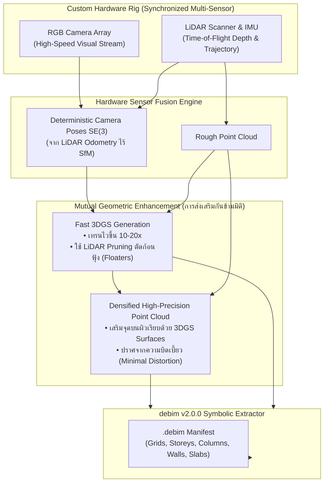
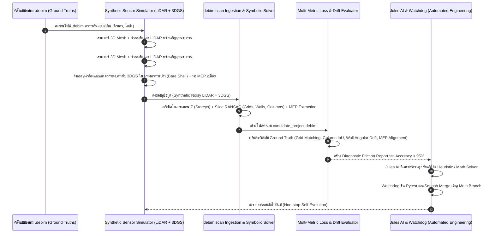

# 🛰️ debim v2.0.0 Architecture Specification
## Hardware-Assisted "Scan-to-debim" & The Synthetic Self-Training Loop
### Sensor Fusion (Synchronized RGB + LiDAR) & 3D Gaussian Splatting (3DGS) Co-Design

> **Document Version:** 2.0.0-DRAFT  
> **Target Release:** debim v2.0.0  
> **Status:** Active Engineering Specification  
> **Author:** debim Systems Architecture & Hardware Co-Design Group  
> **Core Concept:** Transforming raw sensor streams (Rough LiDAR + Photorealistic 3DGS) into deterministic, declarative OpenBIM (`.debim`) via an automated Synthetic Self-Training Loop.

---

## 📑 สารบัญ (Table of Contents)
1. [บทนำและปรัชญาการออกแบบ (Executive Summary & Philosophy)](#1-บทนำและปรัชญาการออกแบบ)
2. [การทำงานร่วมกันระหว่างฮาร์ดแวร์และซอฟต์แวร์ (Hardware-Software Co-Design)](#2-การทำงานร่วมกันระหว่างฮาร์ดแวร์และซอฟต์แวร์)
   - 2.1 การแก้ปัญหาคอขวด 3DGS: ทราบมุมกล้องล่วงหน้าผ่าน LiDAR Odometry (Zero-SfM)
   - 2.2 การตัดสิ่งรบกวนและก้อนฟุ้ง (Floater Pruning using LiDAR Geometry Bounds)
   - 2.3 การเพิ่มความหนาแน่นจุดไลด้าโดยไม่เพี้ยน (3DGS-Guided Point Cloud Densification)
3. [วงจรอัตโนมัติ: Synthetic Scan-to-debim Self-Training Loop](#3-วงจรอัตโนมัติ-synthetic-scan-to-debim-self-training-loop)
   - 3.1 Forward Simulation: การจำลองการสแกนจากโมเดล Ground Truth
   - 3.2 Inverse Symbolic Solver: การถอดรหัสเรขาคณิตเป็นพารามิเตอร์ debim
   - 3.3 Automated Benchmark & Diagnostic Feedback: การประเมินผลความคลาดเคลื่อนอัตโนมัติ
   - 3.4 Agentic Continuous Evolution: การส่งงานให้ Jules AI ปรับแต่งเอนจิน
4. [โครงสร้างสถาปัตยกรรมระบบและคำสั่ง CLI (`debim scan`)](#4-โครงสร้างสถาปัตยกรรมระบบและคำสั่ง-cli-debim-scan)
5. [แผนแม่บทการพัฒนา (Development Roadmap towards v2.0.0)](#5-แผนแม่บทการพัฒนา)

---

## 1. บทนำและปรัชญาการออกแบบ

การแปลงข้อมูลการสแกนสภาพแวดล้อมจริง (As-Built Reality Capture) ให้เป็นโมเดลจำลองข้อมูลอาคาร (**Scan-to-BIM**) เป็นหนึ่งในความท้าทายที่ยากที่สุดของวงการสถาปัตยกรรมและวิศวกรรม เนื่องจากข้อมูลดิบจากเซ็นเซอร์ (Point Cloud / Mesh) เต็มไปด้วยสัญญาณรบกวน วัตถุบดบัง และขาดโครงสร้างความหมายเชิงวิศวกรรม (Semantic Meaning)

**debim v2.0.0** นำเสนอแนวทางใหม่ที่ผสาน **ฮาร์ดแวร์สแกนเนอร์ที่พัฒนาขึ้นเฉพาะ** เข้ากับ **ระบบถอดรหัสเชิงสัญลักษณ์ (Symbolic Constraint Inverse Solver)**:
- เราไม่พยายามสร้าง Mesh ดิบๆ แต่เราสกัด **"ความสัมพันธ์เชิงสถาปัตยกรรม"** (แนวกริดเสา, ระดับชั้นความสูง, ผนัง, ช่องเปิด) เพื่อสังเคราะห์ออกมาเป็นโค้ด `.debim` ที่กระชับและแม่นยำ
- นำ **"Synthetic Scan-to-debim Self-Training Loop"** มาเป็นกลไกขับเคลื่อนการพัฒนา โดยจำลองข้อมูลการสแกนสังเคราะห์คู่กับโมเดลจริง เพื่อให้ AI Agent สามารถทดสอบ ฝึกฝน และแก้บั๊กของอัลกอริทึมได้ตลอด 24 ชั่วโมงโดยไม่ต้องรอมนุษย์ลงพื้นที่สแกนจริง

---

## 2. การทำงานร่วมกันระหว่างฮาร์ดแวร์และซอฟต์แวร์ (Hardware-Software Co-Design)



### 2.1 การแก้ปัญหาคอขวด 3DGS: ทราบมุมกล้องล่วงหน้าผ่าน LiDAR Odometry (Zero-SfM)
- **ปัญหาเดิมของ 3DGS:** ในท่อประมวลผลทั่วไป (เช่น COLMAP / Structure-from-Motion) ต้องเสียเวลาการประมวลผลกว่า 80–90% ไปกับการคาดเดาตำแหน่งและมุมกล้อง (Camera Poses $SE(3)$) จากการจับคู่จุดภาพ (Feature Matching) ซึ่งมักล้มเหลวในห้องที่มีผนังสีขาวเรียบหรือแสงสะท้อน
- **การแก้ปัญหาใน v2.0.0:** ฮาร์ดแวร์บันทึกตำแหน่งพิกัดและทิศทางกล้องอย่างแม่นยำผ่าน **LiDAR Odometry ร่วมกับ IMU** แบบเรียลไทม์ ทำให้สามารถส่งค่า Extrinsics ให้ 3DGS ได้ทันที ส่งผลให้:
  - ความเร็วในการสร้าง 3DGS **เร็วขึ้นกว่าเดิม 10–20 เท่า** (จากชั่วโมงเหลือเพียงไม่กี่นาที)
  - กำจัดความล้มเหลวในการจับคู่จุดภาพ (No Drift / Zero Reconstruction Failures)

### 2.2 การตัดสิ่งรบกวนและก้อนฟุ้ง (Floater Pruning using LiDAR Geometry Bounds)
- **ปัญหาเดิมของ 3DGS:** 3DGS มักสร้างเกาส์เซียนลอยอยู่กลางอากาศ (Floaters) ในจุดที่กล้องถ่ายไม่ทั่วถึงหรือมีแสงฟุ้งกระจาย
- **การแก้ปัญหาใน v2.0.0:** นำความลึกของ LiDAR (Depth Priors) มาสร้างเป็น **Bounding Hull**:
  - เกาส์เซียนใดที่มีตำแหน่งไม่อยู่บนพื้นผิวที่ LiDAR ยิงเจอในระยะพิกัด tolerance จะถูกตัดทิ้ง (Prune) ทันที
  - ผลลัพธ์: โมเดล 3DGS มีความคมชัด ขอบเสา-ขอบผนังเรียบเนียน ปราศจากกลุ่มหมอกฟุ้งรบกวน

### 2.3 การเพิ่มความหนาแน่นจุดไลด้าโดยไม่เพี้ยน (3DGS-Guided Point Cloud Densification)
- **ปัญหาเดิมของ LiDAR หยาบ:** สแกนเนอร์พกพาจะมีจุดสแกนที่ห่าง (Sparse Points) เมื่อสแกนระยะไกล
- **การแก้ปัญหาใน v2.0.0:** อาศัยเกาส์เซียนของ 3DGS ซึ่งมีความหนาแน่นของสีและระนาบพื้นผิวระดับพิกเซล มาทำ **Guided Depth Upsampling**:
  - สอดแทรกจุดกึ่งกลางของพื้นผิวระนาบ (Surface Splats) ลงไปเสริมในช่องว่างของ Point Cloud
  - รักษาความถูกต้องของมิติทางฟิสิกส์ ไม่เกิดการโก่งงอ (Minimal Distortion)

---

## 3. วงจรอัตโนมัติ: Synthetic Scan-to-debim Self-Training Loop

เพื่อปลดล็อกการพัฒนาแบบก้าวกระโดดโดยไม่ต้องรอมนุษย์ลงพื้นที่จริง ระบบจะรันวงจรจำลองข้อมูลและการประเมินตนเอง (Self-Training & Continuous Evaluation Loop):



### 3.1 Forward Simulation: Bare-Shell & Exposed MEP Reality (สภาพอาคารจริงหน้างาน)
ในหน้างานก่อสร้าง ปรับปรุง หรือรีโนเวทจริง ก่อนการสแกนพื้นที่ ผู้รับเหมาจะดำเนินการ **รื้อถอนและเคลียร์พื้นที่ (Demolition / Strip-Out)** ขนย้ายเฟอร์นิเจอร์ โต๊ะ ตู้ เตียง และสิ่งของออกไปทั้งหมดแล้ว ข้อมูลที่สแกนได้จึงเป็น **อาคารเปล่า (Bare Building Shell)** ซึ่งถือเป็นความได้เปรียบมหาศาล:
- **ไร้สิ่งกีดขวาง (Zero Clutter Occlusion):** มองเห็นระนาบผิวเสา คาน ท้องพื้น และผนังอิฐก่อ 100% ทำให้ RANSAC และ Plane Fitting มีความแม่นยำสูงระดับมิลลิเมตร
- **การมองเห็นท่อและงานระบบ (Exposed MEP Visibility):** ท่อดักท์แอร์ (HVAC Ducts), ท่อประปา-สุขาภิบาล (Pipes), รางร้อยสายไฟ (Cable Trays), และท่อดับเพลิงใต้ท้องพื้นจะเปลือยให้เห็นอย่างเด่นชัด สามารถสกัดเส้นแกนกลาง (Centroid Vector) เพื่อแปลงเป็น `IfcPipeSegment`, `IfcDuctSegment`, `IfcCableCarrierSegment` ได้โดยตรง

### 3.2 Inverse Symbolic Solver (ขั้นตอนการถอดรหัสสู่ .debim)
1. **Storey Extraction (การหาระดับชั้น):**
   - วิเคราะห์ Histogram ความหนาแน่นของพิกัดแกน $Z$ ของ Point Cloud
   - ยอดพีคระนาบแนวนอนขนาดใหญ่บ่งบอกถึงระดับพื้นคอนกรีต ($Z_{floor}$) และท้องพื้นชั้นบน ($Z_{slab\_bottom}$)
2. **Grid & Column Centerline Extraction (การหาแนวกริดและเสา):**
   - ตัดระนาบ Slice Point Cloud ในช่วงความสูงกึ่งกลางเสา ($Z_{floor} + 1.20\text{ ม.}$)
   - นำกลุ่มจุดทรงสี่เหลี่ยมเข้ากระบวนการ Clustering เพื่อหาจุดศูนย์ถ่วง (Centroids) ของเสาจริง
   - ใช้อัลกอริทึม RANSAC / Hough Line Transform ลากเส้นเชื่อมระหว่างเสาเพื่อสกัดระบบแกนกริด `axes_x` และ `axes_y`
3. **Wall Identification & Thickness Calculation:**
   - ค้นหากลุ่มจุดที่เป็นระนาบแนวดิ่งระหว่างกริดเสา คำนวณความหนาผนัง ($t = \Delta \text{distance}$)
4. **Exposed MEP Extraction (การสกัดท่อและงานระบบบนฝ้าเพดาน):**
   - กรองกลุ่มจุดรูปทรงกระบอกและทรงกล่องยาวใต้ท้องพื้น ($Z_{slab\_bottom} - 0.20\text{ ถึง } -0.80\text{ ม.}$)
   - สกัดเส้นแนวแกนกลางท่อ (Centerline Polyline) และวัดขนาดเส้นผ่านศูนย์กลาง/ความกว้าง-ลึก แปลงเป็นชิ้นส่วน MEP ของ debim โดยตรง
5. **Semantic Feature Mapping via 3DGS Views:**
   - เรนเดอร์ภาพจาก 3DGS ในมุมมองตรง (Orthographic View) ของผนังแต่ละด้าน
   - ส่งให้ Multimodal Vision Model (เช่น Gemini) ทำ Object Detection เพื่อระบุประเภทประตู ช่องเปิด และหน้าต่าง

### 3.3 Automated Metric Evaluation (เกณฑ์การวัดผลอัตโนมัติ)
- **Grid Offset Error ($\epsilon_{grid}$):** ระยะเบี่ยงเบนของแกนกริดเมื่อเทียบกับ Ground Truth (เป้าหมาย: $\le 3\text{ cm}$)
- **Storey Elevation Error ($\epsilon_{storey}$):** ความคลาดเคลื่อนของระดับพื้น (เป้าหมาย: $\le 1\text{ cm}$)
- **Element Semantic F1-Score:** ความถูกต้องในการตรวจจับเสา คาน ผนัง และช่องเปิด (เป้าหมาย: $\ge 0.95$)

---

## 4. โครงสร้างสถาปัตยกรรมระบบและคำสั่ง CLI (`debim scan`)

```bash
# 1. นำเข้าข้อมูลสแกนจากฮาร์ดแวร์เพื่อสร้างโมเดล .debim
debim scan ingest \
  --lidar site_scan.ply \
  --gs site_scene.splat \
  --out reconstructed.debim \
  --tolerance-grid 0.05

# 2. ทำการ Calibrate เทียบกับภาพถ่ายเพื่อตรวจหาประตู-หน้าต่าง
debim scan enrich-semantics \
  --manifest reconstructed.debim \
  --gs site_scene.splat \
  --vision-model gemini-3.0-flash

# 3. รันชุดทดสอบ Synthetic Scan-to-debim Benchmark
debim scan benchmark \
  --synthetic-bank ./tests/data/synthetic_scans/ \
  --min-f1 0.95
```

---

## 5. แผนแม่บทการพัฒนา (Development Roadmap towards v2.0.0)

| ระยะการพัฒนา (Phase) | เป้าหมายและขอบเขตงาน | เครื่องมือหลัก |
|---|---|---|
| **Phase 1: v0.6.0 - v1.0.0** (ปัจจุบัน) | พัฒนาภาษาแกนกลาง: Modular Arraying, Parametric Roof/Stairs, Slab Voids, และ BOQ ราชการไทย (ว480) | `schema.py`, `compiler.py`, `qto.py` |
| **Phase 2: v1.1.0 - v1.5.0** | สร้าง Synthetic Sensor Simulator (จำลอง Virtual LiDAR + 3DGS Ray-caster จากไฟล์ debim) | `numpy`, `trimesh`, Virtual Sensor |
| **Phase 3: v1.6.0 - v1.9.0** | พัฒนา Inverse Symbolic Solver (Z-Histogram, RANSAC Grid Slicer, Wall Extractor) | `src/debim/scan/` |
| **Phase 4: v2.0.0 Release** | ผนวก Hardware Capture Stream (Zero-SfM 3DGS + Point Cloud Densifier) เข้าสู่ CLI `debim scan` สมบูรณ์แบบ | **debim v2.0.0 Scan-to-debim** |

---
*เอกสารนี้ถูกบันทึกเพื่อใช้เป็นพิมพ์เขียวสำหรับระบบ Scan-to-debim ฮาร์ดแวร์-ซอฟต์แวร์ฟิวชันรุ่นถัดไป*
