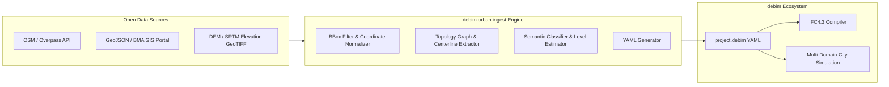

# debim-urban: Technical Specification & IFC4.3 Compilation Architecture
## ISO 19650 / buildingSMART Standard for Computable Urban & Linear Infrastructure

---

## 1. Executive Summary & Vision

`debim-urban` คือส่วนขยายระดับเมืองและโครงสร้างพื้นฐานของ **debim** (Declarative Building-as-Code Engine) ออกแบบมาเพื่อปิดช่องว่างระหว่าง **BIM อาคารแนวตั้ง (Vertical Buildings)** กับ **BIM โครงสร้างพื้นฐานเชิงเส้น (Linear Infrastructure & Civil Works)** ก่อนการเชื่อมต่อระบบสแกนเข้า `.debim` (Scan-to-debim)

เพื่อความเป็นสากลและการแลกเปลี่ยนข้อมูลข้ามแพลตฟอร์มอย่างสมบูรณ์ (Interoperability กับ Civil 3D, OpenRoads, QGIS, Blender GIS, Cesium 3D Tiles) การคอมไพล์เป้าหมายของ debim-urban มุ่งเน้นมาตรฐาน **IFC4.3 (IFC4X3_ADD2 / ISO 19650)** เป็นหลัก

---

## 2. Four Core Architectural Pillars

```
+---------------------------------------------------------------------------------+
|                               debim-urban Engine                                |
+---------------------------------------------------------------------------------+
|  1. Spatial Breakdown      |  2. Alignment-Based Geometry                       |
|     - IfcFacility          |     - IfcAlignment (Stationing / Chainage)         |
|     - IfcRoad / IfcRailway |     - Horizontal: Line, Spiral/Clothoid, Arc       |
|     - IfcFacilityPart      |     - Vertical: Grade, Parabola                    |
|       (ROADWAY, SIDEWALK)  |     - Sweep: IfcSectionedSolidHorizontal           |
+----------------------------+----------------------------------------------------+
|  3. Civil Entities Mapping |  4. GIS-BIM Coordinate Operation                   |
|     - IfcGeotechnicalStrat |     - EPSG Code Mapping (e.g., EPSG:32647)         |
|     - IfcPavement          |     - IfcProjectedCRS                              |
|     - IfcKerb / IfcSign    |     - IfcMapConversion (Local to World Meters)     |
|     - IfcPipeSegment       |     - 0-mm Drift Precision                         |
+---------------------------------------------------------------------------------+
```

### 2.1 Spatial Breakdown: Linear Hierarchy
โครงสร้าง IFC เดิมผูกกับ `IfcBuildingStorey` ซึ่งไม่สามารถจำแนกงานแนวราบได้ ใน IFC4.3 จะใช้โครงสร้าง:
- `IfcProject`
  - `IfcSite` (Parcels / ขอบเขตแปลงที่ดิน)
    - `IfcFacility` (Superclass ใหม่)
      - `IfcRoad`: เส้นทางจราจร ถนน ซอย สะพานข้ามแยก
      - `IfcRailway`: แนวราง ระบบขนส่งมวลชน
      - `IfcBridge`: ทางยกระดับ สะพาน
      - `IfcMarineFacility`: ท่าเรือ ท่าเทียบเรือ
    - `IfcFacilityPart`: จำแนกส่วนย่อยตามความยาวหรือฟังก์ชัน
      - `ROADWAY`: ผิวจราจร
      - `SIDEWALK`: ทางเท้า
      - `INTERSECTION`: ทางแยก
      - `JUNCTION`: จุดตัด/ชุมทาง

### 2.2 Alignment-Based Geometry Engine (Linear Coordinate System)
- **Stationing / Chainage (Sta. 10+250.00)**: เลิกใช้ Cartesian ล้วน แต่ใช้สถานีตามแนวราบ (Horizontal Alignment)
  - Horizontal Curve: Line (เส้นตรง), Clothoid Transition Spiral (โค้งก้นหอยผ่อนแรงเหวี่ยง), Circular Arc (โค้งวงกลม)
  - Vertical Alignment: Longitudinal Profile, Gradient (%) และ Parabolic Curves
- **Sweep Method**: หน้าตัดถนน/ราง (Cross-Section Profile) วิ่งกวาดตลอดแนวเส้นทางด้วย `IfcSectionedSolidHorizontal` หรือ `IfcDirectrixDistanceSweptAreaSolid`

### 2.3 Civil & Infrastructure Entities Mapping Table

| debim DSL Element | IFC4.3 Official Entity | PredefinedType / Usage |
|---|---|---|
| `terrain: mesh` | `IfcGeotechnicalStratum` / `IfcEarthworksFill` | ชั้นผิวดินเดิมและดินถมปรับระดับ |
| `pavement_material` | `IfcPavement` | `PAVEMENT` / `USERDEFINED` |
| `track_network` | `IfcTrackElement`, `IfcRailway` | `RAIL`, `SLEEPER` |
| `road_furniture: curb` | `IfcKerb` | คันหินทางเท้า ขอบทาง |
| `road_furniture: barrier` | `IfcImpactProtectionDevice` | การ์ดเรล ราวกันอันตราย |
| `drainage_mains: pipe` | `IfcPipeSegment`, `IfcDistributionChamber` | ท่อระบายน้ำเมือง บ่อพัก (Manhole) |
| `street_light: pole` | `IfcLightFixture`, `IfcSign` | เสาไฟถนน ป้ายจราจร |

### 2.4 GIS-BIM Geo-Referencing (IfcMapConversion)
แก้ปัญหา "โมเดลลอยฟ้า" และพิกัดคลาดเคลื่อน:
- ฝังบล็อก `crs: "EPSG:32647"` (WGS 84 / UTM Zone 47N สำหรับ กทม.)
- Compiler สร้าง:
  1. `IfcProjectedCRS`: ระบุ EPSG Name, Geodetic Datum, Map Projection
  2. `IfcMapConversion`: กำหนด `Eastings`, `Northings`, `OrthogonalHeight`, `XAxisAbscissa`, `XAxisOrdinate`, และ `Scale` เชื่อมโยง Local Engineering Origin `(0, 0, 0)` เข้ากับพิกัดแผนที่จริง

---

## 3. Sample debim-urban YAML DSL

```yaml
version: "debim-urban/1.0"
project:
  name: "Sukhumvit-Asoke Smart Corridor"
  crs:
    epsg: 32647 # WGS 84 / UTM Zone 47N
    origin:
      easting: 668250.00
      northing: 1521420.00
      elevation: 2.50
    rotation: 14.2 # Degrees from True North

spatial:
  parcels:
    - id: "PARCEL-ASOKE-01"
      name: "Interchange Commercial Zone"
      polygon: [[0, 0], [150, 0], [150, 100], [0, 100]]

facilities:
  - type: IfcRoad
    name: "Sukhumvit_Main_Road"
    alignment:
      name: "Sukhumvit_Alignment"
      horizontal:
        - type: LINE
          start_station: 10000.00 # Sta. 10+000
          length: 300.0
          bearing: 85.0
        - type: CLOTHOID
          start_station: 10300.00
          length: 50.0
          start_radius: Infinity
          end_radius: 500.0
        - type: CIRCULAR_ARC
          start_station: 10350.00
          length: 150.0
          radius: 500.0
      vertical:
        - station: 10000.00
          elevation: 2.50
          grade: 0.2%

    facility_parts:
      - name: "Carriageway_Eastbound"
        part_type: ROADWAY
        cross_section:
          width: 10.5
          cross_slope: -0.02
          layers:
            - material: ASPHALT_SURFACE
              thickness: 0.10 # IfcPavement
            - material: CRUSHED_STONE_BASE
              thickness: 0.20
      - name: "Sidewalk_North"
        part_type: SIDEWALK
        cross_section:
          width: 3.5
          kerb:
            standard: "BMA_TYPE_1" # IfcKerb

utilities:
  - type: DRAINAGE
    pipe:
      diameter: 1.20 # 1200mm
      invert_depth: 1.50
      material: REINFORCED_CONCRETE # IfcPipeSegment
      manhole_interval: 40.0 # IfcDistributionChamber
```

---

## 4. Jules Task Distribution Roadmap

งานจะถูกแบ่งเป็น 5 สเต็ปย่อย ผ่าน GitHub Issues ติดป้าย `jules` และควบคุมการผสานโค้ดด้วย `jules_watchdog`:

1. **Step 1 (`urban_01`):** GIS Geo-Referencing (`IfcProjectedCRS` + `IfcMapConversion` Compiler Support) — *[Completed & Merged #507]*
2. **Step 2 (`urban_02`):** Linear Spatial Breakdown (`IfcFacility`, `IfcRoad`, `IfcRailway`, `IfcFacilityPart`) — *[Active #508]*
3. **Step 3 (`urban_03`):** Procedural Corridor Sweeper (`IfcSectionedSolidHorizontal` / `IfcDirectrixDistanceSweptAreaSolid`)
4. **Step 4 (`urban_04`):** Civil & Utility Semantic Mapping (`IfcPavement`, `IfcKerb`, `IfcPipeSegment`)
5. **Step 5 (`urban_05`):** Open GIS-to-debim Ingester (`debim urban ingest` for OSM, Overpass API, BMA GIS, and DEM)

---

## 5. Open GIS-to-debim Ingestion Pipeline (Open City Data to debim)

### 5.1 The "Zero-Cold-Start" Urban Concept
แทนที่จะต้องเขียนไฟล์ YAML นิยามเมืองหรือโครงข่ายถนนด้วยมือทีละเส้น debim จะมีโมดูล **`GIS Ingester`** ดึงข้อมูลเมืองแบบเปิด (Open City Data) มาแปลงร่างเป็นไฟล์ `.debim` (debim-urban) พร้อมคอมไพล์เป็น IFC4.3 ได้ในคำสั่งเดียว:



### 5.2 Source-to-debim Entity Mapping Rules

1. **Roads & Highways (`highway=*`):**
   - ดึง Centerline Coordinates แปลงเป็น `IfcRoad` + `alignment`
   - ตรวจจับแท็ก `lanes=*`, `width=*`, `surface=*`:
     - `lanes=3` $\rightarrow$ width: 10.5m
     - `surface=asphalt` $\rightarrow$ pavement: `ASPHALT_WEARING_COURSE`
   - แปลงทางเท้าติดถนน (`sidewalk=both/left/right`) เป็น `IfcFacilityPart(SIDEWALK)`

2. **Buildings Footprints (`building=*`):**
   - สกัดโพลีกอนฐานอาคาร
   - คำนวณความสูง:
     - หากมี `height` ใช้ค่านั้นโดยตรง
     - หากมี `building:levels=N` คำนวณ $H = N \times 3.20\text{ m}$
     - ค่า Default เมื่อไม่มีข้อมูล: $H = 2 \text{ floors } (6.4\text{ m})$
   - บันทึกการใช้ประโยชน์อาคาร (`amenity`, `office`, `residential`) ลงใน property metadata สำหรับโมเดลจำลองเมือง

3. **Public Transit & Rail (`railway=subway|light_rail`):**
   - แปลงแนวสายทางรถไฟฟ้า (เช่น BTS สุขุมวิท, MRT สายสีน้ำเงิน) เป็น `IfcRailway`
   - หมุดสถานี (`railway=station`) แปลงเป็น `IfcFacilityPart(STATION)`

4. **Canals & Waterways (`waterway=canal|drain`):**
   - เช่น คลองแสนแสบ หรือท่อระบายน้ำ กทม.
   - แปลงเป็นแนวระบายน้ำหลัก `utilities: [type: DRAINAGE]` เพื่อเชื่อมต่อกับระบบจำลองน้ำท่วม (Flood Simulation)

5. **Terrain Elevation (SRTM / Copernicus 30m DEM):**
   - นำเข้าค่าความสูงผิวภูมิประเทศ (Elevation Grid)
   - แปลงเป็นระนาบดิน 3D ใน debim ด้วย `terrain: mesh` (เชื่อมโยงกับ `IfcGeotechnicalStratum`)

### 5.3 CLI Interface

```bash
# ตัวอย่าง: ดึงข้อมูลย่านอโศก-สุขุมวิท จาก OpenStreetMap มาเป็น debim
debim urban ingest \
  --bbox "13.7300,100.5550,13.7480,100.5700" \
  --source osm \
  --elevation srtm \
  --output asoke_city.debim \
  --crs EPSG:32647

# ตัวอย่าง: นำเข้า GeoJSON ผังเมืองหรือแนวท่อจาก กทม. GIS Portal
debim urban ingest \
  --file bangkok_drainage.geojson \
  --type utilities \
  --output drainage.debim
```

